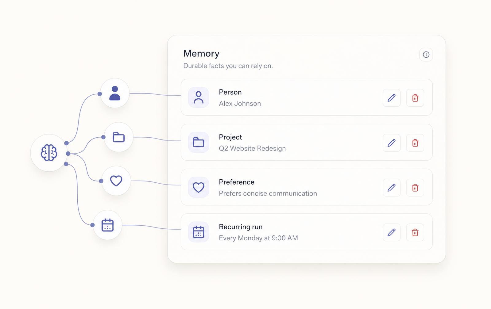
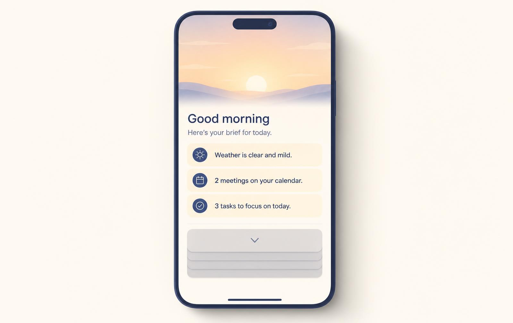
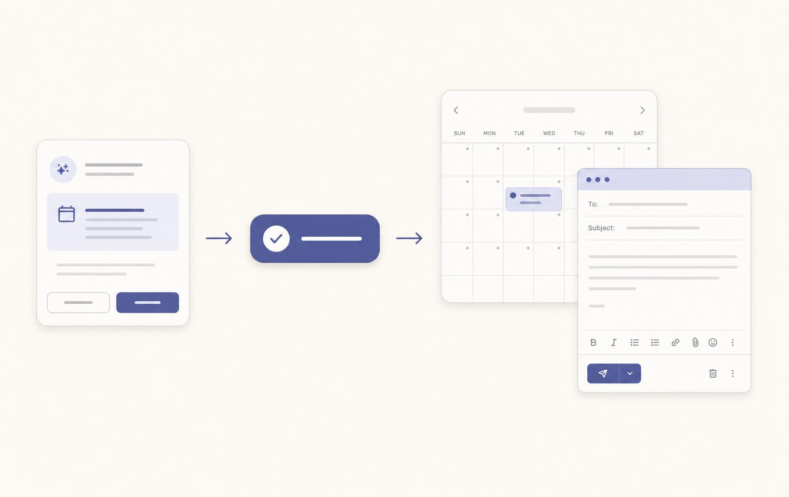



**收录说明**：官方产品说明。中英文版同日发布在 today.ai 的博客上，英文版记入 altUrls；中文版读来像由英文译出，但页面没有说明哪一版是原文，这里按官方中文版存档。文末的「分享」按钮未收入，站内相对链接改为绝对地址。旧笔记 learning-ai-agent 的 Today 资料索引引用过英文版。

**内容摘要**：文章把 Today 定义为 AI 个人智能体：底层是把前沿模型、任务执行和连接器结合起来的智能体循环，三个设计选择是活记忆（可读、可改的人物、偏好、承诺等稳定事实，而非搜不到的聊天记录）、默认主动（智能体先开口，同时讲究克制），以及经确认才执行的连接器动作。举例有按客户来信修订时间表、为半程马拉松训练安排日程；健康数据遵循 Apple HealthKit 与 Android Health Connect 的权限。文中用表格对比聊天机器人、通用 AI 助理与 Today，并区分企业智能体、编码智能体与个人智能体，列出不适合 Today 的用户（只偶尔提问、想要完全自主、需要医疗诊断）。结尾称 Today 已在 Mac、iOS 和 Android 上线。

**保留理由**：官方对产品机制（活记忆、主动性、确认后执行）的最完整说明，也记录了 2026-08 发布时的平台范围。

---

大多数 AI 工具都是聪明的陌生人。你打开一个空白输入框，把生活从头解释一遍，换回一段文字，然后关掉窗口。**Today** 就是为终结这个循环而造：记忆持续存在，主动性以尊重你的注意力为前提，执行直接落进你这一天本就依赖的应用。

## 我们为什么打造 AI 个人智能体

同一种失败我们见了一次又一次，而且从来败得不在智能上。模型能力人们手里从来不缺，缺的是**连续性**。真实的生活散落各处：行程在日历里，想法在笔记里，九天前许下的承诺沉在某段聊天里，疲惫记在健康应用中，别的工具一概读不到。只会应答提示的工具看不见这幅全貌，除非你每个会话都亲手把它重新拼一遍。

碎片化靠小事累积。你在手机上应下一场会议，笔记本里的聊天对此一无所知；你告诉一个应用自己在吃素，另一个应用转头就推荐牛排馆；你在某条对话里答应合作者周五交稿，而那条对话要到周四晚上才会被再次点开。单看每一件都无伤大雅，叠在一起，消耗的正是**个人智能体**本该替你省下的那部分心力。

这就是空白框的代价：最难的部分始终压在你身上，判断什么重要，注意到 9 点那场变动会挤掉下一个时段，记得起飞前要到期的那份合同。之后的文字生成反而是简单环节，也是多数聊天机器人唯一会做的环节。行业文章越来越把「助理」和「智能体」混着用，但实际分界大家并不陌生：一轮一轮被你推着走的被动帮忙，和经你批准后跨工具推进目标的软件。[IBM 对 AI 助理与 AI 智能体的区分](https://www.ibm.com/think/topics/ai-agents-vs-ai-assistants)把这条沟说得很清楚：助理负责回答；智能体会规划、会记住，并在职责范围内动手。

**AI 个人智能体（AI personal agent）**从设计上就是另一种东西。它在时间中在场：记住，盯着有意义的变化，在你批准后进入你的系统办事。这比「更聪明的搜索框」更接近一位好的人类助理，Today 就是围着这个模型打造的。

> 我们要的不是更聪明的聊天机器人。我们要的，是一个陪你把一整天过顺的 AI 个人智能体。

## Today 究竟是什么

**Today 是 AI 个人智能体**：一台把活记忆、主动信号和跨应用执行合在一起的个人 AI，跑在 Mac、iPhone 和 Android 上。同一段记忆跟着你换设备。公交站台上用手机做的决定，一小时后打开笔记本，那边早有上下文。你管理的从来不是两个产品；你带着的，是一根贯穿全天的线。

三个选择决定了它的智能体行为，每一个都是拿熟悉的聊天模式，去换更难开发、住起来却更舒服的方案。记忆存成一条条可查看的事实，而非一团搜不动的滚动记录。首屏呈现即将发生和刚刚变化的事，不会摆一个光标等你重新向模型做简报。Today 提议行动时，它会起草、找时段或重排下午，然后在任何对外发送之前，先等你的那声「可以」。

底层是一个智能体循环，把**前沿模型**、**任务执行**和**始终在线的云计算机**组合起来，多步骤工作在你离线时也能继续跑。**社区 Skills** 让智能体会做更多的事，你不必重写提示词：装一次 Skill，它就继承一套可复用的工作流。可用的连接器和 Skills 一直在增加，架构假设却从没变过：**动作有边界、人来确认、每跑一次记忆就更新一次。** 可靠的智能体栈靠的是有纪律的范围划分和人工检查点，[Anthropic 关于构建有效智能体的指南](https://www.anthropic.com/research/building-effective-agents)讲的正是我们用在日历和邮件上的同一套直觉。产品演示（活记忆、主动帮助和执行能力）都在 [Today 落地页](https://today.ai/articles/zh-Hans)上。

想要这个类别的标准定义（记忆、主动性、确认），读[什么是 AI 个人智能体](https://today.ai/articles/zh-Hans/blog/what-is-ai-personal-agent)。那一篇给这套产品实现的三段式框架命了名；本篇讲 Today 怎么把它落到每一天。

## 活记忆：你的智能体记得你的生活

多数 AI 产品把记忆当成搜不动的聊天记录，或者厂商持有、你改不动的上下文。个人智能体需要更结实的东西：能跨周留存、跨设备同步、出了错还看得懂的事实。所以 Today 把**活记忆**存成一行行由你掌控的结构化条目，而不是一堆读不懂的转录堆。

活记忆的意思是：你的 AI 个人智能体保存的是关于你生活的结构化事实，不是你翻不动的原始聊天日志。你是素食者，说一次；Maya 是你的联合创始人，说一次；你周二周四跑步，说一次。六周后 Today 替你安排和 Maya 的工作晚餐，这些事实都在场。它不会把饭订在周二晚上，不会推荐牛排馆，也不会问 Maya 是谁。

记忆必须可读，这一点对个人智能体没有商量余地。Today 对你的理解，你能用平实的话打开看；任何一行都能改，任何一条事实都能删，删完它立刻不再影响建议。哪次建议让你意外，你能查到是哪一行记忆在起作用，几秒钟改掉。信任就是这样攒起来的：你不必猜智能体为什么这么做，也不会被几个月前早已过时的事实锁死。

记忆行是稳定事实：人物、偏好、承诺，并非搜不动的逐字转录。这个区分对隐私和排错都重要。Today 出错时，你修的是一行事实，不是一团说不清的感觉。生态型助理正在补个人上下文检索，[Apple 将 Siri AI 定位为](https://www.apple.com/newsroom/2026/06/apple-introduces-siri-ai-a-profoundly-more-capable-and-personal-assistant/)基于设备端的消息、邮件和照片；但个人智能体产品必须让这些事实**归你编辑**，别把它们埋进你无权查看的厂商数据孤岛。

## 主动是默认：智能体先开口

被动的 AI 等你自己发现哪里坏了。个人智能体把这个姿态反过来，但有限度。Today 只在一天的两个锚点先开口：早晨和傍晚。因为价值最高的时机，往往正是那种你拖到太晚、修起来已经不便宜才发觉的事。

只会应答的个人智能体，不过是一个有礼貌的搜索框。Today 先开口的锚点就这两个，不会全天喋喋不休。晨间简报只讲真正会塑造这一天的少数几件事：挪动的会议、航班值机、一夜之间变成明天的截止日期。晚间收尾把今天滑过去的事往前滚，再问那一个决定去向的问题。

克制和察觉同样重要。什么都往外报的智能体，很快就会变成通知垃圾。我们给自己定的门槛是：每条主动消息，都得是你愿意让一个人特地来告诉你的事。简报保持短；其余默认折叠，除非自你上次查看后起了变化，而且关系到你还来得及做的决定。正因为守着这条纪律，人们到周三还愿意在开邮箱之前先开 Today，而不是早早把它静音。

这里的主动不等于自主。没有你的明确确认，Today 不会发邮件、不会挪日历事件、不会给任何人发消息。智能体的职责是在对的时刻**察觉并提议**；你的职责是一次点击或一处修改，把判断加上去。这条线守住信任，也让产品始终站在「贴心伙伴」一边，而没有滑向「替你做主的软件」。

## 连接器：建议变成行动

光有建议、没有执行，最难的部分还是留给你：复制、粘贴、翻线程、找空档。连接器就是个人智能体补上这一段的方式：权限有边界、**发送前确认（confirm-before-send）**、动作落在你这一天本就在跑的应用里。Today 可连接日历、邮件、笔记、文件和健康数据源，每一项都可接可撤。会议也享受同等待遇：[Today Recording 录音](https://today.ai/articles/zh-Hans/blog/introducing-today-recording)写出的纪要认识你的项目和人，交出的可远不止一份转写。另有 [Today Recording 产品页](https://today.ai/articles/zh-Hans/recording)，把采集、纪要、追问串成一条线，讲得更直观。

记忆告诉智能体什么重要；连接器决定它能办完什么。每条建议都限定在你点头之后它真能完成的动作里，所以它从不提议挪一场它根本挪不动的会议。

落到实际：日历连接器找的是真实空档，护住你总也保不住的专注时段。邮件让 Today 用你的口吻起草，把周五那条线程重新捞上来。笔记在你需要的时刻把对的文档拉到手边。健康信号读睡眠和恢复状况，让计划对齐你这一天真正扛得动的强度。不连连接器，Today 照样能对话、能积累记忆，只是替你执行的部分会少一些。

设想客户来信，要一份修订后的时间表。Today 读到项目笔记里已有的日期，用这些日期起草回复，用的全然不是貌似合理的猜测，并顺势提议把新里程碑放上日历。你改一个数字，确认，发送。检索、起草、日程准备都归智能体；判断归你。

再比如你告诉 Today，你在为半程马拉松训练，周二周四各练一次。六周后，HealthKit 显示你睡眠偏短，它建议把高强度间歇课挪一挪。依据并非什么通用模板，而是记忆把**固定承诺**和**今天的恢复信号**对上了号。这才是个人智能体的行为：事实，加信号，加一条范围明确的提议；万金油式的健康段落给不了这个。

健康集成遵循 Apple HealthKit 和 Android Health Connect 的平台权限；推理服务提供商如何处理数据，见 Privacy 页说明。

## AI 个人智能体 vs. 聊天机器人 vs. 助理

**差别不在一个定义清晰的问题能答得多好；差别在上下文、主动性和执行。**在窄提示上，强聊天机器人和 Today 听起来可能差不多。沟出现在答案周边的一切：周一做的规划，能否不经重新简报就影响周四的日程；产品打开时，迎面是否是隔夜的变化；一条建议，确认之后能否真的变成日历上的挪动。

|  | 聊天机器人 | 通用 AI 助理 | Today（AI 个人智能体） |
| --- | --- | --- | --- |
| 记忆 | 仅会话；你重新简报 | 部分 / 应用特定 | 持久、可查看的活记忆 |
| 主动性 | 等待提示 | 你配置的提醒 | 日程变化时主动 |
| 范围 | 你自己执行的文字 | 常单应用 | 确认后日历、邮件、笔记 |
| 输出单位 | 一个答案 | 一个建议 | 能撑住的一天 |

### 企业智能体、编码智能体与个人智能体

**企业智能体**带着组织权限优化共享系统：工单、CRM 阶段、审批。**编码智能体**优化代码仓库：文件、测试、终端。**个人智能体**优化的是**个人连续性**，跨越日历、笔记、邮件、恢复信号这些从没打算互通的应用。范围不同，产品选择就不同。企业智能体强调基于角色的访问控制；编码智能体强调仓库上下文；个人智能体强调**你能亲手编辑的记忆行**，以及在绑定你身份的动作上的**发送前确认**。Today 属于第三类。

想把经典助理和个人智能体正面对比，看 Siri 式帮助何时够用、何时需要活记忆，读我们的指南[AI 个人助理 vs AI 个人智能体](https://today.ai/articles/zh-Hans/blog/ai-personal-assistant-vs-ai-personal-agent)。全天连续性与 Cowork 式交付物工厂怎么分界，见[个人智能体 vs 工作智能体](https://today.ai/articles/zh-Hans/blog/ai-personal-agent-vs-work-agent)。

### 何时聊天机器人仍是更好工具

只是要一个不留上下文的一次性答案时，普通聊天机器人完全够用：调试一段代码、从零起草一封邮件、头脑风暴一组马上要粘去别处的选项。要是你整个生活都在一家厂商的生态里，又很少需要跨应用执行，通用助理可能比上手一个个人智能体更省事。

Today 为日子横跨**多个应用、多个星期上下文**的人而建：同时应付几位客户的创始人、统筹全家日程的父母、每个早上都受够了向空白框重新交代一遍的人。如果你的一周基本是在同一套工具里一问一答，先从助理用起；真正磨人的若是失信的承诺和不断漂移的日程，你要找的就是智能体行为。

个人智能体碰的是敏感界面：邮件、健康、日历，所以隐私姿态和功能清单同样要紧。Today 把记忆限定在你的账户内，每一行都允许你审计，提供商的处理方式公布在 Privacy 页。简报、连接器和 Skills 都在持续演进，本文写的是方向，并非冻结的企业 SLA。现在就[开始使用](https://today.ai/articles/zh-Hans#cta)；如果你的平台还在开发中，可以先登录网页端或桌面端，正式上线后一切自动带过去。

晨间简报是习惯的钩子：开邮箱之前先开 Today，扫一眼隔夜的变化，批准一两个动作，然后开始这一天。正是这个节奏，把智能体和那种卡住了才想起来翻的书签区分开。几周之后，简报会摸清哪些条目你从来只扫一眼，哪些你每次都动手处理。

## 与 AI 个人智能体共度的一天

这是一个再普通不过的周二，全不需要英雄主义，要的只是连续性。7:10，Today 开屏三行：9 点的会挪到了 11 点；设计评审在等周五的演示文稿；你昨晚只睡了五小时，于是它已经把一场可去可不去的下午电话撤掉，问你撤得对不对。三行里有一行，来自任何日历都读不到的健康信号。13:40，客户来问时间表能否调整；Today 按项目里的真实日期起草回复，并提议把里程碑放上日历，你改一个数字，发送。

21:20，Today 问你那份合同挪到明天还是周四；它记得你周四要飞，建议明天，你点了一下。「察觉 → 记住 → 提议 → 确认」，智能体循环的一个缩影。风平浪静的日子跑的也是同一个循环，那时它的价值是**替你挡掉**早餐前那六遍手动检查。这种「什么都没发生」最难截进演示图，却在一周靠谱的简报之后最容易感觉到。

周三下午可能毫无危机，只有几声温和的提醒：明早第一场会撞上你固定的接娃；有份草稿还没分享出去；昨晚睡眠一般，建议给深度工作划出四十分钟。这些事没有一件需要天才，需要的是**记得**和**在乎时机**。个人智能体的超能力就这么朴素，也就这么管用。

## Today 适合谁（以及谁应等待）

Today 适合日子混着工作、健康和生活杂事的知识工作者与创作者：同时盯着客户和差旅的创始人、重新串起研究线索的写作者、平衡训练与恢复的马拉松跑者、给孩子调作息的年轻父母。角色不同，模式一致：记忆，加主动帮助，加确认把关的执行。写作者和研究者真正受益的时刻，是智能体替你重建引用线索、把几周前存下的来源重新捞出来的时候；它再生成一份通用大纲，帮不上这个忙。

创始人受益，是当投资者更新、招聘线程和产品截止日期共用同一张记忆图谱，而非各困在三个互不相通的聊天里。在意健康的用户受益，是当睡眠和运动信号重塑今天的计划时，但只在生活方式的边界内，不做医疗声明。如果这些听起来像你的这一周，你就是我们为之构建的人；如果不是，更轻量的助理也许是更聪明的第一步。下面这些情况，Today 可能并不合适：

- 只是偶尔问个问题，既不需要记忆，也不需要跨应用执行。
- 想要完全自主、没有确认步骤的智能体；Today 在任何对外发送前一定会先问你。
- 需要医疗诊断或临床建议；Today 提供的是**生活方式支持**，不做医疗诊断（工作流与边界见 [Healthcare](https://today.ai/articles/zh-Hans/healthcare)）。

智能体的信任是一点点挣来的。想先不接任何个人数据试试，就从纯对话模式开始，等记忆面板和简报让你放心了，再连日历或邮件。这种分阶段的授权，与人类助理逐步赢得权限的方式一致，无须一次性交出全部权限。Today 现已登陆 Mac、iOS 和 Android，目前免费使用（Terms）。

## 结论

Today 已在 Mac、iOS 和 Android 上正式上线。我们在继续加深连接器覆盖，探索家庭共享记忆，并把语音当作一等输入来投入，不给它降格成事后补的听写框。付费计划以后可能有；真要变化，用户会提前很久听到消息。如果你想要的是**记得你的生活、在你开口前就行动**的 **AI 个人智能体**，不想再开一个聊天标签页，去[落地页看看 Today 如何工作](https://today.ai/articles/zh-Hans)，或者试试 [AI 健身教练](https://today.ai/articles/zh-Hans/healthcare/fitness-coach)这个生活方式工作流。现在就[开始使用](https://today.ai/articles/zh-Hans#cta)。

模型在进步，这个类别还会继续变。我们的赌注不变：**连续性胜过聪明**，**克制胜过喧哗**；当智能体赢得日历和邮件的访问权，**办完胜过建议**。如果这也正是你想与 AI 相处的方式，Today 为你而建。
