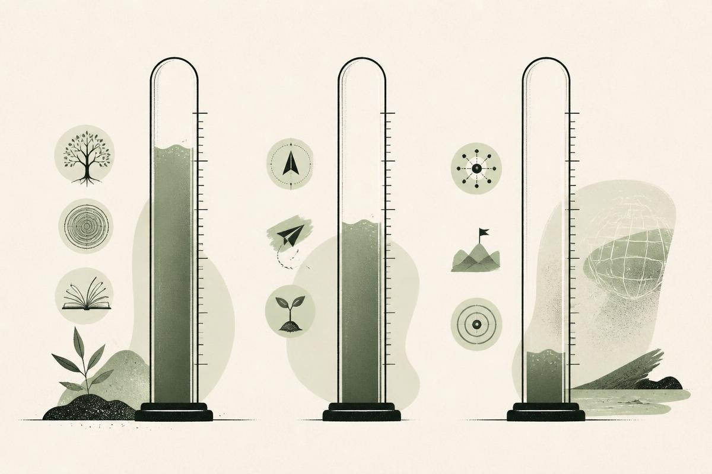



**收录说明**：厂商写的品类定义文，带有自家产品的推荐。中英文版同日发布在 today.ai 的博客上，英文版记入 altUrls；中文版读来像由英文译出，但页面没有说明哪一版是原文，这里按官方中文版存档。文末的「分享」按钮未收入，站内相对链接改为绝对地址。旧笔记 learning-ai-agent 的 Today 资料索引引用过英文版。

**内容摘要**：文章认为模型已越过能力阈值，瓶颈从能力挪到了「关系」，因此 AI 个人智能体自成一类。它给出定义和区分真实智能体的五个行为属性（如个人范围、范围限定的主动性等），对比智能体、助理与聊天机器人，并把「活记忆」和「带克制的主动性」称为真正难的部分。「Today 如何实现该类别」一节称 Today 有活记忆、主动简报和带确认的连接器动作，目前免费，运行在 Mac、iOS 和 Android 上，并说明 Today 不做医疗诊断、不做完全自主，对外发送一律先经用户批准。

**保留理由**：Today 团队对「个人智能体」这个品类的定义，可与其他厂商的定义对照；属于厂商立场，不是行业标准。

---

2026 年的标签拥挤不堪，每个产品页都写着「智能体」。这篇文章要说清：当主题是**你的生活**，既非单一工作流、也非企业任务时，**个人智能体**应当意味着什么。

**搜索引擎和买家把三个词搅在一起：助理、智能体、伙伴。**当一款产品同时声称拥有持久记忆、贴着日程的主动性和确认把关的执行，我们才用 **AI 个人智能体（AI personal agent）**称呼它。缺了任何一条腿，就老实叫它本来的名字；反正用不了一周，用户自己就会把差距用出来。

## 为什么「AI 个人智能体」如今自成一个类目

模型越过了能力阈值：规划、工具使用、长上下文都成了标配。瓶颈挪到了**关系**上：系统留得住你生活的多少，盯的是对的信号，产出究竟是改变了世界，还是只描述了一番你该做什么。让聊天机器人几秒起草一封改期邮件不难；难的是，有没有谁记得这份草稿是你欠的、周四已经排满、那位利益相关者偏好异步更新。

搜索兴趣聚在三处：*AI 个人助理*、*主动式 AI*、*有记忆的 AI*。可「助理」低估了执行，「聊天机器人」低估了持久。**AI 个人智能体**点名的恰是那套组合：**个人范围**、**智能体行为**（主动性加工具加多步计划），再加**问责**（对外动作之前有人工确认）。行业文章把两极越搅越糊，[IBM 对 AI 助理与 AI 智能体的区分](https://www.ibm.com/think/topics/ai-agents-vs-ai-assistants)可以当锚用：助理偏被动帮忙；智能体加上目标追寻、工具使用和离了反复提示也能继续的多步计划。

如果你已经认识 Today，就把本文当词汇层；产品细节和创始人的想法，见下文第 7 节链接的两篇配套文章。

## AI 个人智能体定义

个人智能体落在记忆、主动性和执行的交点上。下面的定义刻意从严：缺一条腿的产品未必没用，但在挣到之前，别把「智能体」这整个标签借用过来。

### 核心定义

**AI 个人智能体**是满足以下条件的软件：

1. **维护持久、由你掌控的记忆**，记的是人物、项目、偏好和承诺，绝不止眼前这条聊天线程。
2. **盯住对你重要的信号**（日历、邮件、健康、笔记，均已连接为前提），一有变化就**主动帮忙**，且始终框在严格的通知限度内。
3. **在已连接的工具间规划并执行任务**：起草、排期、重排，然后在任何不可逆的对外动作之前**停下来等你确认**。

人始终是那道批准关卡。这条边界，一边隔开完全自主的系统，一边隔开从不碰你应用的聊天机器人。

### 区分真实智能体的五个属性

真正的个人智能体，与企业工单机器人、通用聊天外壳的差别落在五个行为维度上，而且这几样往往结伴出现，绝非可选配件。**个人范围**指系统优化的是你的一整天：工作、健康惯例、学习目标、家庭后勤，而非某个部门的队列。**可查看记忆**指事实存在一行行可读、可改、可删的条目里；软件嵌进日常节奏后，黑箱式用户画像过不了信任这一关。**日程优先的体验**指默认视图反映日程与变化，而不是一个空提示框，等着你来表演晨间简报。

剩下两条属性，决定主动性落在贴心还是烦人。**范围限定的执行**让每条建议都拴在智能体真能办完的动作上；老提议它执行不了的日历挪动，只会训练你对它视而不见。**有克制的主动性**给锚点设上限（晨间与晚间两份简报，而非每小时推送），只端出你还来得及做的决定。[McKinsey 对智能体 AI 的界定](https://www.mckinsey.com/capabilities/quantumblack/our-insights/seizing-the-agentic-ai-advantage)强调跨步骤的编排；在个人软件里，编排要成立，先得把通知量压到你还愿意读当天首屏的程度。

## 智能体 vs. 助理 vs. 聊天机器人

买家被晃得头晕，因为厂商在同一个首页上把三个标签换着用。一张行为对照表，比功能清单更快切开包装。

| 维度 | 聊天机器人 | AI 助理（通用） | AI 个人智能体 |
| --- | --- | --- | --- |
| 主要输入 | 用户提示 | 提示 + 部分应用上下文 | 日程状态 + 记忆 + 提示 |
| 记忆 | 会话 / 线程 | 各异；常浅 | 持久活记忆 |
| 主动性 | 被动 | 你配置的提醒 | 对生活变化反应 |
| 执行 | 文字输出 | 有时单应用动作 | 带确认的跨应用 |
| 最适合 | 一次性问答 | 狭窄任务 | 全天连续性 |

**聊天机器人赢的场合：**单发问题、零设置、不接个人数据。

**通用助理赢的场合：**你整个生活都在一个生态里（比如只用手机提醒），也用不着跨应用执行。

**个人智能体赢的场合：**上下文跨周、跨应用、跨角色，每天向空白框重新交代一遍才是痛点。

想读得更深：[助理与个人智能体](https://today.ai/articles/zh-Hans/blog/ai-personal-assistant-vs-ai-personal-agent)按上面三根轴对比经典助理与智能体；[个人智能体 vs 工作智能体](https://today.ai/articles/zh-Hans/blog/ai-personal-agent-vs-work-agent)把全天个人连续性与 Cowork、ChatGPT Work 这类被委派的工作智能体分开。

## AI 个人智能体在实践中做什么

实践中，可信的个人智能体跑的是一条连续循环，而非干等孤立的提示。它**察觉**有意义的变化：日程撞车、影响今天优先级的未读线程、本该调低训练强度的睡眠缺口、相对上周承诺正在滑动的截止日期。它**检索**相关的记忆行和文档：项目日期、饮食偏好、你自己都忘了的旧承诺。它**提议**具体的下一步：一条草稿消息、一次日程调整、一个重排过的下午时段，然后**等你确认、修改或否决**，在此之前不可逆的事一概不发生。过了这道门它才**执行**：改动落进日历、邮件草稿或笔记，记忆随之更新，下一轮循环从事实起步，不从猜测起步。

设想一场会议挪到了与接娃冲突的时段。记忆里存着接娃职责的个人智能体，可以提议把内部电话移一移，起草一条改期说明，然后停在那里等你批准。聊天机器人回答的是*改期邮件怎么写*；智能体一个动作里办完检索、起草和日程准备。同一个循环如今也跑在会议本身上：[懂上下文的会议纪要](https://today.ai/articles/zh-Hans/blog/introducing-today-recording)记得某个决定归属哪个项目、相对上周变了什么。另一个常见模式是**过期承诺**：三段对话之前，你答应合作者「周末前发草稿」。聊天机器人不问不提；个人智能体把这条承诺记忆行对上周四的日历密度，赶在截止日期变得难堪**之前**轻推你一下。当然，前提还是那条：这一提醒得先过「换成一个靠谱的人，会说这句话吗」这一关。

正是这条循环，把智能体行为和炫目演示区分开。厂商发布会偏爱周二的烟花；个人智能体在乏味的周三证明自己：预防胜过戏剧，漏掉的交接更少，过期的承诺更少，「忘了挪那个时段」的时刻更少。

## 记忆与主动性：真正难的部分

记忆和主动性，是个人智能体一周内攒起信任、或者烧掉信任的地方。两者都要明写出来的产品设计，光靠模型规模撑不起来。

### 活记忆

记忆应当存**稳定事实**：人物、饮食偏好、固定承诺；逐字聊天导出不算。你纠正它，它就更新；你删掉的事实，**立即**停用。

沾健康的信号（睡眠、HRV、运动）必须守在**生活方式支持**的地界内，不得越到诊断那一边。Today 这类产品在 [Healthcare](https://today.ai/articles/zh-Hans/healthcare) 页把这条边界明说了。

### 带克制的主动性

察觉容易，**判断**难。个人智能体需要写死的规则：每份简报最多几条、默认折叠、暂时无法行动的变化不推送。当天首屏天天靠谱，信任才会复利。

**误报侵蚀信任的速度快过漏报。**漏掉一次轻微的日程漂移，烦你一回；午饭前弹十二次，你从此对它视若无睹。把「更多通知」当参与度的产品团队，最后交付的多半是戴智能体徽章的聊天机器人：量高、信低、执行为零。克制也不是缺功能，它正是让主动性保持可读的机制。

## 执行与连接器

不配连接器的智能体还能记、还能出主意；配了连接器的才能办完。这道差距解释了为什么有的「记忆」产品用着像日记本，有的像后勤伙伴。连接器把建议变成你一点头就能生效的结果，替你省下复制粘贴的功课。

典型的连接器分几类：**日历**（找空档、挪事件、护专注时段），**邮件与消息**（起草、把过期线程捞回来），**笔记与文件**（此刻要的文档顺手附上），**健康**（恢复不足时调低强度）。每个连接器都应**主动开启、随时可撤**。未经同意的执行，比错误的文字更快烧掉信任。

评估一款自称个人智能体的产品时，别停在演示视频上。要求看**记忆面板**，要一份**晨间简报**样本，再看日历或邮件写入之前的**确认步骤**。三缺一，就该把它的宣称从「智能体」降级为「助理」。

[Google Research 关于主动式对话助理的研究](https://research.google/pubs/pub51399/)点出了「何时先开口」有多难；个人智能体接下这份难，还外加一条义务：你说「好」之后，动作必须做对。

## Today 如何实现该类别

**Today** 是我们面向全天生活的 AI 个人智能体：活记忆、主动简报，加上带确认的连接器动作。现已上线，目前免费（Terms）。同一个产品我们写了三篇视角，免得一页硬包所有事：本文定义类目；[Today 产品导览](https://today.ai/articles/zh-Hans/blog/what-is-today)带你看记忆、主动性、连接器和一天的真实样貌；[创始人愿景文](https://today.ai/articles/zh-Hans/blog/meet-today)解释长期弧线和个人范围为什么跑赢收件箱速度。在比较工具，从本文读起；在盘算 Today 合不合你的一周，从产品文读起。

Today **不是**什么，我们照直说：

- 不做医疗诊断，只提供生活方式支持。
- 不做完全自主，对外发送一律先经你批准。
- 仍在演进，连接器与 Skills 的覆盖持续扩大。

Today 跑在 Mac、iOS 和 Android 上；连接器随时间越接越多，见[落地页能力区](https://today.ai/articles/zh-Hans/#capabilities)。

## 选购个人智能体时的常见错误

这个类目里的购买后悔，多数源于期望错位，很少是因为选错了模型。

### 把记忆与聊天历史混淆

再长的线程也称不上可编辑的事实。删不掉一条错误认知，你手里的就算不得智能体级记忆，只是一堆可搜索的聊天日志，模型下个会话会怎么加权它们，没人说得准。

### 把通知当主动性

数量不等于主动性。午饭前弹你十二次的产品，优化的是参与度指标，与你的日程无关。可信的智能体给锚点封顶、默认折叠细节，只端出时间窗口还开着的决定。如果唯一的主动功能是一条刷不完的通知流，一周之内你总会把它静音。

### 期望自主却无问责

发送前确认是功能，绝非缺陷，尤其当邮件和日历动作挂着你名字的时候。完全自主的发送听着高效，直到某一封落进错误的线程。个人智能体该让批准这一步看得见、点得快，而不是设成可选项。

### 第一天连接每个应用

权限分阶段给。先连日历，再连邮件；先核对记忆行，再开主动简报。信任来自早期简报件件靠谱，并非来自智能体握着满级权限、在每个界面上一起出错。

### 用个人智能体做医疗诊断

生活方式支持和临床建议是两个类目，监管红线和伦理红线各不相同。Today 只做前者；健康工作流怎么界定，见 [Healthcare](https://today.ai/articles/zh-Hans/healthcare)。产品若把这条线搅混，无论模型多好，都当危险信号处理。

### 忽视跨设备连续性

打开笔记本就忘了你手机上聊过什么的个人智能体，终究只是多绕几步的聊天机器人。记忆应当跟着你走，走到你这一天真正发生的那几块屏幕上；Mac、iOS、Android 三端同频，就是 Today 瞄准的那条线。

## 结论

**AI 个人智能体**应当比改名换姓的聊天机器人多出一些分量。它应当意味着：记忆持久留存，主动性尊重你的注意力，执行落在你日子本来的地方，而且全程在你掌控之下。

市场常把**智能体式**（会规划、会用工具）和**个人化**（用受治理的记忆圈定在你的生活里）混作一谈。两者都重要：没有工具的个人智能体是本日记；没有记忆的工具是场噱头。Today 想交付的是交集，并且清楚这只是起点，尚非证明。

如果这正合你对个人 AI 的期待，去看看 [Today](https://today.ai/articles/zh-Hans)，或者现在就[开始使用](https://today.ai/articles/zh-Hans#cta)。
