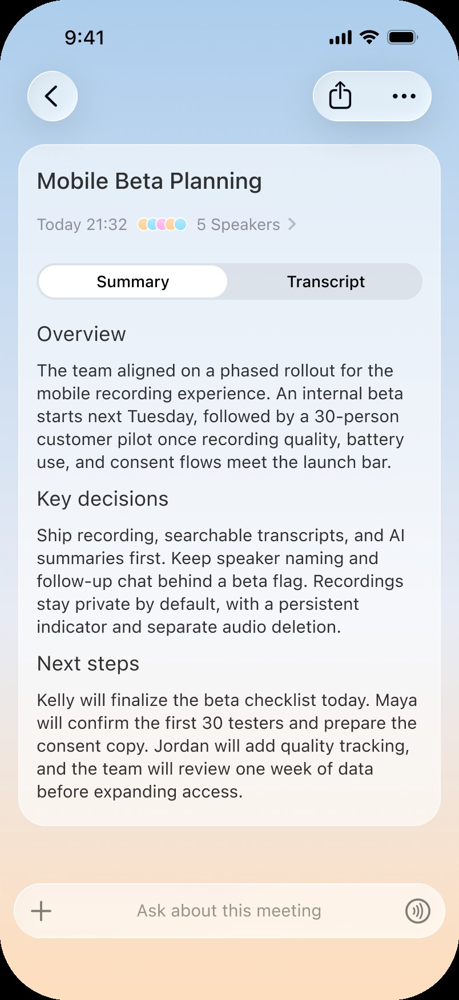
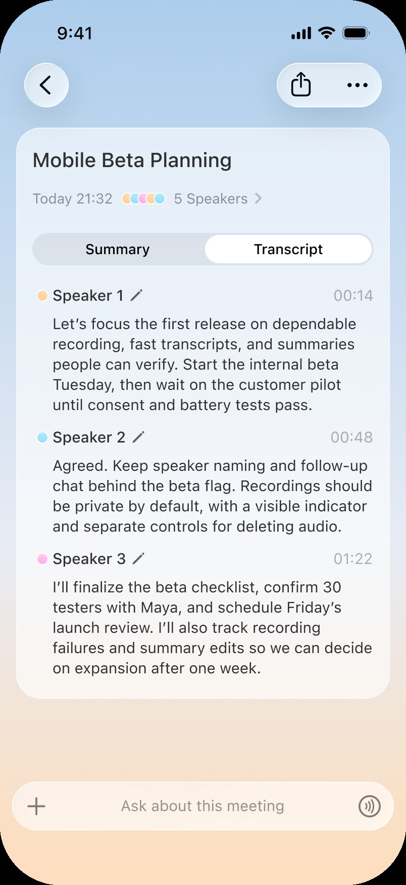
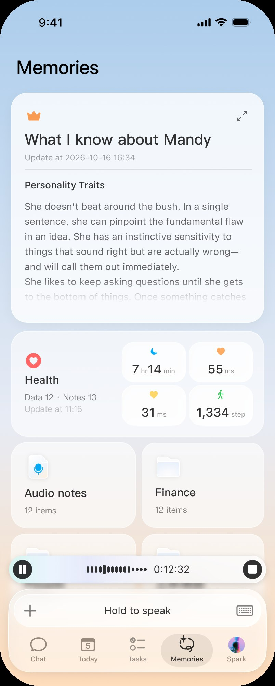
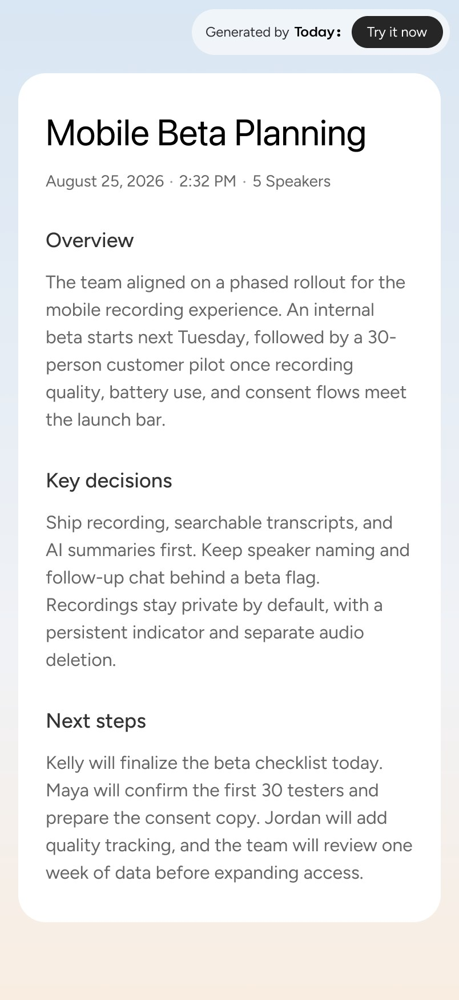



**收录说明**：新功能发布文。中英文版同日发布在 today.ai 的博客上，英文版记入 altUrls；中文版读来像由英文译出，但页面没有说明哪一版是原文，这里按官方中文版存档。文末的「分享」按钮未收入，站内相对链接改为绝对地址。

**内容摘要**：Today Recording 是内建在 Today 里的录音能力，率先登陆 Mac 和 iPhone，生成的 Summary 和后续对话留在 Today 里。链路从会议前开始：Today 连着日历，提醒用户开始录音；录完后用 Memory 对照已有的项目、团队和决定来读转写，Summary 以已定事项和未决问题收尾，会后可以继续追问。「我们还没有承诺的事」一节写明：Memory 只为 Summary 提供理解；转写质量公开测量，最新一轮用公开基准中 5.5 小时的多人重叠长会议，与三家语音供应商的原始输出对比，说话人归属错误率下降超过四个百分点；声纹识别还在内部测试，不附日期；行动项自动建任务尚未提供。

**保留理由**：说明了记忆如何用于一个具体功能（会议纪要），并公开了功能边界和转写评测结果。

---

一场会议从来不是孤立发生的。它落在已经推进数月的项目中间，落在带着各自角色与来龙去脉的人中间，也落在上周另一个你不在场的房间里做出的决定之上。做 Today Recording 的这段日子，我们反复撞见同一个缺口：录音工具越来越擅长「听见词语」，却始终不擅长「知道这些词语指的是什么」。于是我们把自己想用的录音功能做了出来。它从你的日历出发，和你的 Memory 一起听，最后交给你一份纪要；不用重新解释任何背景，拿起来就能行动。

## 一场会议，从来不是孤立发生的

在你最近的一场录音里，多半有人说这样的话。「Launch 还是按之前的方案。」「让 Sunhao 接着改。」或者散会前干脆的一句：「这次先不上声纹，发布延后一周。」

转写把这些句子记得分毫不差，断句也漂亮。可是冷读一遍，它们什么都没指向。之前哪次会议定的方案？Sunhao 是谁，接手改的又是什么？声纹相对什么预期被搁置，延后从哪个时间点起算？词都在，意思留在了会议室里。

平心而论，这个品类并没有原地踏步。大多数会议纪要应用如今都能承诺实时转写、发言人标签、日历同步，散会后几分钟内把一份回顾投递进 Slack 或邮箱。不少还走得更远：行动项自动建成任务，转写随时可以灌进提案或产品文档，历次对话沉淀成一份可检索的档案。到今天，这些是基线，不是前沿；是入场券，还称不上制胜的那手牌。

问题在于，这套机器底下压着的还是同一个安静的失败。你拿到一份流畅、工整、却出奇空泛的文档，一份能描述任何人会议的总结，交到唯一一个指望它省事的人手上。转写、分发、检索，全都默认纪要已经知道自己在说什么；可它并不知道。要用它之前，你得先自己补上下文：这涉及哪个项目，那个人是谁，之前定过什么。然后把整份纪要粘进另一个 AI 助手，把项目背景从头交代一遍，只为爬回会议结束时就已站过的位置。会议产出了决定；纪要产出了作业。

录音工具可以做得更好，原因就放在 Today 里。如果你在用 Today，它已经持有关于你工作的活记忆：推进中的项目，并肩的人，账面上的决定，悬而未决的问题。Today Recording 做的事，不过是让这份记忆在你说话时也在场。

## Today Recording 是什么

Today Recording 是内建在 Today 里的录音能力，围绕一个想法组织起来：会议纪要不该只记录说了什么，还应该知道你们在说什么。录下一场对话，Today 会把它放进你已有的 Memory 里去读，写出一份点得出具体项目、具体的人和实际变化所在的 Summary。普通纪要写「团队讨论了上线安排」；Today 能写明是哪次上线、哪份安排、其中哪一部分动了。

录音能力率先登陆 Mac 和 iPhone；生成的 Summary 和随后的对话则住在 Today 里。Today 跑在哪些平台，它们就在哪些平台。会议室里用手机开录，回到书桌前读 Summary，通勤路上接着追问。录音从两台设备开始，工作在任何地方继续。

如果你刚认识 Today，短版本：它是一位保有活记忆的 AI 个人智能体（AI personal agent），在你确认之后才代你动手。长版本在[什么是 Today](https://today.ai/articles/zh-Hans/blog/what-is-today)里。如果你对整个品类都还陌生，[记忆、主动、执行三件事](https://today.ai/articles/zh-Hans/blog/what-is-ai-personal-agent)讲清了它所依赖的那几件事：记忆、主动、执行。两篇都不是前置功课。你需要的，只是一份日历，和一场值得留下的对话。

## 一条链路：从日历提醒到会后追问

最容易丢的录音，是你忘了按下的那一个，所以链路在会议之前就开始了。Today 连接你的日历，注意到一场对话即将开始，锁屏上便出现 Live Activity，问你是否要录音。点一下，就开始。你不必提前记住「待会儿要录」，不必满屏找应用，也不必让一屋子人等你摆弄设备。

对话录完，转写只是原材料，算不上成品。下一环是 Memory：Today 把录音对照它对你的已有了解来读，进行中的项目、团队里的人、已经做出的决定、你一直挂着的问题。这让 Summary 能做到具体，而不只是整洁。它写得出「Atlas 上线」，而不是「一次产品上线」；写得出「负责定价的 Priya」，而不是「一位与会者」；写得出「这项推翻了上月的决定」，而不是「达成了一项决定」。

Summary 是你最先看到的东西，但我们把它设计成一个开头，而不是结尾。它收尾时指向前方：定了什么，还有什么没解决，接下来是什么。会议又住在 Today 里面，你可以继续跟它说话：问一个决定为什么这么定，问还有哪些事悬着，请它照着这场会议把本周剩下的日子重新排一排。一条链路从头到尾：日历，录音，Memory，Summary，追问。不导出，不重新交代背景，中间不需要第二个工具。

## Memory 改变了纪要的什么

差别在反复召开的会议里显形最快。假设你每周主持一次上线评审：同一个项目，同一批人，一套滚动更新的决定。一个只听得见本周这通电话的独立录音工具，会忠实地产出这样的东西：团队讨论了发布安排，部分功能本周上线，另一项延后测试。然后它心满意足，把回顾归档到它归档回顾的地方。每个字都对，指涉全没了。你知道它指的是哪次上线；纪要不知道；一个月后，你也不会知道。

Today 读同一段录音，结合 Memory，可以把同一场会议写成：本周上线将发布新的 Summary 体验和日历 Live Activity；声纹识别完成开发，先进入内部测试，再决定是否发布。纪要写明它属于哪个项目，每一部分由谁负责，相对上一次评审变化在哪。你不必重新解释「上线」是什么、「Summary」指哪件事、哪个功能滑档了；纪要已经知道，因为 Today 知道。

Memory 改变的第二件事，是会议与会议如何累积，这一件更要紧。真实项目里，决定会被修订。第一次评审说，新 Summary 和声纹识别本周都发；下一次说，Summary 照常，声纹再留一轮内部测试。两段录音，在大多数工具里，是两份悄悄互相矛盾的文档。Today 把两场对话挂在同一个项目下，以最新确认过的决定为当前状态。之后你再问发布计划到底是什么，得到的是今天的答案；想追溯方案怎么一路变过来的，路径也在。

这一点值得停下来想一想。不了解你的录音工具，把每场会议都当作孤立的档案，你的项目于是慢慢变成一座档案馆。了解你的录音工具，把每场会议当作一次更新，关于仍在推进中的工作的最新信息。堆积不再照原来的方式增长，因为上下文在被维护，而不只是被囤积。

## 会议结束，继续问下去

纪要再好，也是一张快照；你的工作是部电影。检验一个会议工具成色的时刻，是你读完的那一秒，新的问题恰好在那儿到站。在大多数工具里，这正是你离开的地方：把笔记复制进另一个窗口，用交换的前半段向一个从没听说过你项目的 AI 解释你的项目。Today Recording 让你留在原地。会议、Summary 和 Memory 住在同一处，你真正想问的问题，直接问就是。

为什么声纹延后了一周？会上给的理由是什么，谁主张再等等？这场会里冒出来、到现在还没解决的问题有哪些？能不能把这场会议整理成本周剩下的计划，下一步排在前头？这些都不需要导出转写，也不需要从头重建背景。你在录音所在的同一个对话里发问，答案落在实际说过的话上，而不是落在对你项目的一个猜测上。

在这里，Summary 不再是录音功能的终点，而成了下一块工作的起点。录音留住了对话；Memory 知道它连着什么；追问把两者变成动势。日常使用里我们看到的模式很一致：人们打开 Summary 是为了核对它，留下来，是为了那些原先不知道可以问的问题。

## 在你需要的时候出现

链路的第一环是知道会议要来了，这件事比听上去重要。录音最常见的失败不是收音差，而是那场你本想录、却没录的会。你端着咖啡走进去，讨论已经开始，进行到一半才发现录音器开在了错的设备上，或者哪儿都没开。Today 把这个决定挪到你还来得及做的时刻：会前片刻，锁屏上的一个 Live Activity，问你录不录。

要说清它不是什么：它不是自动录音。每一次，没有你亲手点下的那一下，什么都不会录。Live Activity 是一个提议，不是义务；你婉拒，Today 就安静等下一场会。我们把它看作录音器也具有我们在 Today 各处想要的那种品质：对你的日子了解得足够多，能在对的时刻出现；对你足够尊重，出现前先问一声。

还有一层更安静的好处。那些小到不值得为录音兴师动众的会，简短的客户电话、临时拉起的同步，也变得值得录了；开始的成本，不过是你本来就在看手机的那个时刻里的一次轻点。门槛从来不在技术，在技术周围的那套仪式。

## 我们还没有承诺的事

一个坐在你会议里的工具，靠把边界讲清楚来赢得信任，所以这里是我们的边界。第一，Memory 为 Summary 提供理解，但永远不覆盖录音。对话是事实的记录，Memory 提供围绕它的上下文。当一个名字、一项决定或一段关系无法有把握地确认时，Today 保留这种不确定，而不是把它抹平成一个听起来自信的猜测。编出一个指涉的纪要，比承认不确定的纪要更糟。

第二，转写质量：我们公开地测，而不是靠形容词。最新一轮评测跑了来自公开基准的五点五小时重叠多人长会议，让 Today 的完整转写管线与三家语音供应商的原始输出同场对比：说话人归属错误率下降超过四个百分点，文字误差保持稳定。基准、判分工具与全部测试条件都公开在[会议转写准确率](https://today.ai/articles/zh-Hans/blog/meeting-transcription-accuracy)里，那里还讲清了什么样的转写值得信任，以及这个品类惯用的准确率宣称该怎么读。

第三，声纹识别（靠声音认出谁在说话）处于内部测试阶段。它不在今天提供的功能之列，我们也不为它附上日期。宁可发布做好的部分，不承诺也许的部分。

最后，关于纪要落地之后会发生什么。这个品类里的一些工具已经会把行动项自动建成任务、替你起草后续消息。Today 还不会从会议自动生成行为建议。它今天做的，就是本文所描述的：一份知道自己上下文的 Summary，和对你就它提出的问题的回答。下一步做什么，仍然是你的决定；Today 应你所请施以援手，一如既往。

## 它适合谁

从 Today Recording 里获益最多的人，多半共享同一种处境：他们的会议在重复，会议里的决定在堆积。如果你主持产品评审，你一定见过半屋人清醒、半屋人恍惚的那种会，天没亮就拨进来的工程师，和对他而言已近午夜的设计师。Summary 落在 Memory 里已有的那个项目上，错过现场的人照样看得见什么动了、动的部分归谁。

如果你的下午被一场接一场的面试吞掉，每段对话都挂在各自的岗位和面试组上，复盘因此诚实：笔记可以并排比较，而不是一天结束后糊成一片的印象堆。如果一通客户电话欠你一条今晚必须发出的跟进，Summary 把承诺了的和悬而未决的分开放，你欠下的那条消息不必离开 Today 就能起草。如果你坐在那个决定反复翻案的周会里，最新确认的决定即当前状态，它一路走来的路径保持可见，翻案变得可追溯，而不只是令人困惑。

留意这些处境的共同点。在每一个里，会议之所以值得录，都是因为它周围的东西：项目、岗位、承诺、历史。不了解这些的工具，仍然能给到你词语。只有了解你的工具，才能给到你那场会议。

## 结论

大多数录音工具只能问一个窄问题：说了什么？[Today Recording](https://today.ai/articles/zh-Hans/recording) 能问一个更宽的，因为它已经认识你。这些话对你手头的工作意味着什么？你又该从哪里接手？全部差别就在这里。其他工具总结一场会议；Today 理解这场会议在你的工作中意味着什么，并让你直接接着做下去。日历告诉 Today 一场对话将至，一次轻点录下它，Memory 讲清它牵动着什么，Summary 把这一切写明，追问把它带向前去。连接你的日历，录下一场重要的对话，[现在就开始](https://today.ai/articles/zh-Hans#cta)用 Today。
