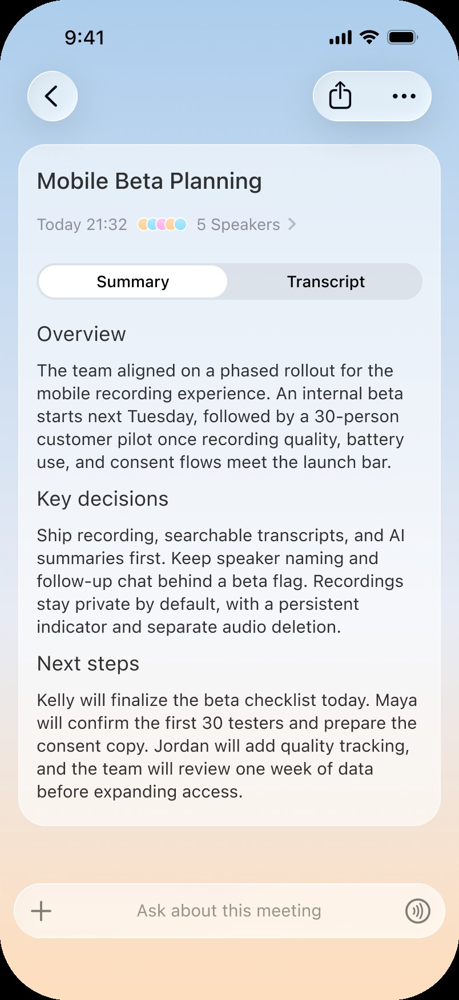



**收录说明**：today.ai 的能力介绍页（国际站）。页首导航与「开始使用」按钮、页尾的行动号召一节未收入；英文版记入 altUrls。页面会持续修改，以后发现变化时覆盖本页。旧笔记 learning-ai-agent 的 Today 资料索引引用过英文版。

**内容摘要**：页面把 Today 的能力分为长期记忆、主动协助、任务执行三块，再列出研究与信息整理、连接应用、自动化与后台任务、语音文件与日常输入。几处限定写得较细：Memory 不代表永久保存每项输入，可在产品支持范围内修正或删除；生成建议和发送通知是两个独立环节；外部操作和敏感变更可能需要确认，也不一定能撤销；符合条件的云端任务可在离开对话后继续，依赖本地设备的任务可能要求设备在线。常见问题中说明部分预先授权或已安排的任务可以自动运行，能力会因设备、地区、分发渠道、账户和灰度而不同。

**保留理由**：官方对 Today 能力边界的当前说法（云端与本地任务的区别、哪些操作要确认），比博客文章更具体。

---

Today 能力

# 一个理解上下文，也能把事情继续推进的 Personal Agent。

Today 将长期记忆、主动协助和任务执行结合起来，让你无需每次从零开始，就能研究、整理并完成工作。

[开始使用](https://today.ai/login?utm_id=8QHtt4d8rwkk) [查看全部能力](#capabilities)

TODAY

## 长期记忆

在多次对话之间延续相关人物、偏好、项目和目标。

## 主动协助

结合时间、上下文与授权信息，在合适时机提出下一步。

## 任务执行

规划多步骤工作、调用可用工具，并返回可检查的结果。

例如

重新打开一个长期项目，直接询问下一步，而不用再次解释全部历史。

长期记忆

## 不用每次都从头解释。

Today 可以把相关上下文从一次对话延续到下一次，让长期项目和日常决策更容易继续。

- 记住相关偏好、人物和项目
- 在回答、计划和简报中调用个人上下文
- 在当前产品支持的范围内修正或删除记忆

Memory 不代表永久保存每一项输入；具体记忆范围和管理方式以当前产品体验为准。

例如

一天开始时，直接看到今天值得关注的会议、跟进事项和优先级。

主动协助

## 在事情变得紧急之前提供帮助。

Today 可以结合时间、Memory 和授权信号，主动呈现简报、提醒或建议的下一步。

- 根据相关上下文生成个人简报
- 结合当天安排和长期目标提出建议
- 外部动作需要批准时请求确认

生成建议和发送通知是两个独立环节；实际能力可能受账户和配置影响。

例如

研究一个主题、整理发现并形成可继续使用的交付物，而不只是告诉你应该怎么做。

任务执行

## 从一个请求，到一个可以检查的结果。

Today 可以拆解任务、调用可用工具，并交付结果、草稿或需要你确认的动作。

- 规划并推进多步骤任务
- 使用搜索、文件、代码或连接工具
- 明确区分草稿、待确认和已完成状态

外部操作和敏感变更可能需要确认，也不一定都能撤销。

信息与连接

## 找到需要的信息，再把它带进真实工作。

研究与信息整理

### 找到、理解并整理真正重要的信息。

把公开信息与用户提供的材料放在一起分析，再形成清晰、可继续使用的结果。

- 搜索公开网络并读取支持的网页
- 处理文件、图片和链接
- 将多个来源整理成摘要、计划和结构化成果

例如

比较多个来源中的选项，得到简明建议，并保留支撑结论的证据。

来源展示能力取决于具体工具和工作流，重要结论仍应复核。

连接应用

### 把散落在不同应用中的上下文放到一起。

获得授权后，Today 可以从支持的邮件、日历、文件和任务服务中找到相关信息，并在支持的范围内执行操作。

- 读取你授权访问的信息
- 连接不同应用与任务中的上下文
- 在连接器允许时创建或更新内容

例如

结合邮件和日历事件中的信息，准备跟进内容并创建下一项任务。

[查看全部集成](https://today.ai/articles/zh-Hans/integrations)

不同连接器、地区和账户的读写范围及确认方式可能不同。

自动化与后台任务

## 离开对话后，工作仍可继续推进。

为支持的任务设定时间、重复使用有效工作流，并让符合条件的任务在云端继续运行。

例如

建立一项周期研究简报，让 Today 按时间准备每一期内容。

从计划到交付

1运行支持的单次和周期任务

2在云端继续符合条件的工作

3完成后返回结果，需要输入时再找你

依赖本地设备的任务仍可能要求设备在线、具备权限或需要用户继续操作。

语音、文件与日常输入

## 用最顺手的方式开始。

通过当前支持的文字、语音、图片、文件或链接，将信息和目标交给 Today。

1把语音笔记转成逐字稿和摘要

2围绕记录的内容继续追问

3导出或继续处理支持的结果

不同客户端支持的输入格式和录音体验可能不同。

## 所有能力都围绕你的选择运行。

Today 在你拥有的产品入口、授权与控制范围内使用这些能力。

### 由你决定连接什么

连接信息的范围不会超过你授予的访问权限。

### 重要操作可以先确认

敏感操作或外部变更可能暂停并等待你的批准。

### Memory 可以管理

在产品支持的范围内查看、修正或删除相关记忆。

### 可用范围可能不同

设备、地区、渠道、账户和权限都会影响具体能力。

## 关于 Today 能力的常见问题

Today 会记住我分享的所有内容吗？

不会。Today 可以保存并使用当前产品支持的个人上下文，但这不表示每项输入都会被永久保存。具体行为和控制方式以当前产品体验为准。

Today 可以不经确认就执行操作吗？

部分预先授权或已经安排的任务可以自动运行。敏感操作或外部变更可能仍需确认，具体取决于工具和工作流。

Today 可以连接哪些应用？

Today 支持不断扩展的邮件、日历、文件、消息和效率工具。完整范围可查看集成目录；每个连接器的读写能力可能不同。

设备离线后，任务还能继续吗？

符合条件的云端任务可以在不保持对话开启的情况下继续。依赖本地设备、文件或权限的任务仍可能要求设备在线。

所有设备都支持相同能力吗？

不一定。具体能力可能受到设备、地区、分发渠道、账户、灰度状态和必要权限影响。
