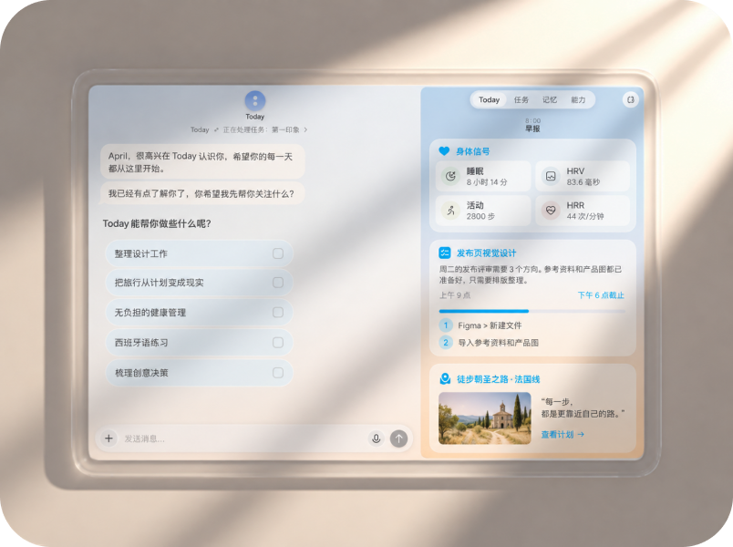



**收录说明**：直接下载国内版首页（todayai.cn），用 `extract.py` 取 `body` 全文，删去页首「登录 / 下载」导航，一级标题「这是「Today」」降为正文。版式和配图与同日收录的国际版首页相同（25 张配图中 12 张与国际版完全一致，其余是中文界面版本），文字是中文，顶部多一条新用户福利横幅。示例界面上的字样按抽取顺序照录。2026-11-05 时国内站 `todayai.cn/landing` 是静态文字很少的单页应用，没有收；这次首页能直接抽到全文。

**内容摘要**：页面顶部写「新用户注册即领 3亿 Tokens，畅享 3 个月 Pro 权益，基础版永久免费使用」，标语是「懂你所想，为你先行的个人 AI 助理」。其余内容与国际版首页对应：记忆（「重要的人和事，始终记得」）、主动帮助、使用场景，以及前沿模型、任务执行、连接器、云端电脑、跨设备协作、社区技能六项能力；使用场景的总述改写为「「Today」是属于每个人的，它擅长工作、知识渊博、关心朋友」。页面没有各档价格。

**保留理由**：这是国内版官网上的新用户福利原文：3 亿 Tokens 加 3 个月 Pro，高于 9 月底上线时报道的 1 亿 Tokens 加 1 个月 Pro；国内版的官方产品介绍此前只有 Chrome 扩展页。

---

新用户注册即领 3亿 Tokens

畅享 3 个月 Pro 权益，基础版永久免费

新用户注册即领 3亿 Tokens，畅享 3 个月 Pro 权益，基础版永久免费使用。

这是「Today」

懂你所想，为你先行的个人 AI 助理

April，很高兴在这里认识你。我是「Today」。每一天都从这里开始。

我已经有点了解你了，你希望我先帮你关注什么？

### Today 能帮你做些什么呢？

整理设计工作把旅行从计划变成现实无负担的健康管理西班牙语练习梳理创意决策

问问 Today……

8:00晨间简报

### 身体信号

睡眠8 小时 14 分

HRV83.6 毫秒

活动2800 步

HRR44 次/分钟

### 发布页视觉设计

周二的发布评审需要 3 个方向。参考资料和产品图都已准备好，只需要排版整理。

上午 9 点下午 6 点截止

1Figma → 新建文件

2导入参考资料和产品图

### 徒步朝圣之路 · 法国线

Sarria

5天115公里15–25°C天气

Santiago

朝圣者旅舍攻略行李清单

「Today」会主动了解你的每一天，建立起丰富可靠的记忆，并把对你的了解转化成恰到好处的帮助，横跨你的所有设备。

记忆

## 重要的人和事，始终记得

「Today」拥有鲜活的记忆系统，会记住你的日常、身边的人、偏好，以及你持续关注的目标；所有上下文都由你掌控。

Hoy [OY]

¡Hoy es tu día!

adverbio

学习西班牙语

朝圣之路法国线

- 5 日行程指南
- 庇护所攻略
- 装备清单

旅行计划

每周餐食

11:50

晚间散步

20:00

学习西班牙语

21:00

待办

设计情绪板

睡眠

8小时14分

HRV

83.6 毫秒

活动量

2,800 步

健康

- 月下岩脊 V6
- 一线银光 V5
- 落日岩板 V3
- 手指恢复训练

攀岩计划

膝盖养护

8:30

税务文件

10:00

周末徒步

15:00

待办

徒步照片

添猫砂

兽医检查

晨间散步

宠物照护

- 市场笔记
- 产品想法
- 新手引导流程
- 用户趋势

调研方向

团队站会

10:00

投资人汇报

15:00

兽医体检

18:00

待办

Maya

联合创始人

Rohan

设计顾问

Jess

投资人

关键人员

主动帮助

## 在你开口前，已经准备好

「Today」会理解你的节奏，在有信息值得了解、有决定需要权衡、有行动可以推进时主动出现，为你提供恰如其分的帮助。

你昨晚只睡了不到 6 小时，10 点还有品牌评审会。需要我把今天的长距离散步挪到晚上，并现在准备好评审文档吗？

品牌发布页：需求变更。创意总监和团队现在希望首屏更温暖，技术细节更少，并使用能呈现真实家居场景的产品图。

- 邮件整理每 2 小时
- 营销活动参考工作日 9:00
- 西班牙语练习周二/周四 20:30
- 晚间散步每天 18:30

Today 帮助了一位作家

重新梳理创作思路

Today 帮助了一位猫咪家长

留意到小猫细微的健康变化

Today 帮助了一位老师

留出了从容放松的时间

Today 帮助了一位马拉松跑者

认真推进备赛计划

Today 帮助年轻的父母

从容安排生活日常

Today 帮助了一位自由职业者

准备报税季

Today 帮助了一对伴侣

追踪储蓄目标

Today 帮助了一位音乐人

安排了持续的练习

Today 帮助了一位创始人

从混乱中找到方向

使用场景

## 「Today」是属于每个人的，它擅长工作、知识渊博、关心朋友，能为你提供多样而个性化的帮助。

能力

## 超强能力，造就无限可能

「Today」拥有前沿 AI 能力：更好的模型、更强的任务执行、可靠的云端算力、更丰富的集成，以及会在真实使用中不断进步的系统。

### 前沿模型

「Today」拥有持续进化的模型能力，将前沿智能和不同任务真正需要的能力匹配起来，提供每一次恰如其分的帮助。

Harness 层

前沿交互模型

Today Bench

### 强大的任务执行能力

它能规划步骤、使用工具、检查进度并向你汇报，让一个请求真正变成结果，而不只是建议。

理解需求规划并使用工具交付结果

### 丰富的连接器生态

「Today」可以连接你生活和工作已经依赖的应用与服务，从日历、邮件、笔记、文件，到消息、项目工具，以及更多系统。

### 可靠的云端电脑

「Today」拥有稳定的云端电脑，可以打开浏览器、处理文件、运行代码，并在你需要的时候持续完成任务。

操作应用

24 小时在线

处理文件

### 跨设备协作

「Today」可以配合你已经在使用的设备，让下一步行动在合适的地方、合适的时间发生。

### 社区技能

来自社区的 Skills 可以在「Today」中运行，带来更多可选择的工作流，也让你更容易带入已经习惯使用的能力。

深度研究研究

HRV 分析健康

会议纪要市场
