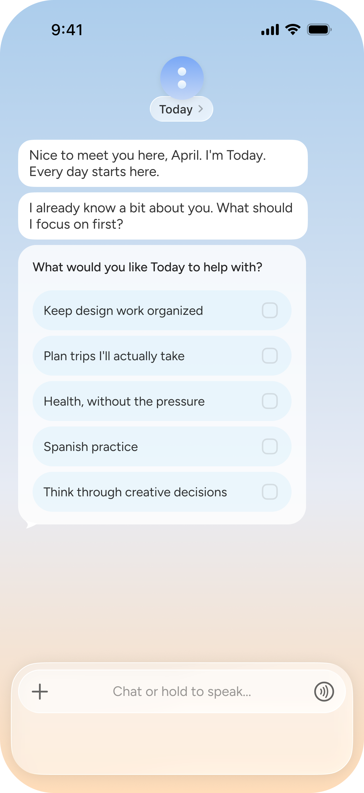
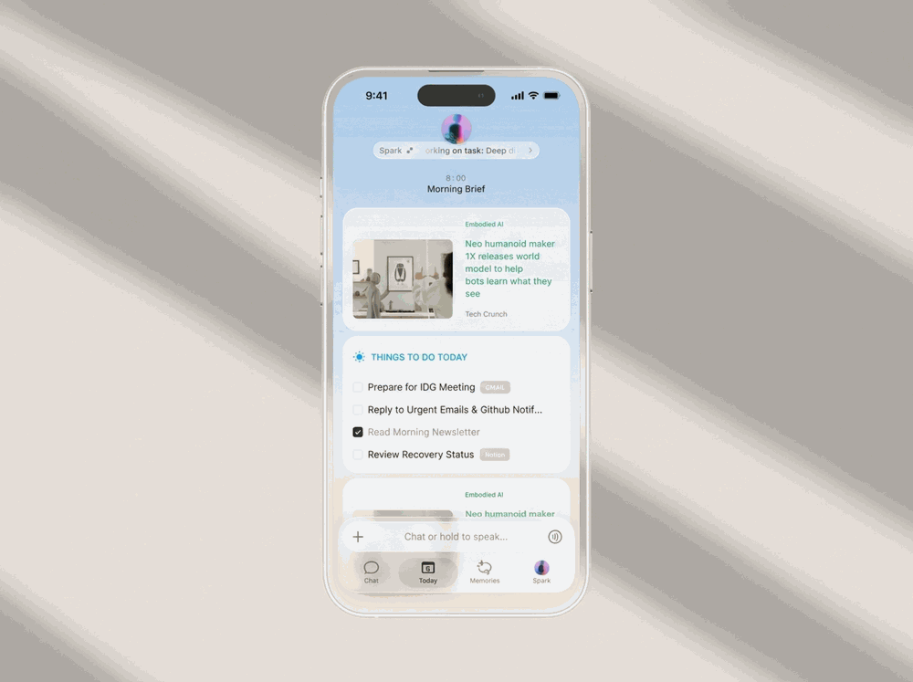
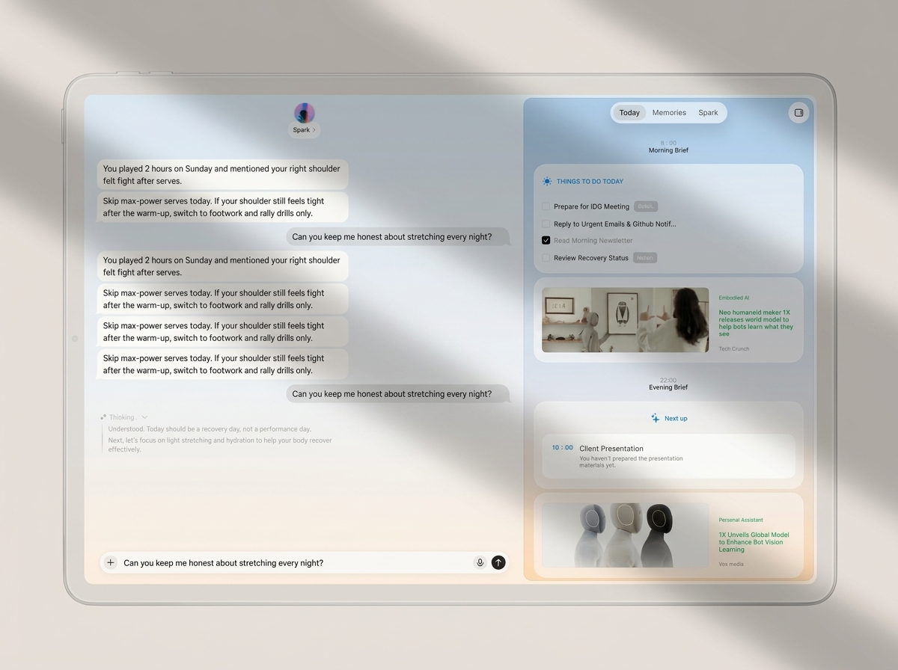



**收录说明**：直接下载国际版首页（today.ai），用 `extract.py` 取 `body` 全文，删去页首「Log in / Download」导航，唯一的一级标题「Meet Today」降为正文。页面中大量文字是示例界面上的字样（如示例用户 April 的简报、日程卡片），按抽取顺序照录；25 张配图都是界面示意图，已下载到 `images/`。收集时 `today.ai/articles/` 下的博客、能力页、集成页都返回 409（站点部署不存在），这页是目前官网上唯一可读的能力介绍。原文存于 `original.md`，已翻译。

**内容摘要**：首页标语是「Your personal assistant that actually knows you — and acts before you ask」，正文分三块。「Memories」称 Today 有 living memory system，记住用户的日常、身边的人、偏好和长期目标，并由用户控制；「Proactive」称它会在有值得知道、决定或去做的事时主动介入，示例有睡眠不足六小时时提议调整日程，以及每 2 小时分拣邮件、每天 18:30 散步提醒等定时项。「Capabilities」列出六项：前沿模型（Harness Layer、Frontier Interaction Model、Today Bench）、任务执行、连接器生态、常驻的云端电脑（开浏览器、处理文件、运行代码）、跨设备控制和社区 Skills（示例 Deep Research、HRV Analyze、Meeting Summarizer）。页面另有 9 个按人群写的使用场景，没有价格信息。

**保留理由**：这是 11 月改版后官网首页对产品的完整表述，「跨设备控制」「社区 Skills」「Harness Layer」等说法在已收的官方资料里没有；能力页、集成页已无法访问，这页可作现在的官方口径。

---

认识 Today

真正了解你、并在你开口之前就行动的私人助理。

很高兴在这里见到你，April。我是 Today。每一天都从这里开始。

我已经对你有些了解。你想先关注什么？

### 你希望 Today 帮你做什么？

把设计工作安排得井井有条、安排我真的会去的旅行、没有压力的健康管理、西班牙语练习、想清楚创意决策

问 Today……

8:00 晨间简报

### 身体信号

睡眠 8 小时 14 分

心率变异性（HRV）83.6 ms

活动 2.8k 步

心率恢复（HRR）44 bpm

### 发布页视觉设计

周二的发布评审需要 3 个方向。参考资料和产品图你都有了——只差把它们排出来。

上午 9 点 截止下午 6 点

1 Figma → 新建文件

2 导入参考资料与产品图

### 前往 Camino Francés 的旅行

Sarria

5 天 115 公里 15–25°C 天气

Santiago

朝圣者旅舍（Albergue）小贴士、打包清单

Today 了解你的一天，围绕重要的事建立起鲜活的记忆，并把这份上下文转化为跨越你所有设备的及时帮助。

记忆

## 它记得重要的事。

Today 有一套鲜活的记忆系统，让你的日子、你身边的人、你的偏好，以及你反复回到的目标都保持在上下文里，而控制权在你手上。

Hoy [OY]

¡Hoy es tu día!（译注：西班牙语，意为「今天是你的日子！」）

adverbio（译注：西班牙语，意为「副词」）

学习西班牙语

Camino Frances

- 5 天路线指南
- 旅舍小贴士
- 打包清单

旅行计划

每周餐食

11:50

傍晚散步

20:00

学西班牙语

21:00

待办

设计情绪板

睡眠

8 小时 14 分

HRV

83.6 ms

活动

2.8k 步

健康

- Moonlit Arete V6
- Silver Lining V5
- Sunset Slab V3
- 手指恢复

攀岩计划

膝部护理

8:30

税务文件

10:00

周末徒步

15:00

待办

徒步照片

补充猫砂

兽医检查

晨间散步

宠物护理

- 市场笔记
- 产品想法
- 新手引导流程
- 客户趋势

研究方向

团队站会

10:00

投资人更新

15:00

兽医检查

18:00

待办

Maya

联合创始人

Rohan

设计顾问

Jess

投资人

重要的人

主动

## 它在开口之前就帮忙。

Today 会留意接下来可能重要的事，在有值得知道、需要决定或可以去做的事时介入。

你睡了不到六小时，10 点还有一场品牌评审。要我把今天的长距离散步挪到傍晚，现在先准备评审笔记吗？

品牌发布页——需求变了。你的创意总监和同事现在想要更温暖的首页主视觉、更少的技术细节，以及能展示这盏灯放在真实家居中的产品照片。

- 邮件分拣 每 2 小时
- Campaign 参考资料 工作日 9:00
- 西班牙语练习 周二/周四 20:30
- 傍晚散步 每天 18:30

Today 帮一位作家

重建了一条研究线索。

Today 帮一位猫妈妈

察觉到一个安静的健康规律。

Today 帮一位老师

为休息腾出空间。

Today 帮一位马拉松跑者

让赛前准备保持诚实。

Today 帮一对年轻父母

安抚日常作息。

Today 帮一位自由职业者

为报税季做准备。

Today 帮一对伴侣

跟踪储蓄目标。

Today 帮一位音乐人

让练习持续推进。

Today 帮一位创始人

把混乱变成下一步。

使用场景

## Today 陪你走向你想要的生活——你在意的工作、你想学的东西、你爱的人，以及塑造你每一天的日常瞬间。

能力

## 为真正管用而打造。

Today 背后是持续投入的基础设施工作：更好的模型、更强的任务执行、可靠的计算资源、更丰富的集成，以及在实际使用中不断改进的系统。

### 前沿模型

Today 的模型层持续优化，把前沿智能与每项任务最合适的模型结合起来，让得到的帮助既聪明又贴合。

Harness Layer

Frontier Interaction Model

Today Bench

### 强大的任务执行

它能规划工作、使用工具、检查进度并回报，让一个请求变成完成的结果，而不只是建议。

理解请求、规划并使用工具、交付结果

### 不断壮大的连接器生态

Today 连接你生活本就在用的应用和服务，从日历、邮件、笔记和文件，到消息、项目工具等等。

### 常驻的云端电脑

Today 在云端有稳定的电脑，可以打开浏览器、处理文件、运行代码，并在你需要时持续处理任务。

操作应用

24 小时可用

处理文件

### 跨设备控制

Today 可以和你已经在用的设备协同，让下一步在合适的地点、合适的时间发生。

### 社区技能

来自社区的技能可以在 Today 中运行，给你更多可选的工作流，也让你更容易把已经在用的东西带进来。

Deep Research 研究

HRV Analyze 健康

Meeting Summarizer 营销
