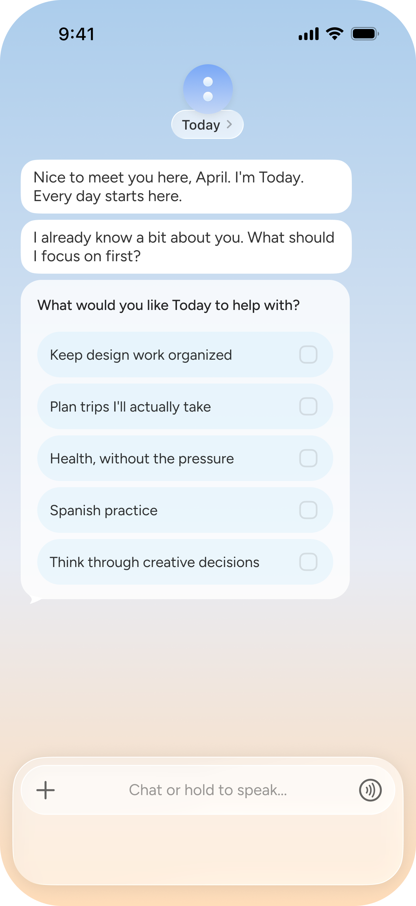
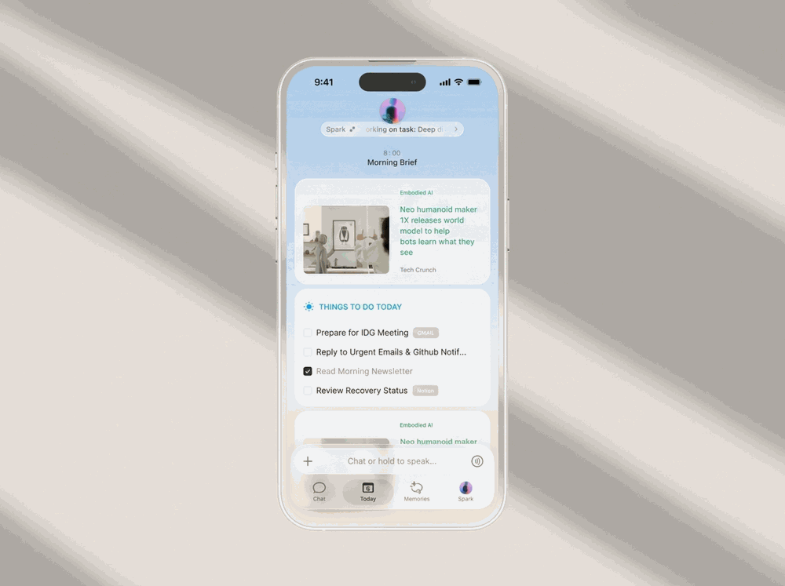
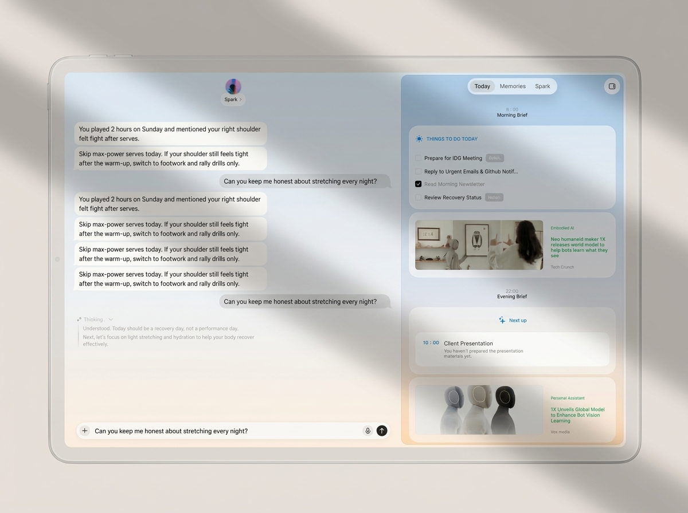
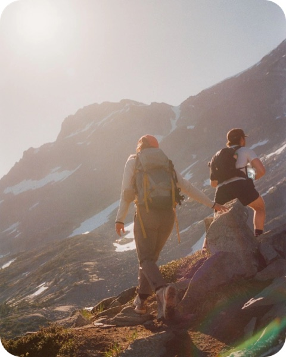
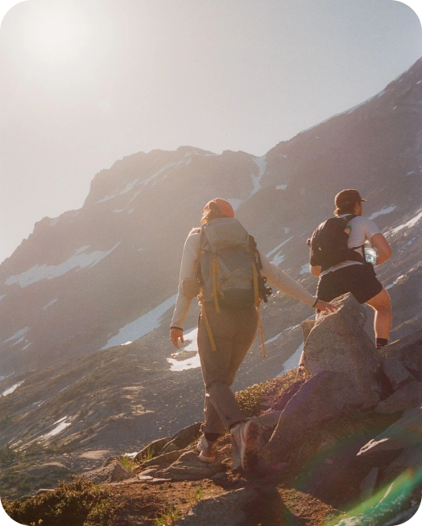
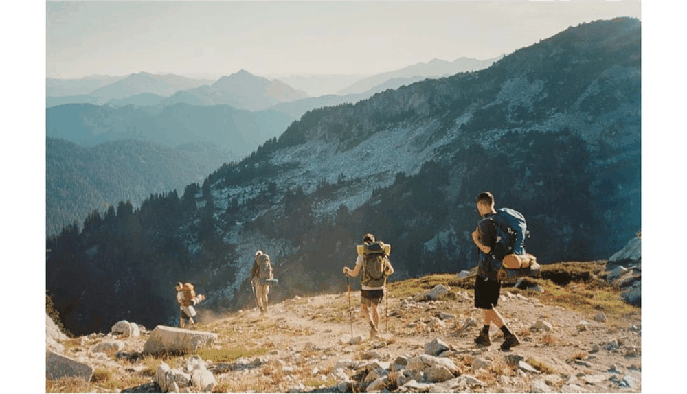
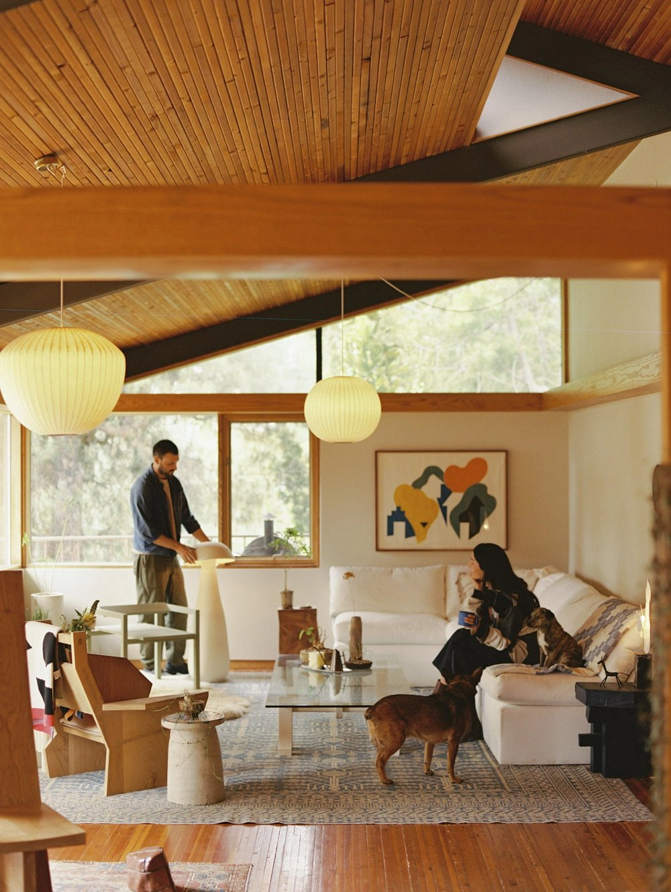
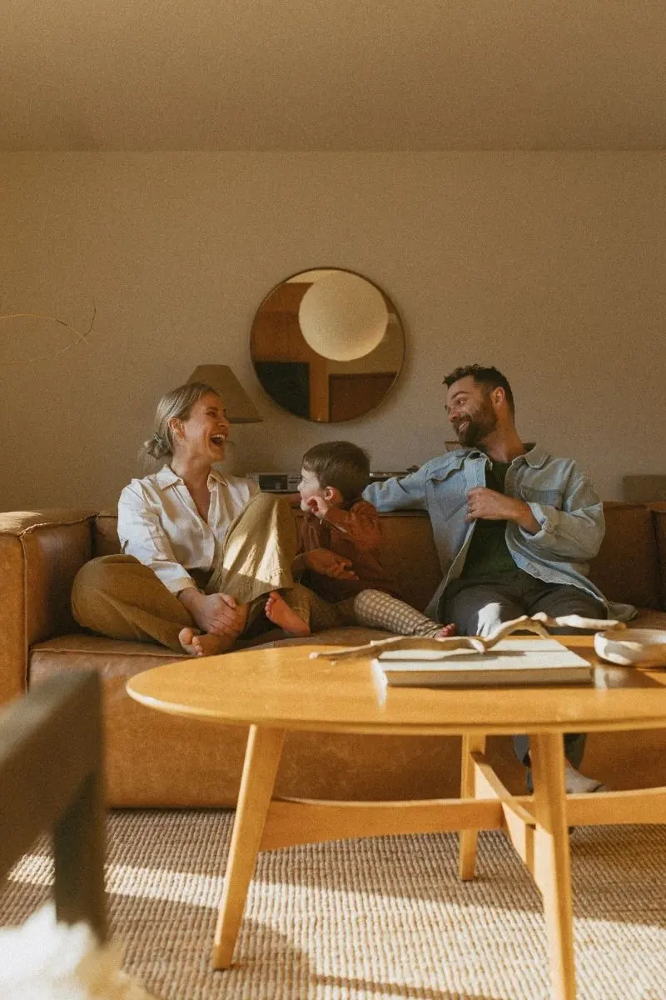

来源：https://today.ai/
取文：2026-11-28，直接下载（国际版首页）

Meet Today

Your personal assistant that actually knows you — and acts before you ask.

Nice to meet you here, April. I'm Today. Every day starts here.

I already know a bit about you. What should I focus on first?

### What would you like Today to help with?

Keep design work organizedPlan trips I'll actually takeHealth, without the pressureSpanish practiceThink through creative decisions

Ask Today...

8:00Morning Brief

### Body Signals

Sleep8h 14min

HRV83.6 ms

Movement2.8k steps

HRR44 bpm

### Launch Page Visual Design

Tuesday's launch review needs 3 directions. You have the references and product shots - just need to lay them out.

9 amDue 6 pm

1Figma → new file

2Import refs + shots

### Trip to Camino Francés

Sarria

5days115km15–25°Cweather

Santiago

Albergue tipsPacking list

Today learns your  day, builds a living  memory of what matters, and turns that context into  timely help across all your  devices.

Memories

## It remembers what matters.

Today has a living memory system that keeps your days, your people, your preferences, and the goals you keep coming back to in context, with you in control.

Hoy [OY]

¡Hoy es tu día!

adverbio

Learning Spanish

Camino Frances

- 5-day route guide
- Albergue tips
- Packinglist

Travel Plan

Weekly Meal

11:50

Evening walk

20:00

Learn Spanish

21:00

Todos

Design Moodboards

Sleep

8h 14min

HRV

83.6 ms

Movement

2.8k steps

Health

- Moonlit Arete V6
- Silver Lining V5
- Sunset Slab V3
- Finger recovery

Climbing Plan

Knee care

8:30

Tax Documents

10:00

Weekend hikes

15:00

Todos

Hiking Photos

Refill litter

Vet check-up

Morning walk

Pet Care

- Market notes
- Product Ideas
- Onboarding flow
- Customer trends

Research Directions

Team Standup

10:00

Investor Update

15:00

Vet Checkup

18:00

Todos

Maya

Co-founder

Rohan

Design Advisor

Jess

Investor

Key People

Proactive

## It helps before you ask.

Today pays attention to what may matter next, then steps in when there is something useful to know, decide, or do.

You slept under six hours and have a brand review at 10. Want me to move today’s long walk to evening and prep the review notes now?

Brand launch page — requirements changed. Your creative director and teammates now want a warmer hero, fewer technical details, and product photos that show the lamp in a real home.

- Email triageEvery 2h
- Campaign referencesWeekdays at 9:00
- Spanish practiceTue/Thu at 20:30
- Evening walkDaily at 18:30

Today helped awriter

rebuild a research trail.

Today helped acat mom

spot a quiet health pattern.

Today helped ateacher

make room for rest.

Today helped amarathoner

keep race prep honest.

Today helpedyoung parents

calm the daily routine

Today helped afreelancer

prepare for tax season.

Today helped acouple

track savings goals.

Today helped amusician

keep practice moving.

Today helped afounder

turn chaos into next steps.

Use Cases

## Today walks with you toward the life you want — the work you care about, the things you want to learn, the people you love, and the everyday moments that shape your days.

Capabilities

## Built to actually work.

Today is backed by serious, ongoing infrastructure work: better models, stronger task execution, reliable compute, richer integrations, and systems that keep improving in real use.

### Frontier models

Today’s model layer is continually optimized to combine frontier intelligence with the right fit for each task, so the help you get feels both smart and well-matched.

Harness Layer

Frontier Interaction Model

Today Bench

### Powerful task execution

It can plan the work, use tools, check progress, and report back, so a request can become a finished result, not just advice.

Understand requestsPlan and use toolsDeliver results

### A growing connector ecosystem

Today connects with the apps and services your life already runs on, from calendar, mail, notes, and files to messaging, project tools, and more.

### Always-on cloud computers

Today has stable computers in the cloud, so it can open browsers, work with files, run code, and keep handling tasks whenever you need it.

Operate Applications

24 Hours Available

Work with files

### Cross-device control

Today can work with the devices you already use, so the next step can happen on the right place at the right time.

### Community Skills

Skills from the community can work in Today, giving you more workflows to choose from and an easier path to bring what you already use.

Deep ResearchResearch

HRV AnalyzeHealth

Meeting SummarizerMarketing
