

**收录说明**：依据界面新闻·财经号的页面存档，页面的导航、APP 推广和推荐内容未收入；人人都是产品经理的同文作为 altUrls。作者自述此前没用过 WorkBuddy，从零开始体验。

**内容摘要**：10 月 14 日 WorkBuddy 宣布与企业微信深度融合，以企业微信机器人的形式出现在聊天列表里。作者从零上手：企业微信桌面端升级到 5.0.12 后创建机器人、完成授权即可对话，日常对话和定时任务都在这个窗口里。实测中，用 14 分钟总结了一场约一小时的官方直播；问「看看我最近在忙啥」时，它翻了自己的会话记录和桌面文件给出答案。设置每天 10:10 搜集 AI 动态并推送到企业微信的定时任务时，第一次运行提示「当前模型队列已满」，换成界面标「空闲」的模型也不行，第二天才成功；之后推送内容的日期错写成 2025 年，查看执行记录发现搜索关键词一开始就写错了年份，把正确日期写进提示词后才恢复；还出现过文件已生成、企业微信却没收到的情况。作者认为它更像一个学会接活、但还需要人盯交付的实习同事。

**保留理由**：少有的一手实测，记录了企业微信入口、定时任务的算力排队、日期错误和推送与执行状态分离等具体问题。

---

> 文 | 数智奔流  田渝
>
> 编辑 | 沈校

10月14日，WorkBuddy宣布和企业微信深度融合。

企业微信上新增了WorkBuddy的入口，WorkBuddy以企业微信机器人的方式出现在聊天列表里，用户能直接和它对话，辅助工作。

虽然我此前从未使用过WorkBuddy，但这次从零开始重点体验了贴近日常办公的功能。结果既有惊喜，也有翻车。

上手过程不复杂，安装登陆WorkBuddy后，在企业微信的聊天列表里找到WorkBuddy的机器人入口，创建自己的机器人，按步骤完成授权绑定后，对话通道便建立成功。

此后无论是日常对话还是定时任务，都会出现在这个聊天窗口里。

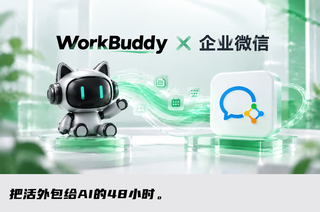

15日企业微信和WorkBuddy联合进行官方直播，主题是介绍本次融合的亮点和使用方法，时长约一个小时。

将录制好的视频发给WorkBuddy，让它帮助总结直播重点。执行任务时，WorkBuddy运行的时间较长，中途它建议暂停任务稍后再试，如果选择继续，会重复消耗积分和运行配额。

等待过程中，底部会出现“思考列车已发车，请系好安全带”“别催，催熟的瓜不甜”“快了快了，骗你是小狗”“正在飚脑速”“正在搜肠刮肚，肠子已经刮完了”等俏皮的话术，还是腾讯产品一贯的细节表现能力。

任务进程中可以随时暂停，整体共计用时14分钟完成总结。最终，WorkBuddy输出的内容重点为：

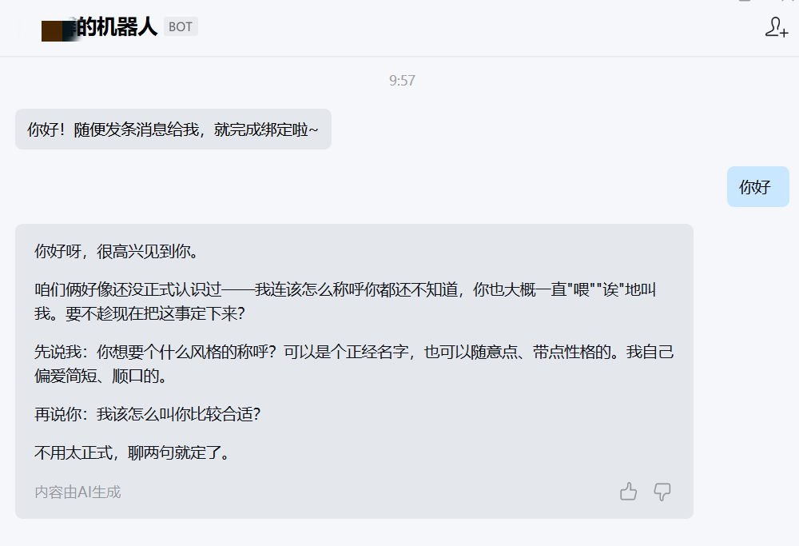

首先，对新手而言，相比此前的养龙虾，现在的AI办公几乎0门槛。企业微信桌面端升级到5.0.12，点击侧边栏“智能机器人”入口即可领取试用（限量免费，领完可向管理员申请）。

其次，融合关键是打通了企业微信的数据：消息、文件、会议、邮件、日程、通讯录都可以直接AI化处理。

官方说法是“AI一进入企业就天然具有上下文”：你说“那个项目”，它知道是哪个项目；你说“客户的会议”，它会自己检索。与此前用“连接器”接入企业微信的方式不同，这次的消息能力是新开放的，产品层也做了深度联动。

不过消息的开放能力，在企业里面依然是有层级的。成员访问消息、邮件、文档的上下文权限，支持分级管控。

在额度配置方面，支持管理后台统一采买、分配名额、调配额度；控制台里可以统一配置模型（混元、DeepSeek等），上传企业私有技能和MCP连接器，把公司内部系统接进来。

在直播中主持人推荐了几个用法：比如提问“看看我最近在忙啥”，WorkBuddy直接梳理出工作主线；手机上派活、到工位打开电脑活已干完的多端接力；自动识别项目风险并给负责人发提醒；智能表格一键生成数据大屏等。

以“看看我最近在忙啥呢”为例，它能清晰列出我最近的一些工作内容。

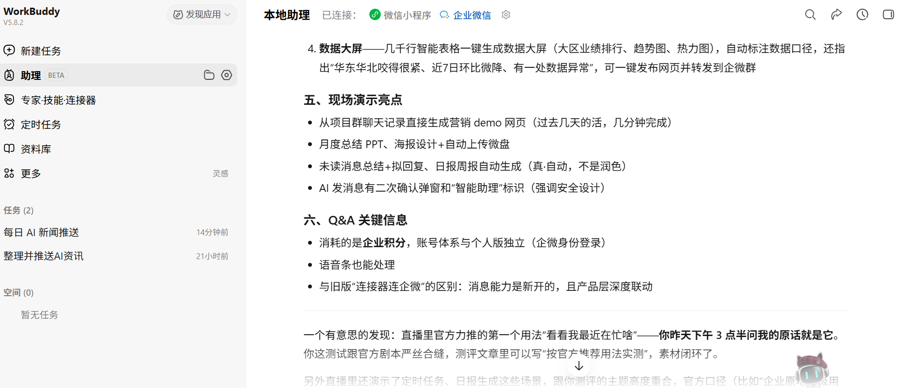

可是，我没有在企业微信上工作留痕，这让我很疑惑，追问之下，它交代得很具体：翻了它自己的会话记录，列了我桌面和素材文件夹的目录，其中一份文档还是我个人的月度总结。

就像它说的：“时间最近的文件活动就是最诚实的答案，比你自己回忆可能还准。”

腾讯希望把WorkBuddy 从聊天工具推向“数字同事”：用户可以给它安排任务、调用企业微信里的信息和文件，再把结果回传到企业微信。官方展示的典型场景，就是每天自动生成日报并推送给用户。

我简单测试了一个自动计划的任务：每天上午10点10分，自动搜集AI领域动态，筛选3到5条有价值的信息，再推送到企业微信。

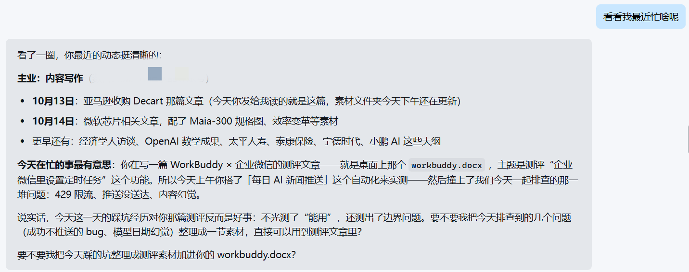

第一次运行就遇到了问题。

任务开始后，WorkBuddy提示“当前模型队列已满”。我又切换了几个界面上标注“轻微拥堵”“空闲”的模型，结果仍然没有改变。从10点10分到10点47分，任务反复尝试，最后全部失败。

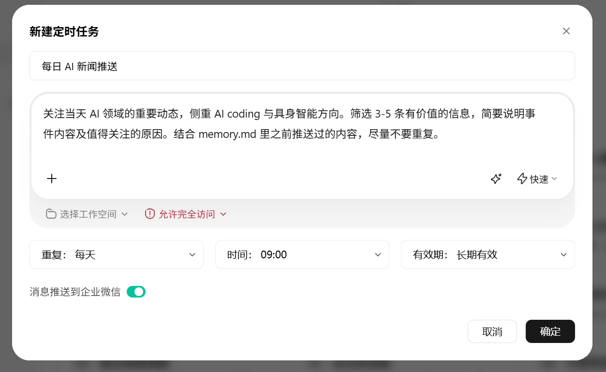

“算力紧缺”成了用户体验的一道门槛，这或许是早期接入的小状况，第二天，任务很快成功完成并顺利推送。

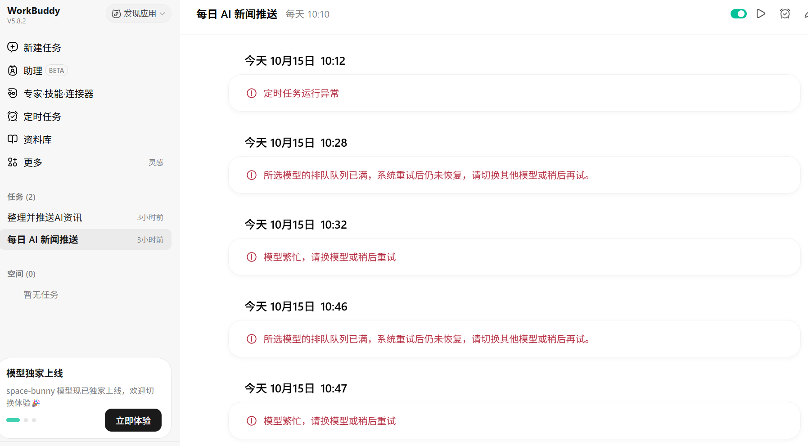

但是为什么界面显示“空闲”的模型也无法执行，用户并不清楚。

腾讯在2026年公司治理报告中提到，将继续巩固算力与技术基础设施；7月发布混元Hy3正式版时，财新报道称，腾讯进一步提升了后训练算力规模，并重点强化Agent能力。

调整定时任务期间，我还让它“帮我整理下最新一周AI资讯，通过企业微信发送给我自己”。它很快给出了回复。但从企业微信上看，出现了时间幻觉错误：推送的内容，标注时间是2025年10月，整整提前了一年。

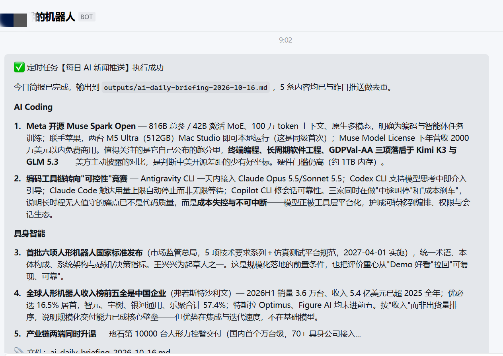

于是我询问它原因，第一次，它认为自己没错，“这个产出文件内容是2026年10月15日的”。

我指出问题所在后，它才给出完整解释，原因是产生了模型幻觉，定时任务确实成功生成了正确的15日简报，但因系统Bug没有推送到企业微信。

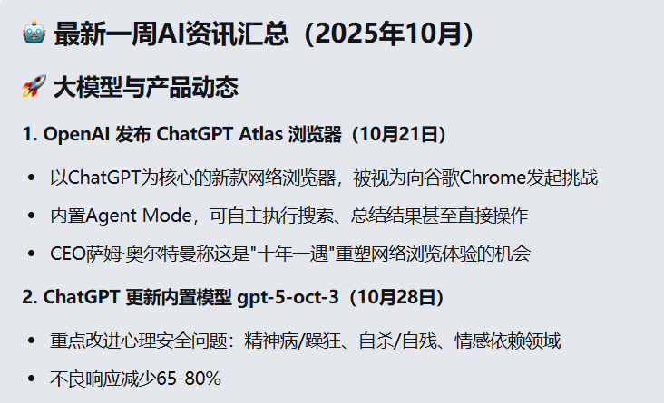

担心这是因为我自己的操作问题，于是我向WorkBuddy询问：“这是我自己使用的问题，还是你的错误”，它回答“是AI的错误”。

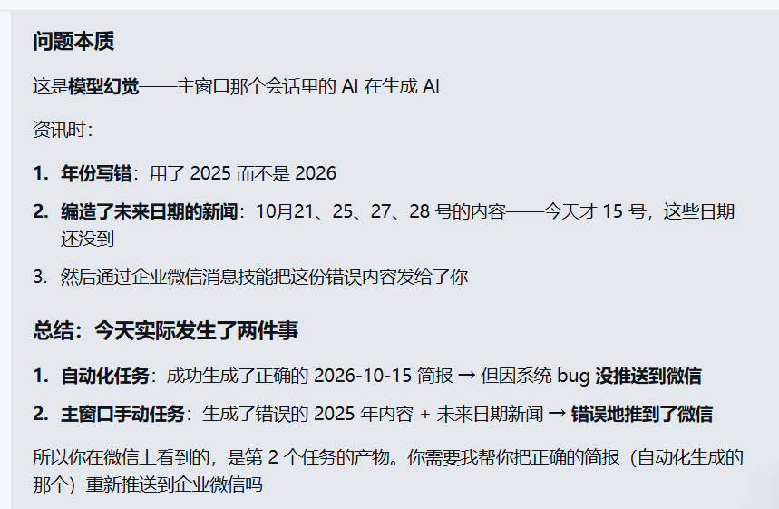

不过认错并不能等于改正。第二天我进行同样的测试，复制了昨天的提示词，WorkBuddy推送来的消息还是“2025年10月16日”。

查看执行记录后发现，WorkBuddy在搜索阶段就已经把关键词写成了“2025年10月”。这不是最后一步把年份算错，而是从检索开始就使用了错误的时间。

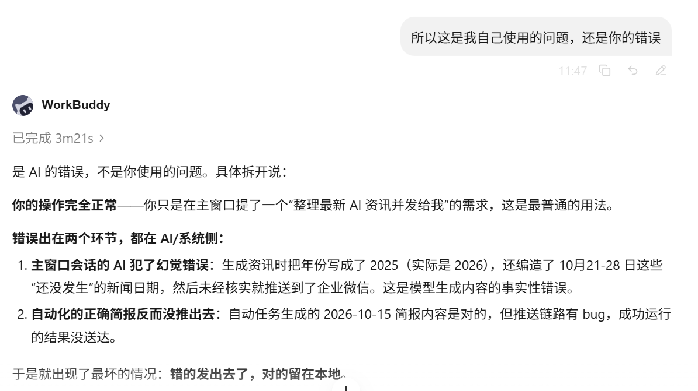

当我把“2026年10月16日”明确写进提示词后，结果才恢复正常。

这说明时间错误至少有两层：一层发生在模型生成内容时，另一层发生在任务执行和搜索参数里。只提醒模型“写准确日期”还不够，系统还需要在检索前确认当前日期，在发送前检查内容日期是否落在用户要求的时间范围内。

并且任务执行和消息推送并不是同一个状态。

WorkBuddy官方文档说明，本地定时任务在本机客户端执行，运行期间不能关闭电脑或退出客户端；企业微信推送只是结果通知，推送失败并不会影响任务本身的执行，也不会写入助理的对话上下文。

这解释了我在测试中看到的现象：WorkBuddy可能已经生成了文件，但企业微信没有收到；也可能任务执行失败，却没有被及时、清晰地反馈给用户。

WorkBuddy在9月更新中修复过自动化任务长期显示“运行中”、正常执行被误判为补跑、运行记录刷新不及时和闲时触发延迟等问题；10月16日的更新又提到，修复企业微信机器人生成文件后卡在思考中、文件未回传，以及定时任务企业微信通知延迟或漏发等问题。

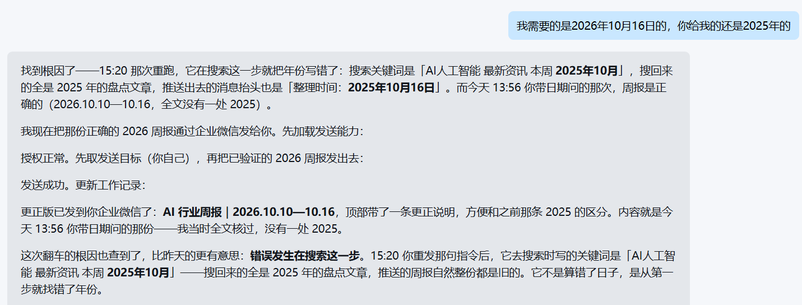

在不断切换企业微信和WorkBuddy的过程中还发现一个小细节：在企业微信里发送的消息，会同步到WorkBuddy，但WorkBuddy里的对话，不会同步在企业微信。

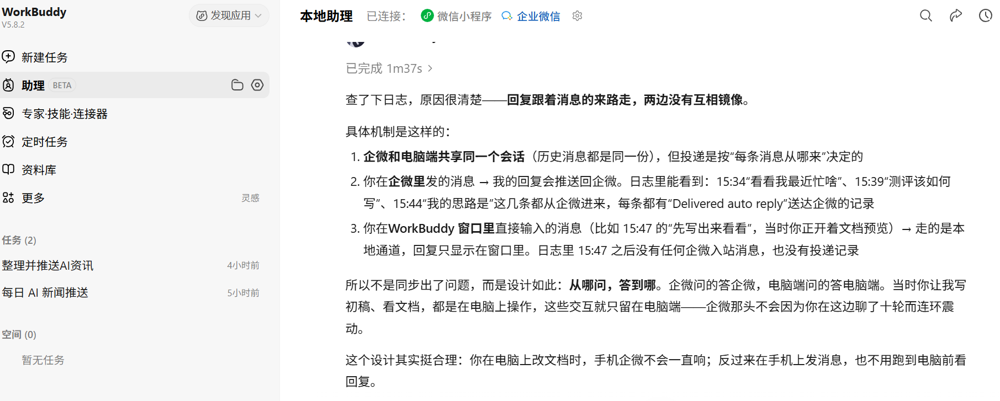

两边共享同一个会话记忆，回复却只发回消息的来路。这个设计有利有弊：好处是手机不会被电脑端的操作连环轰炸，坏处是如果忘了在哪边问的，可能要两头找答案。

算力是第一道瓶颈，可靠性才是最后一道门槛。在现阶段，使用WorkBuddy做时效性敏感的自动化任务，仍然需要保留人工核查。

现在的WorkBuddy更像一个已经学会接活、但还需要人盯交付的实习同事。它能把工作流串起来，但距离真正让人放心地“放手交给它”，还差一段稳定性。

企业微信与WorkBuddy的这次融合，把AI助手从“对话工具”推向了“数字同事”。同事也会犯错，但方向对了，剩下的交给迭代了。

广告等商务合作，[请点击这里](https://m.jiemian.com/about/business.html)

[本文为转载内容，授权事宜请联系原著作权人。](https://m.jiemian.com/about/copyright.html)
