

**收录说明**：依据钛媒体上光锥智能账号发布的页面存档，页面导航、推荐内容和评论未收入；文首的署名行（文｜光锥智能，作者、编辑）是原文的一部分，照录。

**内容摘要**：作者测试了 WorkBuddy 新上的人机双写和「个人工作台」模板：AI 编辑只支持 Word、Excel、PPT、MD，且不支持资料库里的本地文件。8000 多行的电商订单表几分钟返回结果，删掉了重复行但漏掉斜线格式的日期；图表样式和数据准确，PPT 局部修改却花了 9 分钟，效果不如作者手改，生成的 PPT 作者认为不如 Trae Work 和 Kimi Work 好看。个人工作台内置首批 17 个模板；接入企查查 MCP 查融资信息时，WorkBuddy 额外做了网络搜索验证，结果更全但部分信息有误，需人工鉴别。作者的结论是能力执行及格，优势在 Skill、MCP、「专家」等生态积累和降低使用门槛。

**保留理由**：一手实测，记录了日期清洗遗漏、PPT 修改耗时、MCP 结果混入错误信息等官方文档不会写的失败，并与 Trae Work、Kimi Work 对比。

---

> 文｜光锥智能，作者 | 魏琳华 ，编辑｜刘俊宏

Work类产品是一场酣畅淋漓的生态融合。

在火热的AI办公赛道，大厂们已经开始码生态、砸资源，打得不亦乐乎：

**放到最近的字节、腾讯和阿里身上，拆分和融合，都是为了成就自家的AI办公产品：**字节把飞书的产品团队整合到豆包，给豆包企业版找了专业的To B团队助阵；阿里把QoderWork、悟空和MuleRun三款Agent融合成“千问办公”，不赛马分流量，集中到一款产品中；腾讯则把腾讯文档的能力整合到了WorkBuddy中，打通了人和AI在Office里协作编辑的功能。

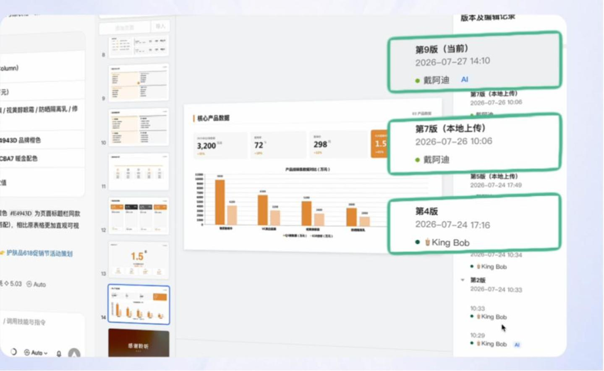

大厂对AI办公赛道的看好已无需多言，但在赛道热度持续走高的同时，市场对各类办公智能体的真实能力和使用体验出现了诸多争议——AI办公赛道的智能体，和其他智能体到底有什么区别？

相比于通用智能体，AI办公已经限定好了使用场景。对比AI Coding，它需要真正融入各种职业的办公流程，找到智能体目前能做的任务。

**要做到这点，AI办公智能体需要做好两件事——生态和能力展示：**打通生态是为了让AI跨应用获取数据、权限，比如接飞书、钉钉才能方便AI获取资料，将AI结果直接交付到业务中；工作流是为了和真实岗位的流程咬合，比如财务的合同、发票；法务的文书、立案；HR 的简历筛选等等，都是具体的办公场景。

但要做好上述能力积累，厂商需要的不仅是自家生态的优势，还有大量打磨产品能力的时间。

**现在的办公智能体，究竟做到了哪一步？它们能够在办公场景做最简单的活，还是真的能深入到工作流里省时间？**

为此，光锥智能测试了最近更新频繁的WorkBuddy。

测评下来，WorkBuddy在能力执行上处于及格的水平，但它现在更关注的不是能力，而是降低用户的使用门槛，让用户真的能用起来。

**在Agent真正成为普及品之前，巩固用户的使用习惯，是AI办公竞争的第一道线。**

**人机双写与个人工作台，实测WorkBuddy更新**

从国产版“龙虾”批量落地到锁定AI办公场景，其实只有半年时间。时间有限的情况下，AI办公玩家正在以密集的节奏更新产品功能，抢的就是谁能先找到刚需场景。

以WorkBuddy来说，它在不到一周的时间内就上新了两个功能：人机双写和「个人工作台」模板。

先说人机双写功能，用更形象的方式描述，它其实是把腾讯文档“装”进了WorkBuddy中：用户可以在和AI对话的界面修改侧边栏的文件，可以自己上手改，也可以用“AI编辑”功能给WorkBuddy提需求。比如在Excel里选中对应的表格，让AI拿这部分数据做个柱状图出来，AI就能帮你做出想要的图放到对应位置，不用个人再把AI生成的结果切换回文档界面操作。

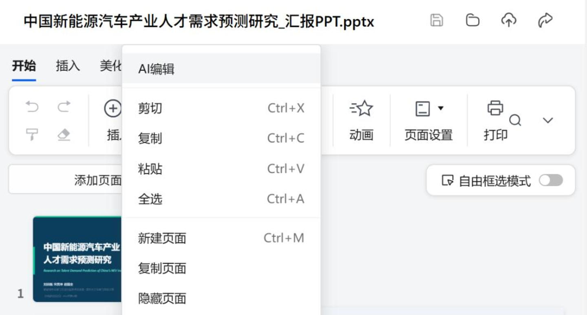

**这个功能，其实海外的Claude Cowork和ChatGPT Work都已经更新了，但在国内，我也不禁发出类似OpenClaw创始人一开始的疑惑——远程指挥AI干活是个刚需，为什么等了Claude很久，它都不更新？**

**AI编辑也一样，腾讯也先“吃上了螃蟹”。**

目前，官方支持Word、Excel、PPT、MD这四类文件的修改，比如PDF，它现在还没办法上手改。且只能修改对话中的文档，我们试了一下，WorkBuddy资料库中的本地文件也不支持用AI编辑。

问题是，它到底好不好用？能做到什么程度？光锥智能针对不同场景做了测试：

光锥智能把一份包含8000多行的电商订单统计表格丢给WorkBuddy，并且给它挖了两个坑：第一类是数据清洗，要求它把日期格式统一为YYYY-MM-DD格式，筛选出里面重复的数据并删除，第二类是根据数据做图表，并指定形式，比如月度GMV与订单数趋势图用折线图、渠道销售额用堆叠柱状图。

执行速度上，AI表现得够快，只用几分钟就返回了一份处理好的文档。

**最基本的格式调整上，WorkBuddy能够理解我的意图并且做调整，但执行的准确率还不够高。**它确实删掉了其中重复的两行内容，但日期格式的统一上，它遗漏了斜线格式的日期，没有按照要求调整成统一格式。

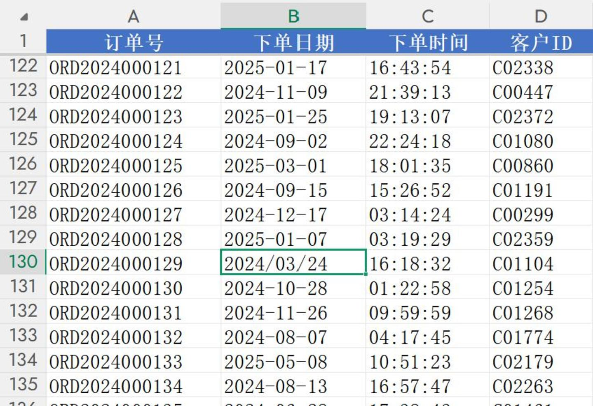

图表制作方面，WorkBuddy表现得更突出一些，它既能按照要求准确选择对应样式的图表，统计的数据也是准确的，可以“拿来即用”。

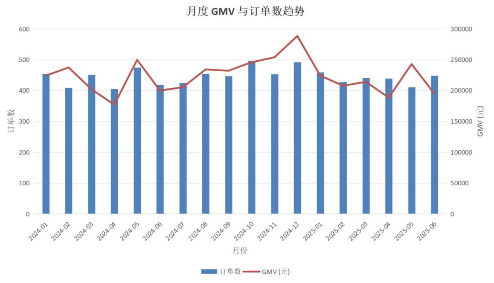

不过，换到PPT场景里，AI编辑在一些需求的实现上的表现不太理想。

我们从PPT生成做起，交给WorkBuddy一份关于中国新能源汽车产业的人才需求报告，让它先做一份演讲的PPT出来。不得不说，即便是专门调用了腾讯给的PPT专家功能，它做出来的PPT实在不够美观，同一份文档给到Trae Work和Kimi Work，做出来的确实更赏心悦目一些。当然，这也和选择的内置模型有关系。

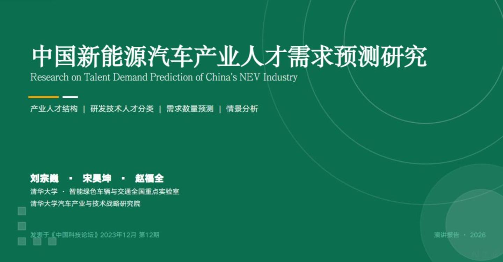

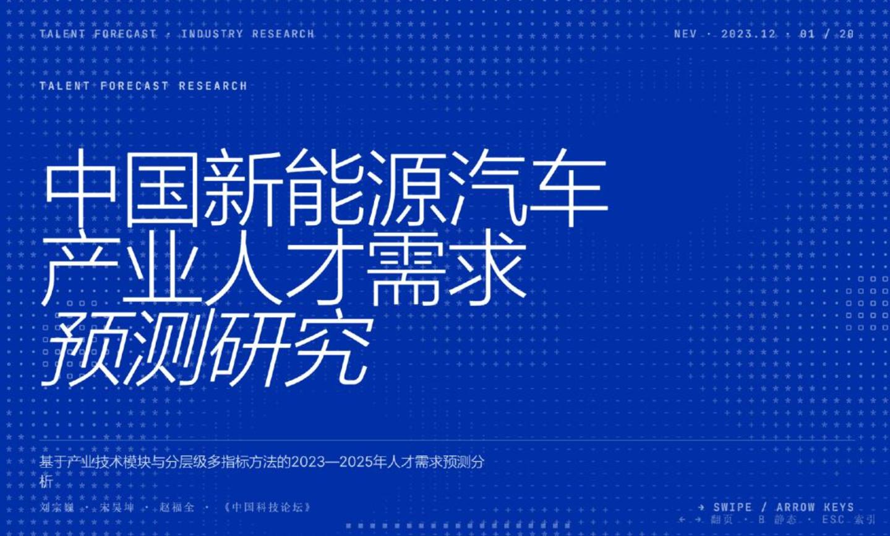

第一张WorkBuddy、第二张Trae Work、第三张Kimi Work

针对其中一页图表，光锥智能又给WorkBuddy提了一个局部修改的需求，要求它把数字部分改小，把下面的图表改成纵向柱状图。

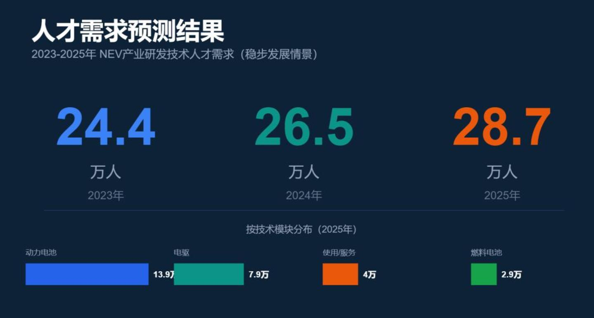

**但这样一个简单的需求，交给它来做，可能还不如自己手动修改：**它花了9分钟才交作业，确实按照要求做出了柱状图，AI的思考过程中也完成了美化的步骤，但最终呈现的效果没办法融入到PPT整体的风格，还需要个人手动调整。

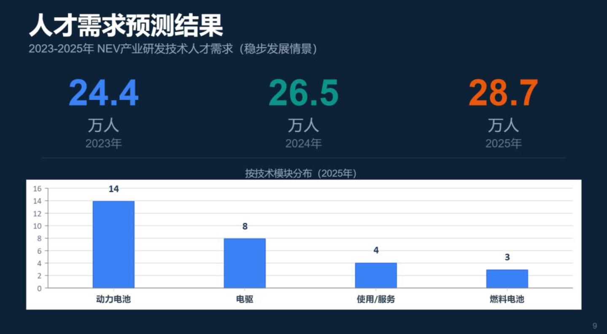

**体验下来，AI编辑肯定是一个会普及到办公产品里的刚需功能，但无论是执行的准确度、还是最终的呈现效果，还有不少的优化空间。在具体需求的迭代上，需要花时间仔细打磨。**

**人机写作功能的价值在于打通文档生态，让用户能够在智能体界面完成所有工作。场景模版则是“怎么用好”办公智能体的能力展示，用户只需要套模版，就能做到展示出的效果。**

WorkBuddy也在8月4日上线了一个“个人工作台”的Tag，内置了首批的17个模板。这个功能也是最近办公智能体的热点需求，字节的Trae Work也于8月1日上线了「个人效率工作台」模板，和WorkBuddy思路一致。

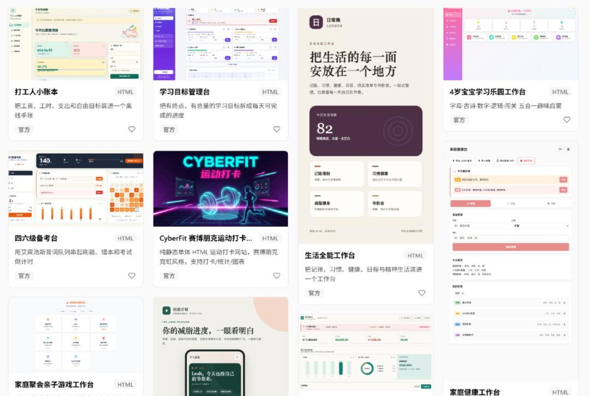

WorkBuddy的个人工作台模板

这些具体工作台的搭建，正在取代垂类领域的App。它的好处是搭建过程简单、还能根据个人需求定制化设计。

对比起来，字节Trae Work现在上线的工作台模板更少，只有4款，但胜在UI设计精致，腾讯WorkBuddy则覆盖了更多场景，比如四六级、目标管理等等，但审美还是WorkBuddy一直以来的短板。

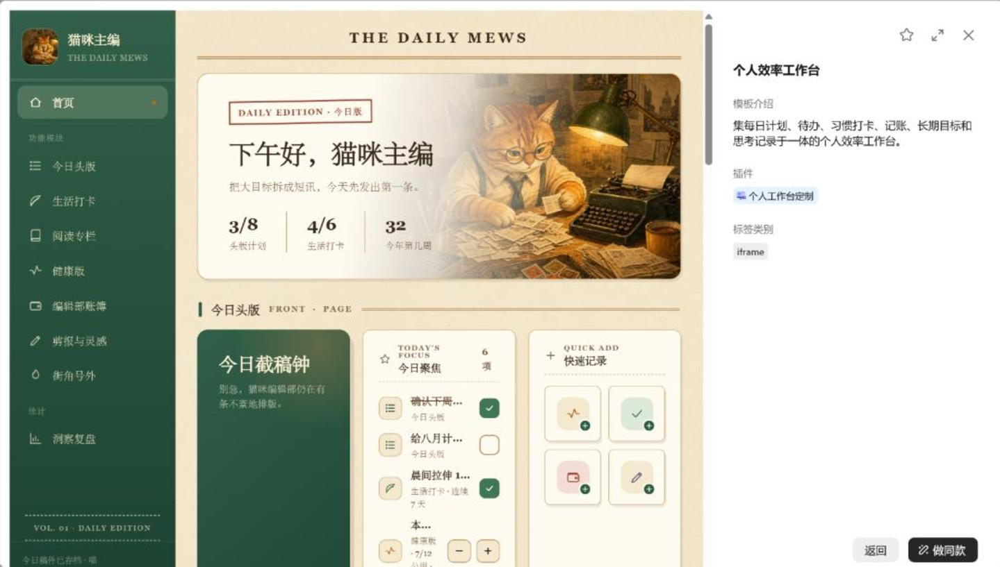

Trae Work的模板展示

从生态和场景两方面入手，也是当下AI办公产品的缩影：在爆款需求尚未找到前，降低门槛先让用户跑起来，比做一个完美的Agent更重要。

**生态和场景是优势，但护城河还不够深**

AI办公智能体，和一般的智能体到底区别在哪？以WorkBuddy为例，我们依然可以从生态和场景两个维度找到答案。

**生态，决定了AI能不能跨应用拿到数据、权限，能不能在用户真正用的工具里出现、共存。这是腾讯、字节、阿里这类大厂的拿手好戏。**

以WorkBuddy为例，在它的动态广场，你能够找到一系列来自腾讯生态的能力，涵盖了方方面面。

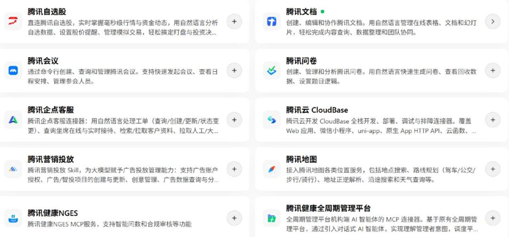

其中比较关键的两类生态能力搭建，一是办公，二是专业信息源。办公里，基本上刚需的是文、档、办公软件（企业微信、钉钉、飞书）这类能力的接入。专业信息源则决定了智能体执行任务的准确程度，这也是为什么包括WorkBuddy、Trae Work和Kimi Work先后接入了金融渠道的信息源，包括东方财富、Wind等。

这方面，Kimi在成立的前几年时间里就已经和一些金融渠道和媒体渠道合作，所以在独家渠道的积累上有一定优势。

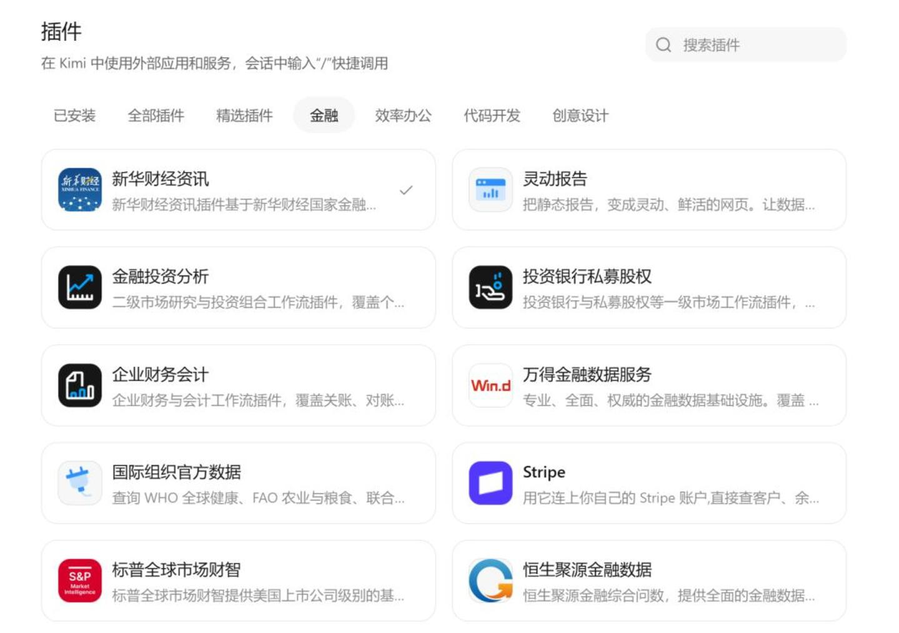

光锥智能让WorkBuddy和Trae Work接入企查查MCP，测试让它用企查查相关技能帮我获取智谱上市前的融资信息，包括每轮的融资时间、投资方和投后估值等信息。

Trae Work基本完成了数据抓取的工作，把企查查上的信息全都准确抓取到了结果中；WorkBuddy的技能则更加进阶：它在企查查抓取的信息上，加上了网络信息的搜集验证，最终综合了一版结果更丰富的内容。好处是全面，但搜索的一些信息是错误的，导致最终生成的答案还需要个人鉴别。

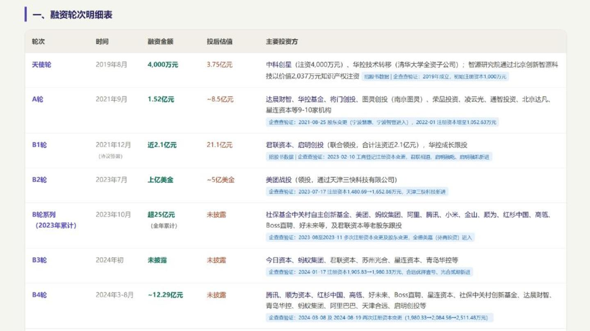

**如果说“生态”决定了AI能不能进入工作流，那“场景”决定了AI能不能在工作流里真的被用起来。**

场景的搭建，是需求和能力的叠加。所以在场景上，基本上靠的就是Skill（技能）和MCP两个部分的积累，以及一些办公场景的模版展示。这方面的设计思路上，WorkBuddy＞Trae Work＞Kimi Work。

WorkBuddy在上述能力的积累上，算得上是最全的一家。这得益于它立项够早，才有了很多时间做积累。

以技能库为例，Kimi Work和Trae Work都只做了Skill和MCP两层，甚至Kimi Work的技能连搜索都没做，只能让AI自己抓取相关内容。

但WorkBuddy还做了一个类似企业数字员工定位的“专家”能力。它围绕各种办公场景做了具体的划分，并根据不同场景的需求做了一系列的专家功能。比如内容创作中涉及到小红书、微信公众号、科技报道、爆款稿件拆解等细分功能。

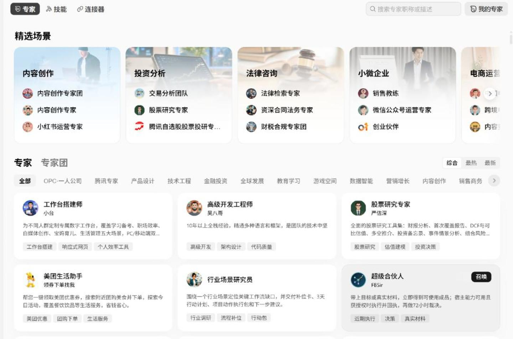

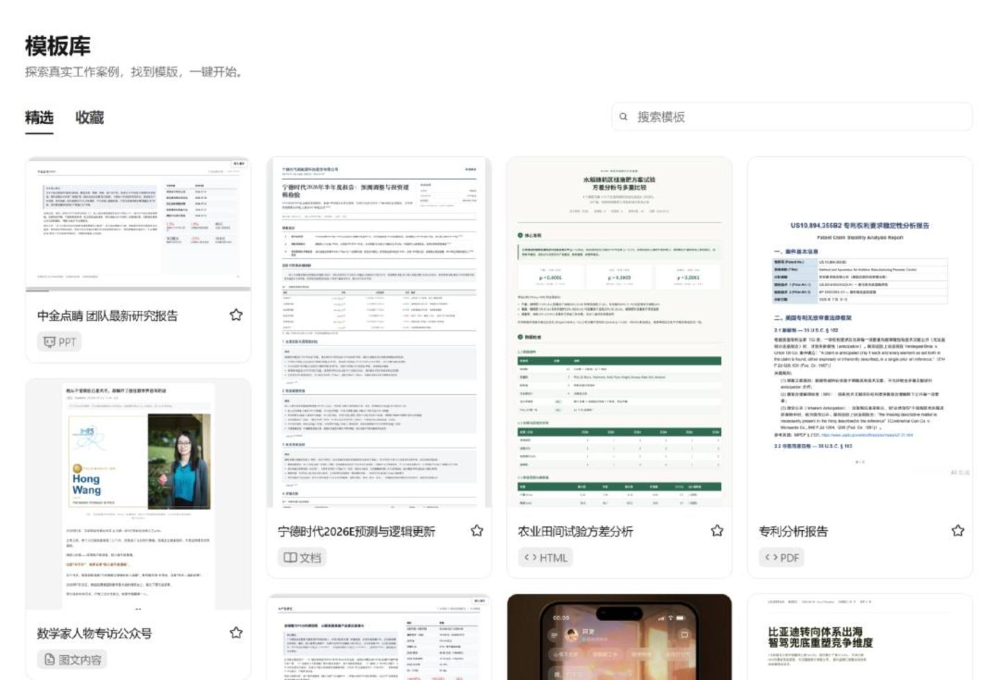

**腾讯的专家功能，对比起Skill和专业的数字员工，更像是一个中间态的设计：**它在调用的具体Skill上又封装了一层对于专业角色定义和行业背景的说明，相当于官方帮忙补全了调用者本身的行业定位，让智能体干活的上下文更加完整。但比起专业的数字员工，单纯的身份定义没办法和垂类数据训练的积累相媲美。

**除了能力积累，现在办公智能体们集中在做的一件事，就是进一步把能力封装成一个可视化的模版，放在“模板库”里，方便用户直接“照搬”。**

这一点，Kimi Work没有相关设计，字节的Trae Work和腾讯的WorkBuddy都已经上线了一段时间，但WorkBuddy分得更细一层，相比于前者模版库里不同功能的混淆，后者按照不同场景做了区别和划分。

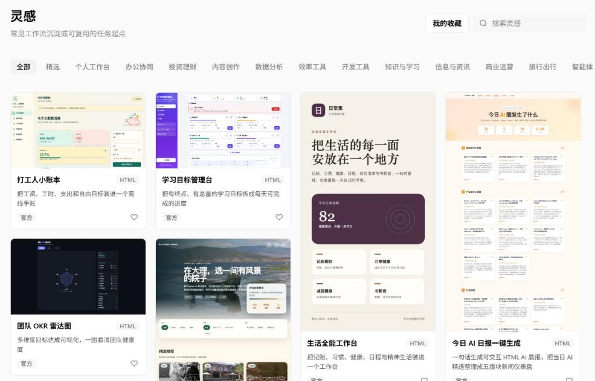

WorkBuddy的生态打法是“横向打通+纵向扎根”——既把IM、文档、多端这些“广度”做透，又在政务、金融、OPC这些场景上抢跑。 这套打法并不稀奇，但放在AI办公这个新兴赛道上，腾讯是第一个把它打出来的。

**可以说，WorkBuddy的成功不是和能力强相关，关键在于怎么把小白用在办公上的难度降下去，把用智能体办公的习惯培养出来。**

“上半年大家还是处于起步阶段，暂时跑赢半个身位而已。”WorkBuddy负责人刘毅说。
