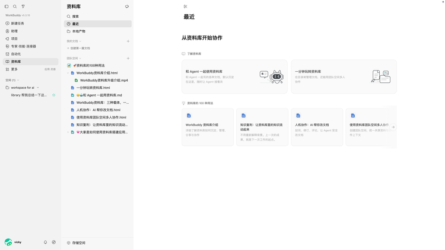
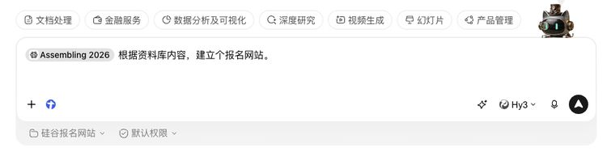
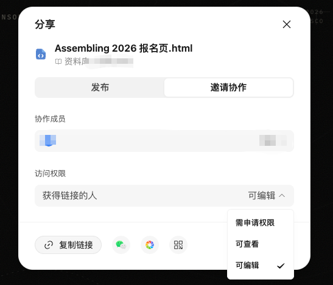
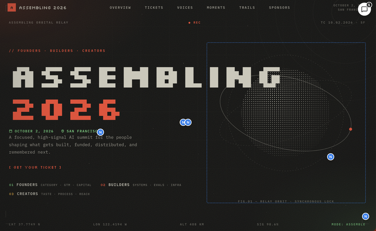
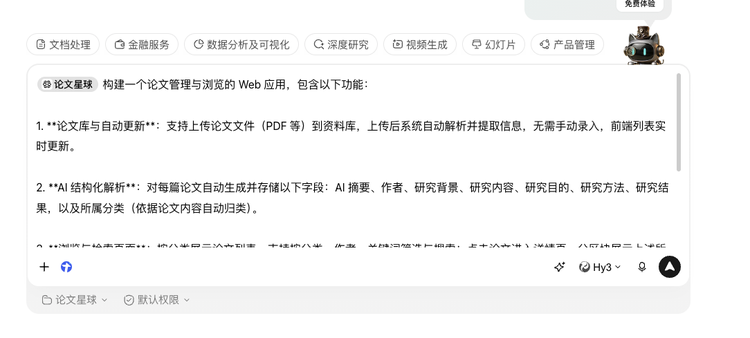
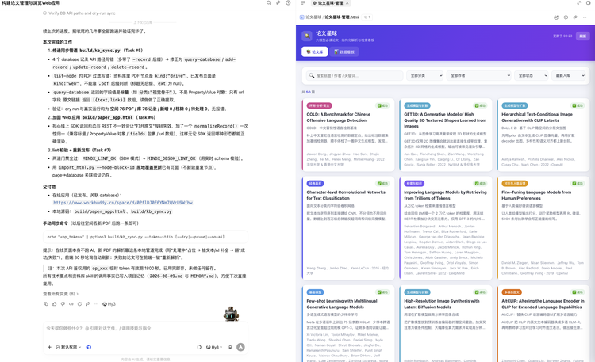
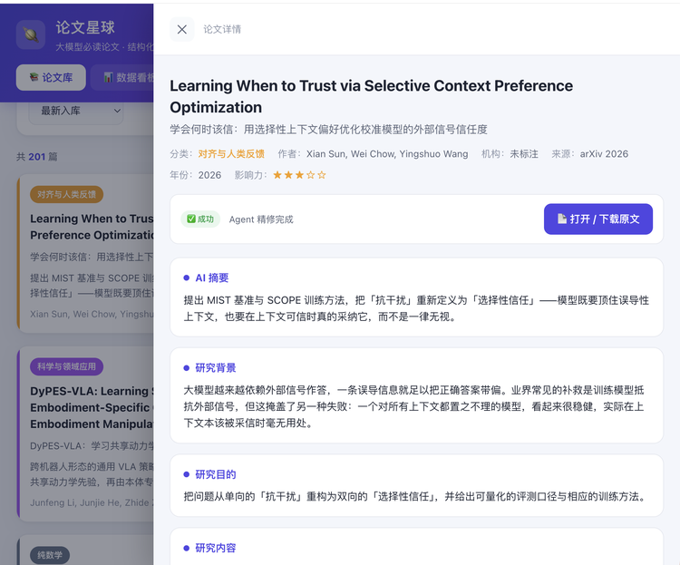
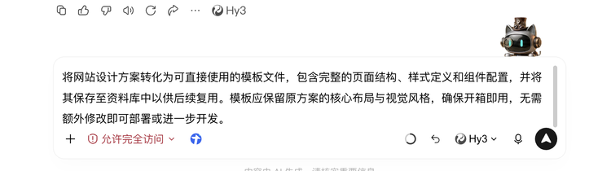
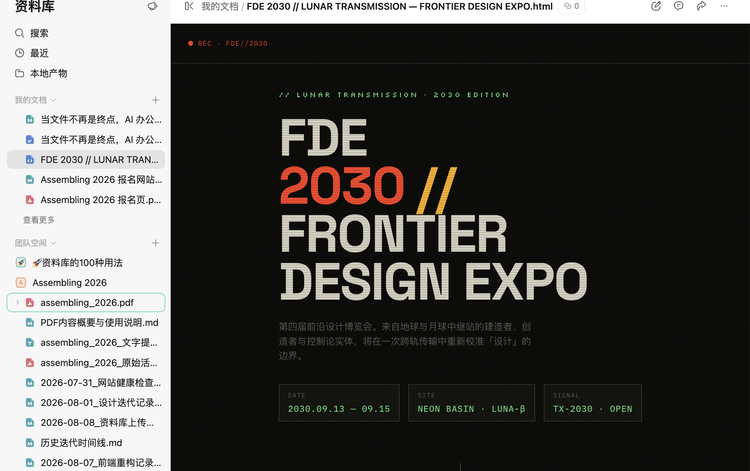



**收录说明**：依据原站页面存档，页面导航、推荐内容未收入；文中两段嵌入视频改为指向视频文件的占位行，部分图片原站下载中断，改用 curl 重新下载。

**内容摘要**：作者介绍 WorkBuddy 以资料库为底座，把 Office、HTML、Markdown、CSV 放进同一工作空间：用户可以像批注 Word 一样批注 HTML，再让 AI 定点修改，网页部署后同事和各自的 Agent 都能进入同一页面修改。实测 1 用团队资料库里的往届资料生成活动页，再由协作者按批注修订；实测 2 用 HTML 展示、CSV 存储做论文看板，作者原有的论文采集 Skill 每天上午十点自动搜索并把结果写入 CSV。作者认为个人和团队资料库能把项目资料与经验沉淀下来，供下一个项目加载，并与 Codex、Claude Code 任务结束后过程难以复用的情况对比。

**保留理由**：一手使用记录，写到资料库沉淀上下文、定时 Skill 持续更新数据这两条与个人上下文、持续运行相关的用法；没有写失败或积分消耗。

---

WorkBuddy 第一次跑出来，靠的不是继续向普通人证明 Agent 有多强，而是真正降低了普通人使用 Agent 的门槛。它抓住的也不是某一轮模型领先，而是 AI 从技术能力走向大众办公产品的窗口期。

可当 Agent 真正走进办公，一个更深的问题也浮了出来：原有的办公形式，真的适配 AI 这种先进生产力吗？

WorkBuddy 的第二次进化，没有停留在功能上的修修补补，而是把矛头指向了 Office 延续了几十年的基本形态。

过去，文字写进 Word，数据放进 Excel，方案做成 PPT。Office 三件套不仅定义了文件格式，也塑造了工作的基本流程——一份文件，既是过程，也是结果。

但这套为人类生产静态文件而设计的流程，并不适合能力强大的 AI。

视频、动画、交互图表和实时数据，正在成为新的表达方式。可一旦进入传统文件，它们往往只能变成截图，或被压缩成附件。

这一次，WorkBuddy 直接把变化落在了文件本身。它以资料库为底座，把 Office 文档、HTML、Markdown 和 CSV 放进同一个工作空间。

换句话说，这是一套真正"AI 原生的 Office"，这些文件不只是给人看，而是 AI 能理解、能直接编辑的活格式。

文件不再是交付的终点，而是容纳文字、图表、视频和交互页面的多模态空间；团队可以共同编辑，前端呈现与后端数据持续联动，每一次修改、发布和使用，又会沉淀为 Agent 下一次工作的上下文。

## WorkBuddy 扩展 AI 办公的边界

WorkBuddy 升级带来的第一个变化，**是拓宽了**AI **办公的载体与范围。**

此前的 AI 办公，主要发生在 Word 等传统文件中。这一次，人机协作的对象进一步延伸到 HTML 和 Markdown。

今天办公内容早已不只有文字，很多多模态内容都在成为表达的一部分。而最适合 AI 时代的文件格式 HTML 不仅能容纳这些内容，结构也更清晰，更方便 AI 理解和修改。

HTML 长期未能像 Office 文件一样进入主流办公场景，一个重要原因是普通人很难上手。AI 可以迅速生成网页，但不会代码的用户很难精确修改。

WorkBuddy 从根源解决了这一痛点，用户可以像批注 Word 一样，直接选中 HTML 上的文字、图片或区块提出意见，再让 AI 定点修改。HTML 由此成为普通人可以继续编辑的办公产物。

协作范围方面，过去的 AI 办公，更多是一个人与一个 AI 之间的配合，而 WorkBuddy 将网页部署，同事和各自的 Agent 都能进入同一个 HTML，围绕同一份内容批注和修改。

AI 办公的单位，开始从“一个人加一个 AI”，扩展为“一群人与一群 Agent”。

WorkBuddy 带来了更适合 AI 的文件，也把整个团队带进了同一个 AI 原生办公场景场。

**实测 1 ：共创活动页面，团队只需要 vibe 一次**

刚好硅星人最近要做一个活动页面。换作不久前，这类任务通常要经历三轮 vibe：老板先说一个大致方向，+1 根据自己的理解整理需求，最后再由执行者把需求翻译成提示词，交给 AI 执行。

问题在于，vibe 本来就是一种感觉。老板 vibe 一次，+1 vibe 一次，执行者再 vibe 一次。三轮下来，离目标就会偏离很多。

用 WorkBuddy 完成网页，既可以享受 AI 的能力，又能解决 AI 的的不确定性。
先在团队资料库中建立活动项目，把本次活动的 PDF、往届活动资料、品牌素材和相关文档统一放进去。随后将整个项目添加到任务中，让 WorkBuddy 读取其中的活动信息和历史材料，再据此生成第一版活动页面。（<https://www.workbuddy.cn/space/d/50NDtKW24n6dd7Z53rb003?source=3>）

过去，团队成员看完网页，要把问题截图，再发到群里解释“第二屏右边那张图下面的文字需要调整”。现在，团队讨论的不再是对页面的二手描述，而是页面本身。

留下批注之后，协作者既可以手动修改，也可以直接调用自己训练过的 Agent 进行修改。比如编辑带着懂写作的 Agent 修改话术，设计师带着懂艺术的 Agent 修改视觉，互相不必再分享 skill 和提示词。

比如在网页开头，每个标记都是一个修改批注，可以修改某一个文字的字体/颜色，或者是一段话的内容，又或者是一张图片。

举个例子，网页的活动介绍不够吸引人，这时候负责内容的同事直接点击按批注修订，就能调用 WorkBuddy进行AI修改，调用 SEO的专家对内容进行润色，一气呵成。

[视频：原文嵌入视频](https://navcdn.pingwest.com/2026/08/12/QtjmSiN2zWRef4656NSD3E2wTQ2ZwAd5.mp4)

## 轻应用：与其教会所有人部署，不如让他们继续使用表格

WorkBuddy 升级带来的第二个变化，是让人们用 csv表格实现网址后端管理。

说实话，用AI做一个网页很容易，但服务器、数据库和部署流程仍是大问题。哪怕有 AI 的协助，但绑数据库该怎么操作，还是很困难。

**WorkBuddy 没有给普通人准备一份更详细的部署教程，而是用打工人再熟悉不过的csv表格替代复杂的数据库，用户面对的依然是自己熟悉的内容。**

HTML 负责界面和操作，CSV 负责存储数据。CSV 中的数据发生变化，HTML 页面随之更新，不只是文本数字，图片等多模态内容，也可以跟随业务数据保存在一起。

对普通人来说，最好的教程不是写得更简单，而是用熟悉的方法接管陌生的流程。

**实测 2：每日论文看版**

我经常用 WorkBuddy 阅读论文，但过去最大的问题是：看过不等于留下。

论文读完以后，PDF、摘要和分析散落在不同的任务与文件里。等到真正需要引用时经常会忘记。

这一次，我尝试用资料库搭建一个能够持续更新的论文看板。

先把几十篇已经论文的 PDF 放进资料库，再将整个资料库添加到任务中，告诉 WorkBuddy：“建立一个论文管理系统，前台用 HTML 展示，数据用 CSV 管理。”

这样就有一个玩法，可以将 WorkBuddy 自动采集论文Skill和资料库结合。

我原本就有一个论文采集 Skill，每天上午十点自动搜索并整理新论文。现在，可以让它把采集结果直接写入项目的 CSV，
每天上午十点，WorkBuddy 最新收集到的 2026 年论文就会出现在页面里，不需要再手动复制和重新发布。

为了让论文之间的关系更直观，我又让 WorkBuddy 制作了一张星系图，用来展示不同论文、研究方向和技术路线之间的关联。它调用的仍是同一份 CSV 数据，因此新论文进入资料库后，可视化页面也可以继续更新。

[视频：原文嵌入视频](https://navcdn.pingwest.com/2026/08/12/nrz8t2Y2x6pmik9fCTC2J8FDJ9K9Ybk9.mp4)

其实，这个论文项目并不复杂。论文采集、网站生成和数据管理都有现成工具，但“不难”不代表“没有门槛”。

AI 可以把数据库和部署教程写得很简单，却不能替用户跳过数据库选型、建表、接口配置和部署。问题并不是普通人学不会，而是为了做一个论文看板，没必要先把自己训练成半个开发者。

WorkBuddy 的思路，是直接用人们熟悉的方式替代这套陌生流程：HTML 负责页面，CSV 管理数据，资料库保存论文，Agent 持续更新内容。

用户仍然在操作 csv 表格，却已经拥有了一套能够持续运行的轻应用。

## 每次对话都有积累

WorkBuddy的升级还解决了一个老生常谈的问题，每次和AI的对话，用AI完成任务后，能留下什么？

每个项目真正有价值的，不只最后交付的内容，使用过的资料、调整的过程、踩过的坑，以及“为什么这样做”的经验，都可能在下一个项目中派上用场。

但在 Codex、Claude Code 等工具中，任务完成后，过程往往留在对话记录和代码改动里。想把这些经验带到下一个项目，还需要人工翻找记录、提炼结论，再单独整理成文档。系统也许保存了完整上下文，人却很难从一长串历史任务中准确找回。

WorkBuddy 的资料库可以把项目使用的数据、参考材料、最终产物和经验总结放回同一个空间。个人资料库保存自己的模板、研究资料和工作方法，团队资料库则沉淀共同使用的数据、案例、项目背景和判断。

开启下一个项目时，可以把相关资料或整个目录直接加载 Agent 对话中。

举个例子，实测1中的硅星人活动页面，在用WorkBuddy调试完后，可以将26年的活动文档以及设计思路保存到团队资料库，27年再举办的时候，就不用再到处问过往资料在哪里。

而且从设计迁移的效果上来看，WorkBuddy 可以复刻的很到位。比如我随便设计了个2030年的活动，WorkBuddy调用测试1中的设计思路，能做出个不错的网站。

## Work Agent 的下一步，不只是更强的 Agent

在 WorkBuddy 跑通这条路之后，冒出了一批 Work Agent 产品，功能清单看着都差不多。如果比拼的只是谁的模型更聪明、谁的 Agent 更听话，这个赛道很快又会变成一场参数和榜单的军备竞赛。

但 WorkBuddy 这次的答案，其实不在 Agent 身上。与其琢磨怎么让 AI 更好地适配 Office，不如反问一句，Office 这套为静态文件而生的形态，还配不配得上 AI 这种动态生产力。

AI 时代的文件应该是多模态的。CSV 不该只是一张表，它可以是一个轻应用的后端。一次对话也不该随着窗口关闭就蒸发，它本该沉淀成下一次工作的上下文。

回头看，AI 办公已经悄悄走过了萌芽期，这一阶段是把AI 塞进我们既有的办公流程，向普通人证明 AI 真能干活。WorkBuddy 这次的进化，像是拉开了成熟期的幕布。不是让 AI 去将就旧工具，而是让工具为 AI 重新长出来。当 HTML 能被像 Word 一样批注，当一张表格能驱动一整个网站，当团队的每次修改都被记下、被复用，办公的边界就从交出一份文件，变成了养活一个会持续生长的空间。

所以 Work Agent 的下一步，答案未必是更强的 Agent。而是一个更朴素、也更难回答的问题。

当文件不再是终点，我们到底该用这些多出来的能力，去做哪些过去根本做不了的事。
