

**收录说明**：智东西在凤凰网凤凰号发布的页面，正文由页面脚本中的数据（allData.docData.contentData）取得，静态 HTML 的正文容器为空；文首的公众号名、作者、编辑行是原文的一部分，照录。智东西网站上的原文未找到。2026-11-10 一轮记为待处理（当时只抽到约 100 字）。

**内容摘要**：智东西 10 月 14 日报道，企业微信与 WorkBuddy 联合发布新版本，WorkBuddy 可在企业授权范围内调用企业微信的消息、文档、会议、微盘等能力，并以机器人身份出现在通讯录中；企微账号与原有 WorkBuddy 账号的数据和使用状态不互通。聊天消息的读取、检索与发送由企微 AI 助手「大圆」承接，文档、日程等走 wecom-unified（CLI），发送消息前需要用户手动确认接收对象和内容。作者实测群聊近 7 天总结、读取微盘周会纪要生成智能文档、整理未读邮件，均能完成；审批目前没有相关技能，无法处理，调用还受企业认证、客户端版本和授权范围限制。

**保留理由**：企业微信入口接入后的一手实测，写明了账号不互通、发送前需确认、审批不支持等限制，与已收的数智奔流实测（个人定时任务角度）互补。

---

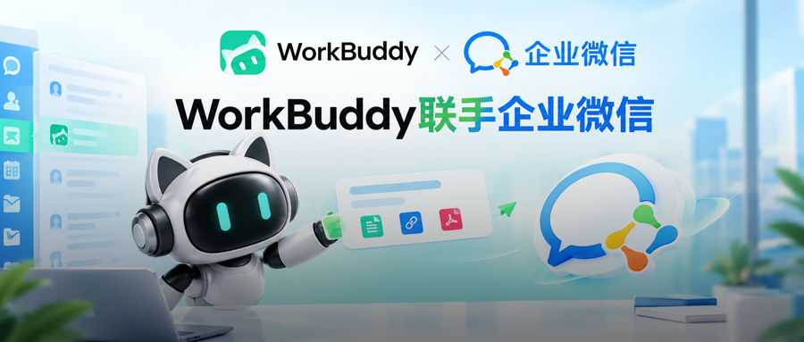

**AI应用风向标（公众号：ZhidxcomAI）**

**作者｜毕伟豪**

**编辑｜漠影**

腾讯，终于还是迈出了这一步。

智东西10月14日报道，今天，腾讯宣布企业微信与旗下AI办公产品WorkBuddy联合发布新版本，双方完成深度融合。

升级后，WorkBuddy客户端可在企业授权范围内调用企业微信的消息、文档、会议、微盘等多项能力，完成深度分析、复杂文档处理等任务。

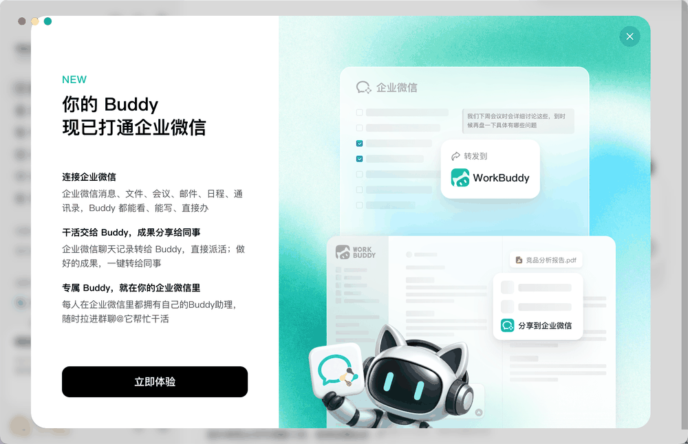

同时，WorkBuddy也以对话机器人的身份进入企业微信通讯录列表，用户在企业微信中即可调用WorkBuddy的相关能力，并可以结合企微AI助手“大圆”完成各类任务。

智东西也是第一时间更新了版本，并对新功能进行了测试。

实测发现，WorkBuddy已能调用企业微信的多项能力，完成消息整理、文档处理和内容回传，但审批、账号互通等环节仍存在限制。

**一、打通消息、资料、任务三大场景，WorkBuddy联动大圆**

要体验相关功能，首先需要更新企业微信和WorkBuddy客户端，然后在企业微信左侧菜单栏找到WorkBuddy入口，点击领取并完成激活。

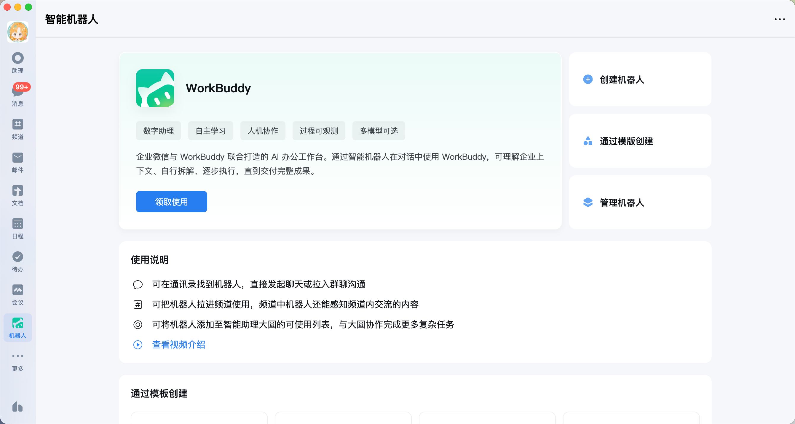

随后，用户可以在通讯录里找到这个机器人，并进行私聊或者拉入群聊等操作。

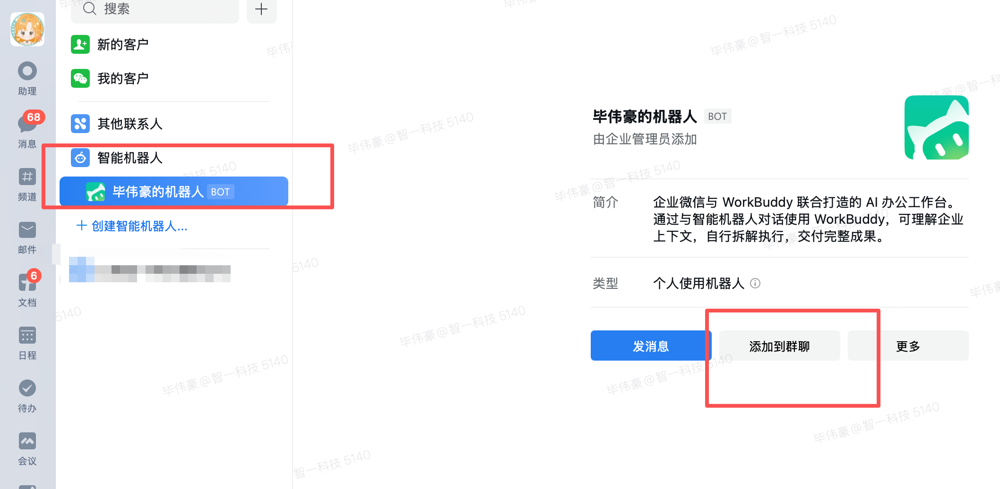

此外，新版本企业微信还在灰度内测一项新功能“频道”，用户可以在推进项目协作、收集产品意见、分享知识经验等场景中使用该功能，并可添加机器人进频道共同协作。

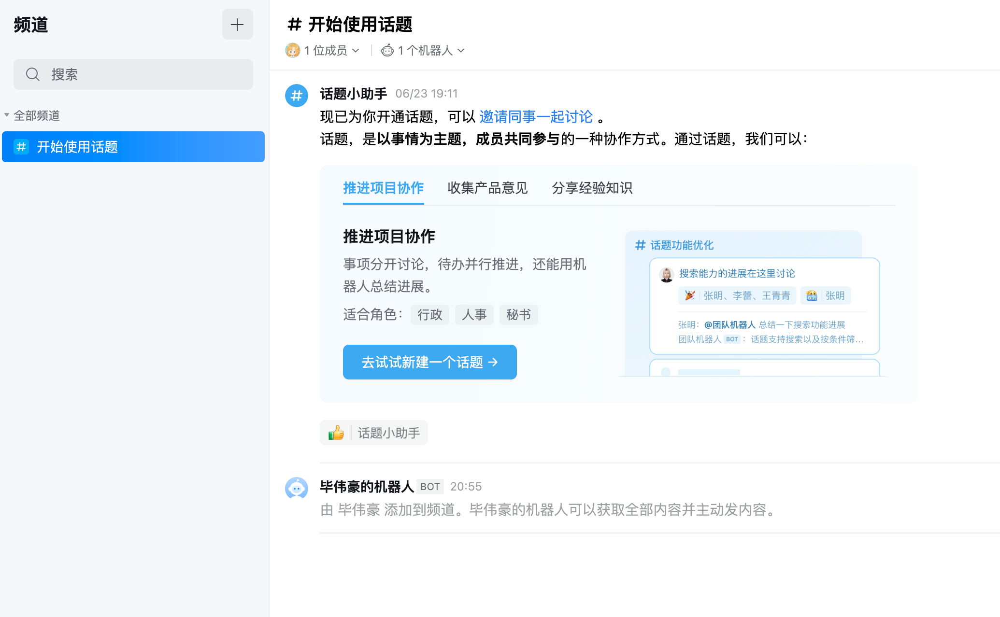

接着，打开更新后的WorkBuddy客户端，使用企业微信账号登录。需要注意的是，企微账号与原有账号的数据和使用状态并不互通。

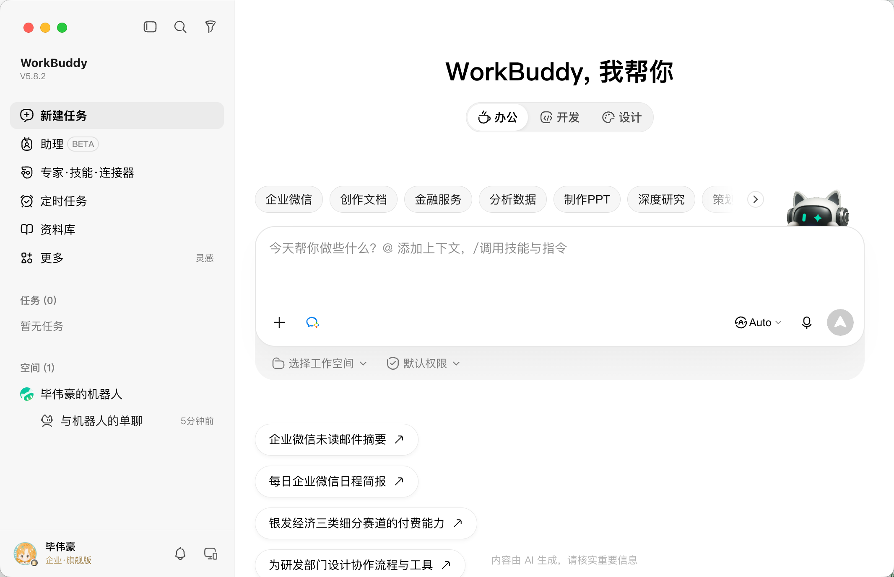

此外，用户还可以在企业微信助理“大圆”中选择关联WorkBuddy机器人，调用相关能力。

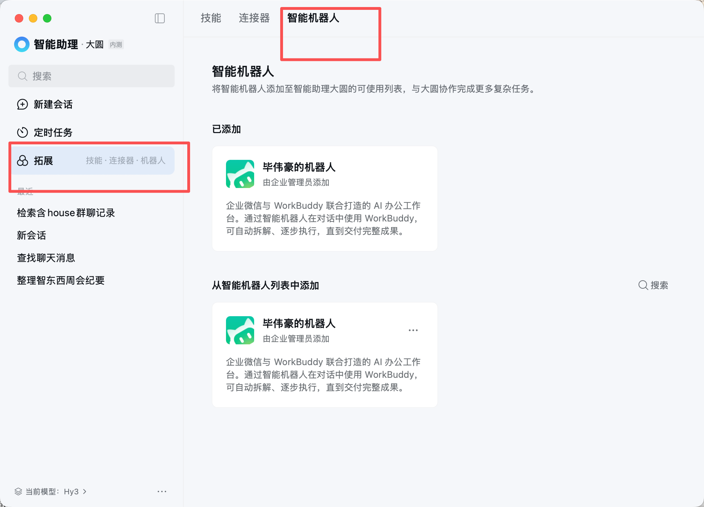

此次升级，WorkBuddy与企业微信的融合主要是这三个场景：聊天消息处理、企业资料调用、任务执行与协作。

聊天消息处理上，WorkBuddy新增了未读消息和邮件整理能力，能把信息分类、提炼重点、梳理待办。

比如我们让WorkBuddy帮忙直接下载今天邮件中的发票，然后保存到桌面的发票文件夹中。

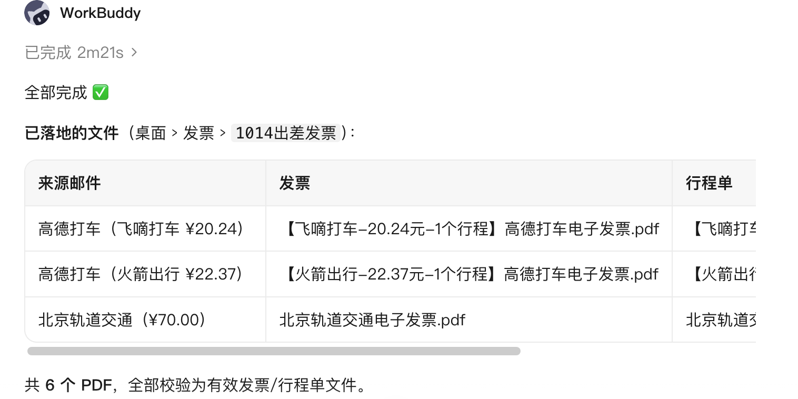

用户还可以指定某个群聊，让它结合上下文总结消息，自动识别聊天中提到的在线文档、微盘文件、日程和会议纪要。

用户还能让WorkBuddy向同事或群聊发送文本、链接和文件，但发送前需要手动确认接收对象和具体内容。

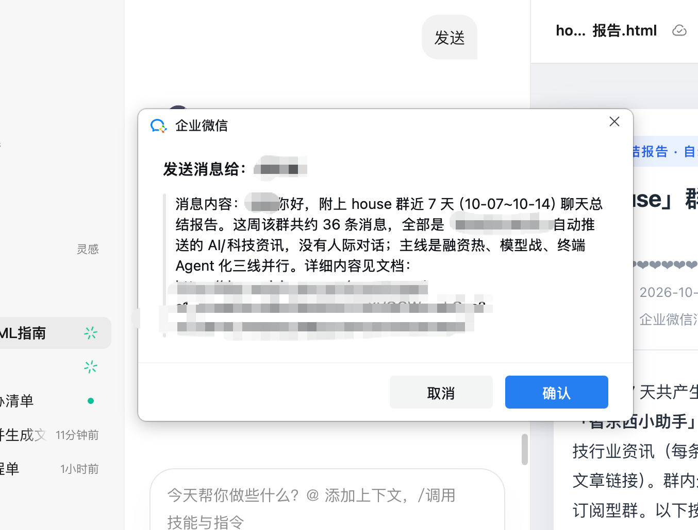

这部分能力与企业微信AI助手“大圆”联动，聊天消息的读取、检索和发送，由大圆承接具体操作。

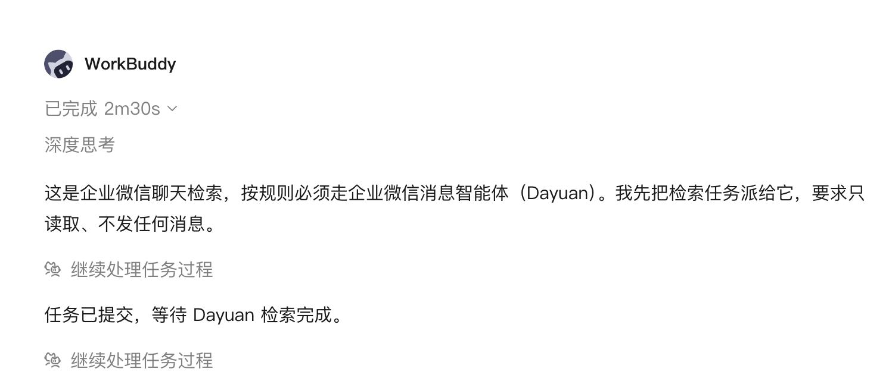

同时，也可以将企微中的消息直接转发到WorkBuddy中，比如我们就转发了一些群聊的聊天记录，操作不复杂，只需要选中聊天记录后，在转发页面中选择更多中的WorkBuddy即可。

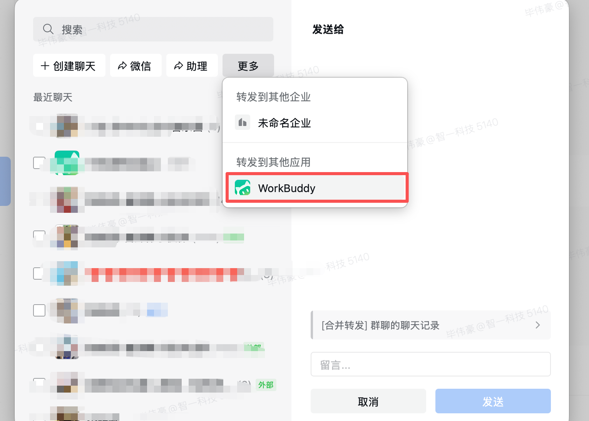

转发完以后会自动跳转WorkBuddy，信息会以压缩文件的形式存在，并显示在聊天框中。

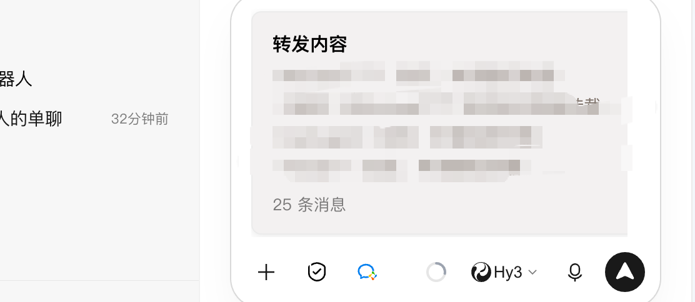

企业资料方面，WorkBuddy可以直接引用微盘文件，读取、编辑在线文档、表格和PPT，还能调用日程、会议、待办和邮件数据。

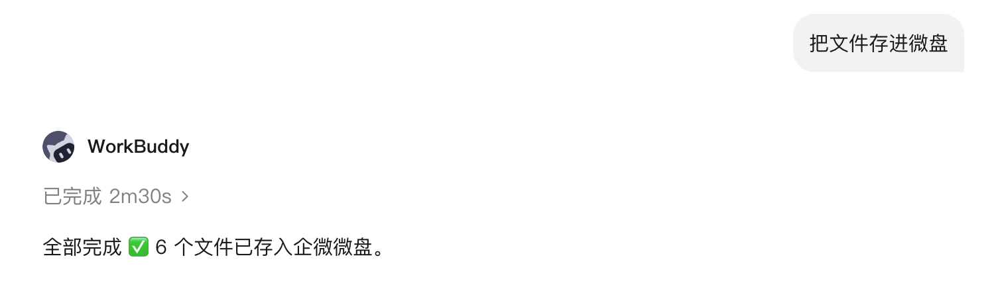

这类文档和业务数据操作，通过wecom-unified（CLI）连接能力完成。两条执行路径各有分工：聊天消息由大圆处理，文档、日程等业务数据走wecom-unified调用。

最后是任务执行与协作。WorkBuddy把内容做出来后，可以分享回企业微信，或上传到微盘。

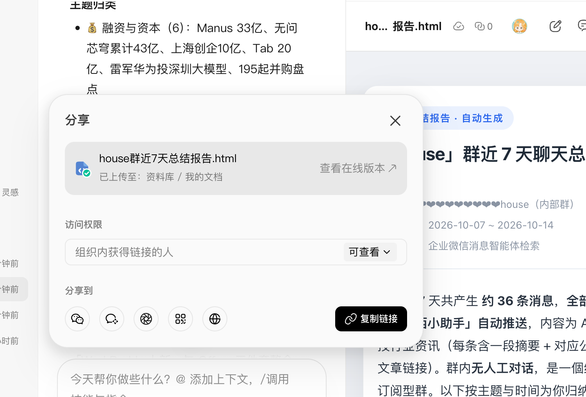

此外，WorkBuddy还可以设置定时任务，并将任务结果推送到企业微信。

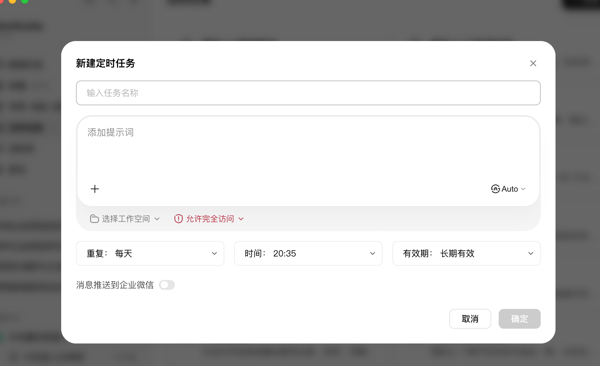

同时，知识库支持邀请企微成员协作，管理员则可以通过企业管理后台，管理席位、权限和使用情况。

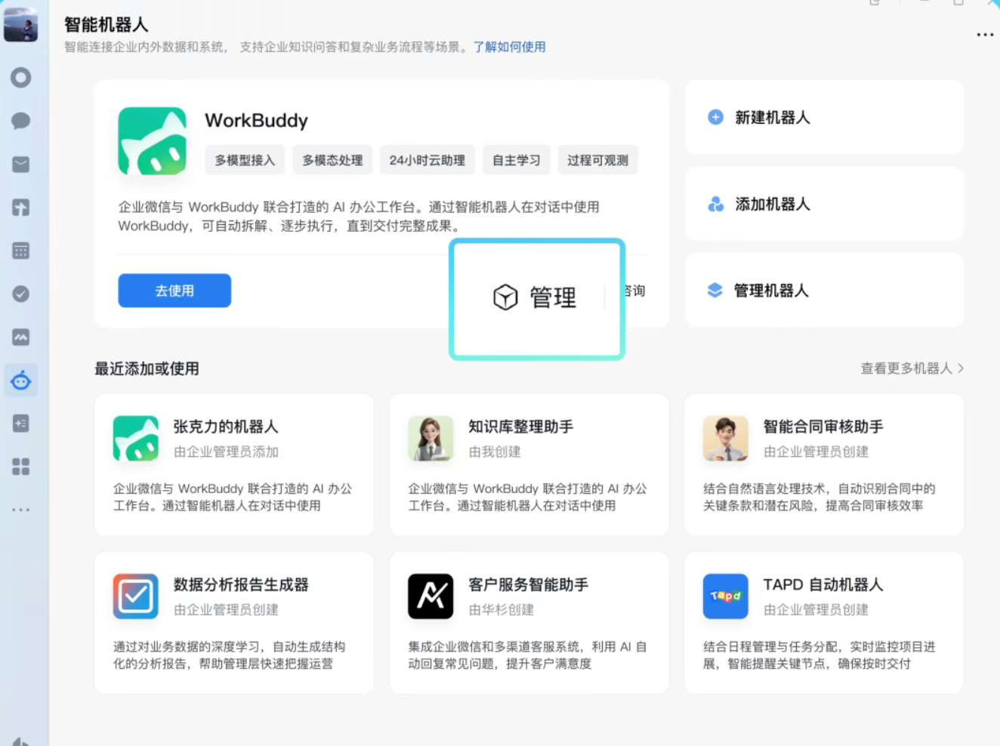

WorkBuddy调用企微相关能力受企业认证、客户端版本和授权范围限制，部分功能还需要在企业微信客户端或管理后台操作。

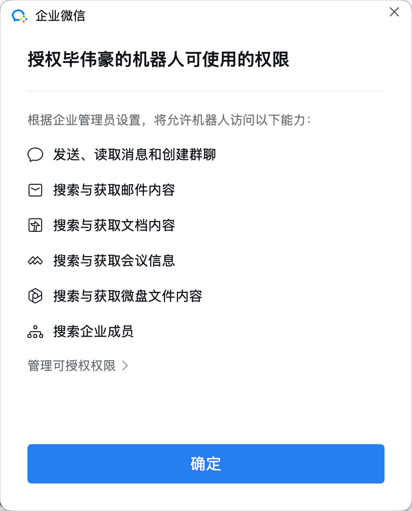

**二、实测WorkBuddy：群聊总结、周报生成、未读邮件整理**

第一项测试是历史聊天记录的检索和总结。我们只说了一句：“查一下我企微house群里近7天的聊天记录，做个总结报告出来。”

WorkBuddy调用“大圆”，按指定群聊和时间范围检索聊天记录，把消息整理成了一份总结报告。

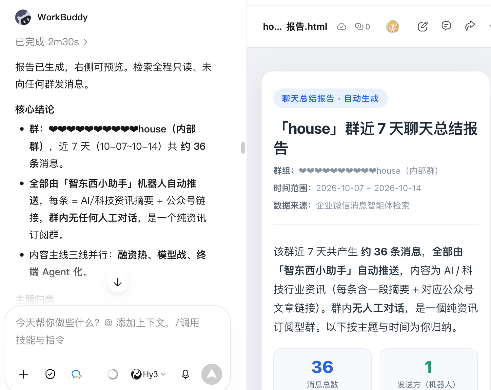

第二项加了点难度，我们让它读取微盘里最新的周会纪要，整理编辑部过去一周的重点工作和未来一周安排，最后生成一份企业微信智能文档。提示词如下：

请读取企业微信微盘中最新的一份编辑部周会纪要，整理编辑部过去一周的重点工作和未来一周的工作安排。请分别梳理上周重点工作、当前待办和未来一周安排，提取重要进展、待解决问题、负责人及时间节点。请忠于原始纪要，不要补造缺失的信息；无法确认的内容请标注“待确认”。完成后，将内容生成一份企业微信智能文档，标题为《编辑部周工作总结与下周安排》，并保存到企业微信中。

WorkBuddy读取了微盘里最新的周会纪要，把内容整理成了智能文档，并保存到了企业微信里。

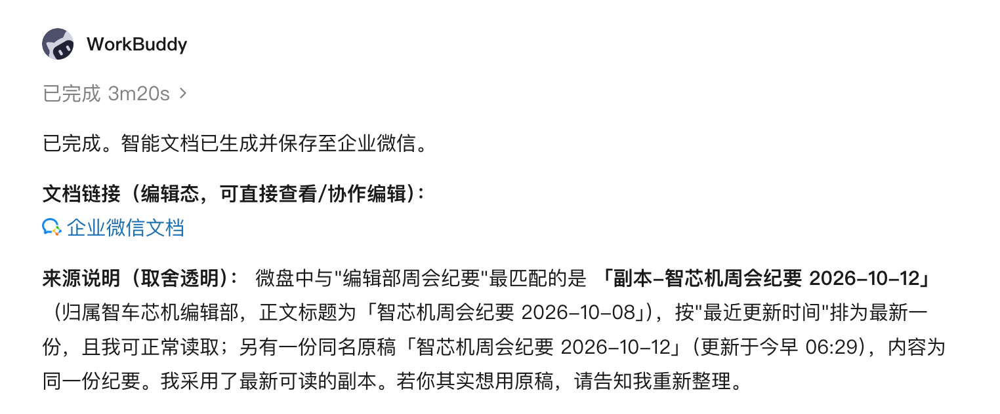

第三项，我们测试了一下邮件相关功能，让WorkBuddy筛选最近一周的未读邮件，归纳重点，提取需要处理和跟进的事项。提示词如下：

请整理我最近一周的未读邮件，按照“需要尽快处理、需要跟进、仅供参考”三类归纳。提取重要邮件的发件人、主题、核心内容、需要采取的行动和截止时间。如果涉及会议、采访、稿件交付或合作事项，请单独列出。最后生成一份简明的待办清单。只整理和总结，不要替我回复或发送邮件。

它按时间范围整理完未读邮件，分成三类，提取出对应邮件的发件人、主题、核心内容、待办事项和截止时间，最后生成了一份待办清单。

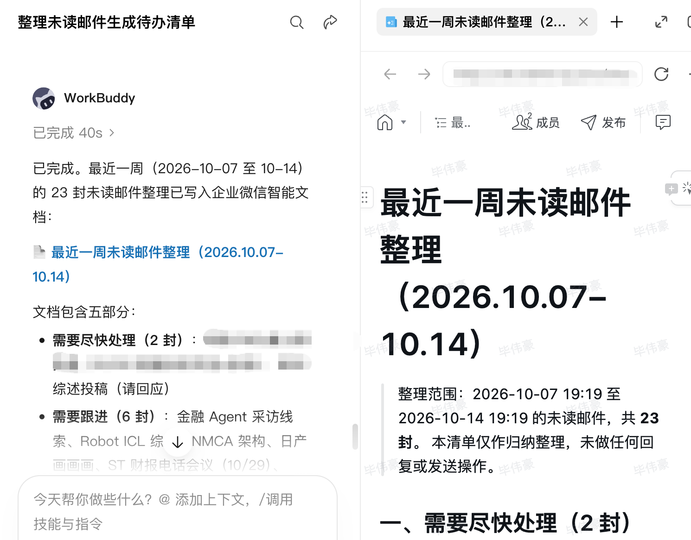

审批方面，目前WorkBuddy还没有相关技能，暂时无法直接处理企业审批流程。

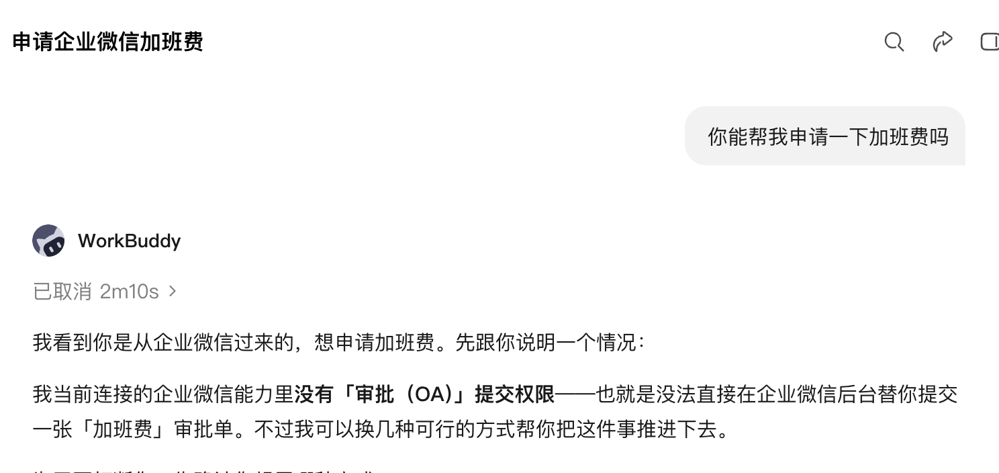

**结语：打通办公接口之后，考验才刚开始**

WorkBuddy与企业微信的深度融合，让AI工具能调用企业内部的聊天记录、文档和邮件，并把处理结果带回现有的协作流程。这也是腾讯把WorkBuddy能力嵌入企业微信这一办公入口的最新尝试。

但能读取消息、生成文档，只是起点。权限划到哪、敏感操作谁来审批、账号和业务系统怎么衔接，都会影响AI能接手多少实际工作。尤其碰上文件操作、消息发送和跨部门协作，流程里任何一个环节卡住，工作都可能回到人工。

对腾讯来说，下一步要看的，是WorkBuddy能不能真正融入企业现有的工作方式，在减少重复操作的同时，不给员工添负担。
