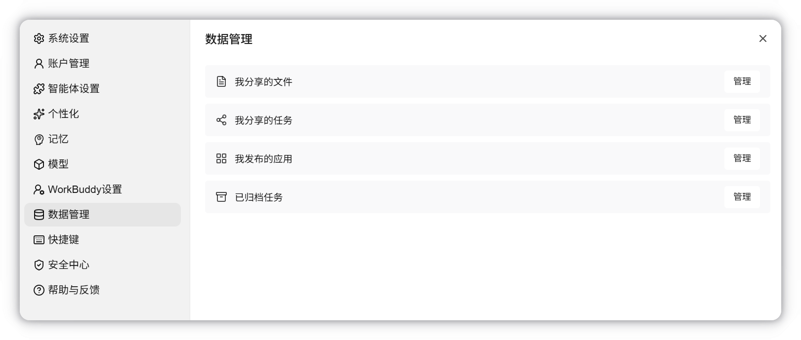
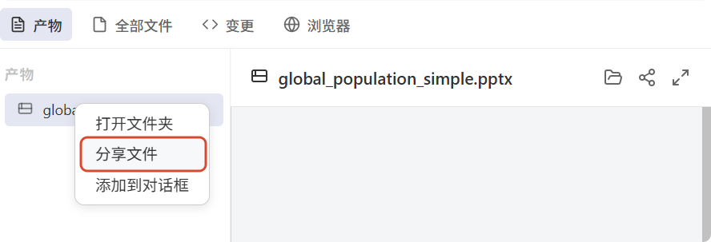
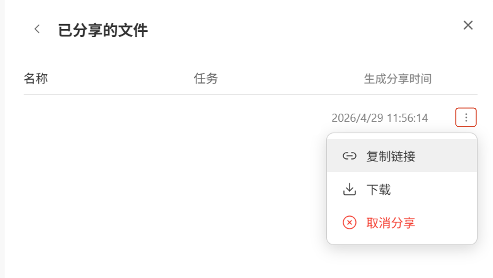
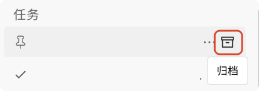
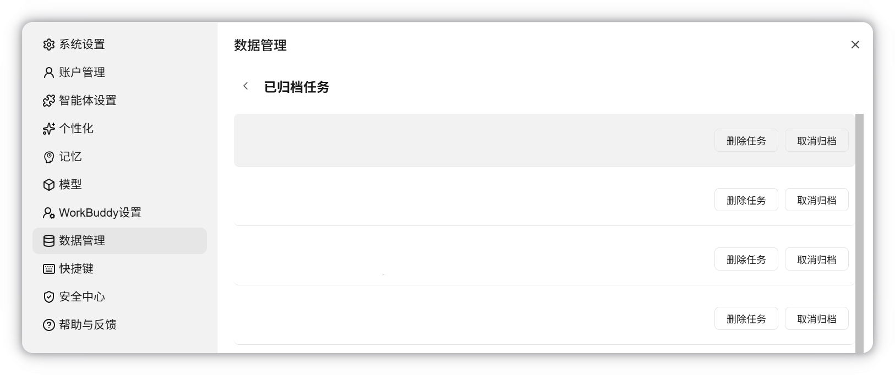



**收录说明**：官方文档站（VitePress）页面，依据原站存档；标题旁的锚点符号、页尾的「最后更新」与上一页/下一页导航未收入，页内相对链接改为绝对地址。旧笔记 learning-ai-agent 的 WorkBuddy 资料索引引用过这一页。

**内容摘要**：数据管理位于「头像 - 设置 - 数据管理」，包括「我分享的文件」和「已归档任务」两部分：分享的产物可以复制链接、下载或取消分享，取消后他人无法再通过链接访问；归档的任务可以删除（二次确认，删除后不可查看和继续对话）或取消归档。

**保留理由**：记录了产物分享和任务删除的用户控制入口。

---

数据管理

管理已分享的文件和已归档的任务，入口为**头像-设置-数据管理**。

## 我分享的文件

将任务的产物分享后，文件会出现在已分享的文件列表中：

在**我分享的文件中**可以复制文件分享链接、下载文件和取消文件分享。取消分享后，文件从列表中移除，他人无法再通过链接访问。

## 已归档任务

将任务列表**归档**后，任务会出现在已归档任务列表中：

**已归档任务**列表支持删除任务或取消归档：

- **删除任务：** 删除任务会弹窗进行二次确认，任务删除后不可查看和继续对话。
- **取消归档：** 取消归档后任务将恢复到**任务列表**。
