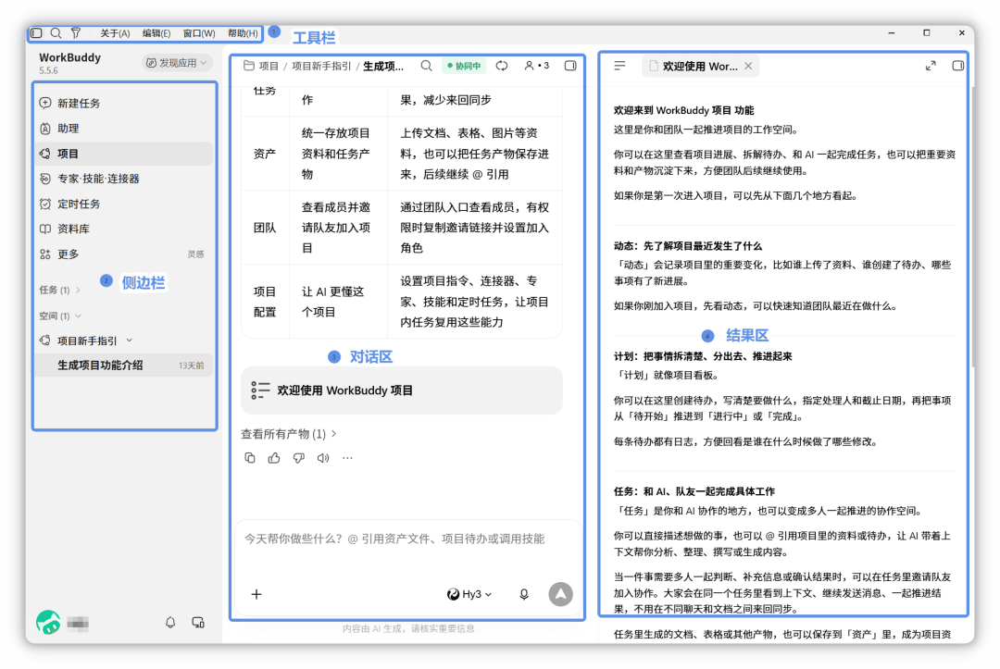



**收录说明**：官方文档站（VitePress）页面，依据原站存档；标题旁的锚点符号、页尾的「最后更新」与上一页/下一页导航未收入，页内相对链接改为绝对地址。旧笔记 learning-ai-agent 的 WorkBuddy 资料索引引用过这一页。

**内容摘要**：WorkBuddy 是腾讯出品的全场景 AI 工作台：用户用自然语言描述需求，由它自主规划和执行任务，交付文档、表格、PPT 等完整成果，并连接腾讯办公生态。核心能力列为自然语言交互、自主规划与执行、多模态任务、授权后的本地文件操作、多任务并行和结果交付。适用场景包括日常办公、代码开发、设计创意、项目协作、专业任务、服务协作和资料知识。文档用表格对比了它与传统 AI 对话：能实际执行任务、自动操作本地文件、处理多步骤任务、交付可验收的结果。

**保留理由**：官方对产品定位的总述：本地桌面智能体，以执行和交付为目标。

---

WorkBuddy 简介

WorkBuddy 是腾讯出品的全场景 AI 工作台。您可以使用自然语言描述需求，由 WorkBuddy 自主规划和执行任务，并交付文档、表格、PPT 等可直接使用的完整成果。完美连接腾讯办公生态，你的办公好搭子。

## 核心能力

- **自然语言交互**：使用自然语言描述需求，无需预先拆分复杂操作步骤。
- **自主规划与执行**：根据任务目标自动拆解步骤、规划执行流程并完成任务。
- **多模态任务处理**：支持文档、表格、PPT、数据分析等多种任务类型。
- **本地文件操作**：在获得授权后读取和处理本地文件，支持批量整理、修改等操作。
- **多任务并行**：支持同时创建和处理多个任务，适合并行完成不同工作。
- **结果交付与验收**：任务完成后可查看和使用生成的文档、表格、PPT 等结果。

## 适用场景

WorkBuddy 可以处理从单次任务到持续项目的多种工作场景，也可以通过专家、技能、连接器和资料库扩展工作能力。

| 场景 | 可以用 WorkBuddy 做什么 |
| --- | --- |
| 日常办公 | 写文档、做分析、查资料、整理信息，把日常工作中的琐碎任务交给 WorkBuddy。 |
| 代码开发 | 写代码、读项目、开发网站和应用，让 WorkBuddy 协助完成开发工作。 |
| 设计创意 | 从一个想法出发，生成图片、PPT、网页等设计内容，快速完成创意表达。 |
| 项目协作 | 围绕项目持续处理任务、使用项目资料，并让 WorkBuddy 参与项目执行。 |
| 专业任务 | 使用专家和技能复用专业知识与工作方法，完成分析、创作、处理等任务。 |
| 服务协作 | 通过连接器接入第三方服务，让 WorkBuddy 访问外部数据并执行相关操作。 |
| 资料与知识 | 将资料集中管理并结合任务使用，让 WorkBuddy 基于资料进行检索、分析和内容生成。 |

## 与传统 AI 对话的区别

| 传统 AI 对话 | WorkBuddy |
| --- | --- |
| 只能对话，提供建议 | 能够实际执行任务 |
| 需要手动操作文件 | 自动操作本地文件 |
| 单步骤简单任务 | 多步骤复杂任务 |
| 输出文字回复 | 交付可验收的结果 |

## 认识工作界面

WorkBuddy 的工作界面主要由以下区域组成：

| 区域 | 功能 |
| --- | --- |
| **工具栏** | 位于屏幕顶部，提供关于 WorkBuddy、编辑、窗口等常用操作入口。 |
| **侧边栏** | 显示任务列表（按文件夹分组），支持搜索和管理。底部显示用户头像。 |
| **对话区** | 核心交互区域，包含任务标题栏、消息列表和输入框。 |
| **结果区** | 右侧面板，提供概览与产物两类内容，可在同一区域切换查看。 |

## 建议阅读顺序

1. [创建任务](https://www.workbuddy.cn/docs/workbuddy/Create-Task)  
    了解如何选择工作模式、填写任务内容和补充上下文。
2. [任务管理](https://www.workbuddy.cn/docs/workbuddy/Task-Management)  
    了解如何查看任务列表、按状态筛选，以及继续处理已有任务。
3. [任务对话](https://www.workbuddy.cn/docs/workbuddy/Conversation)  
    了解如何在对话区持续追问、上传文件，并使用顶部操作。
4. [结果查看](https://www.workbuddy.cn/docs/workbuddy/Results)  
    了解如何在右侧结果区查看产物、全部文件、变更和预览。

## 声明

本节说明，构成[服务协议](https://rule.tencent.com/rule/202603180001)和[隐私保护](https://privacy.qq.com/document/preview/771d9a58551449e9a7e7445ebfe04966)指引的组成部分，具有同等法律效力。 如有不一致之处，以前述协议原文为准。
