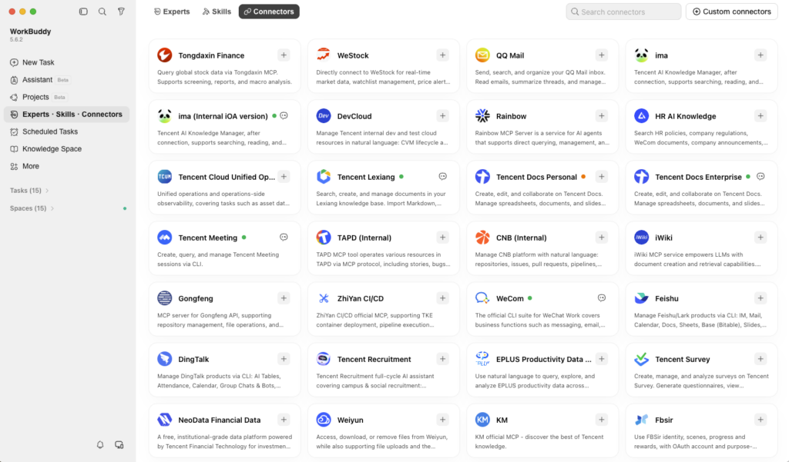



**收录说明**：旧笔记 learning-ai-agent 的 WorkBuddy 资料索引引用过这一页。腾讯官网英文「Stories」栏目的文章，是 WorkBuddy 三篇系列的第一篇。页面导航、分享按钮未收入，文中的演示视频改为链接。原文存于本目录的 original.md，网站上不显示，已翻译。

**内容摘要**：文章以季度复盘为例：数据在 Excel、报告在 Word、幻灯片在 PowerPoint、笔记在 Notion，普通 AI 助手只能处理复制进来的文字。WorkBuddy 的做法是把 AI 带进用户已在用的文件和应用：通过「人机共写」（Human–AI Co-Writing）直接在 Word、Excel、PowerPoint 或腾讯文档里修改，变更落在文件本身；再通过内置连接器或 MCP 读取共享盘、团队笔记和消息中的信息，跨工具推进任务。文末预告系列下一篇讲专家团。

**保留理由**：腾讯面向海外用户的官方定位文章，说明了「AI 进入文件和应用」的路线和国际版的连接方式。

---

*AI 曾承诺改变你的工作。结果它只是又给你多了一个要管理的标签页。这个三部分系列将跟随腾讯 [WorkBuddy](https://www.workbuddy.ai/pricing/)——一款处理日常任务的 AI 智能体——看它如何把 AI 从聊天框带进工作真正所在的工具中。首先是解决一个我们大多数人都能感同身受的挑战。*

试着让一个普通的 AI 助手编辑你的报告。首先，找到文件，复制文本，粘贴到聊天框里。AI 会以纯文本形式发回一份改写。你再把它粘贴回文档，修正格式，并祈祷中途没有丢失任何内容。

AI 完成了它那部分。复制是你做的，而这还只是一份文档。

一次季度复盘可能意味着同时要在六个地方工作。数字在 Excel 里，报告在 Word 里，幻灯片在 PowerPoint 里。笔记在 Notion 里，更新在聊天中传来，而写给老板的邮件还需要写。

AI 可以帮你把这些数字变成摘要，但除非你把信息一点一点喂进去，否则它看不到任何内容。你仍然需要把它复制到报告里、修正格式、对照最新数字检查，然后更新幻灯片。

腾讯 WorkBuddy 采取了不同的方法。它不是让你把工作带给 AI，而是把 AI 带进你已经在使用的文件和应用中。

**在文件中与 AI 协作**

借助[人机共写（Human–AI Co-Writing）](https://www.tencentcloud.com/techpedia/148052?lang=en)，你和 WorkBuddy 在同一份文档上工作。打开 Word、Excel 或 PowerPoint 文件，或腾讯文档（腾讯的云文档平台）中的在线文件。选中需要处理的内容，用自然语言描述改动，WorkBuddy 会直接在那里完成修改，而你可以继续在旁边编辑。

[视频：WorkBuddy 编辑 Excel 演示](https://www.tencent.com/wp-content/uploads/2026/10/ssstwitter.com_1790590400248.mp4)

*用户可以用简单的提示词直接在 WorkBuddy 中编辑 Excel 表格。*

回到那次季度复盘。在 Word 报告中，你选中开头部分，要求对季度情况做一份更紧凑的总结。在 Excel 中，你让 WorkBuddy 标出未达目标的地区，并把结果做成图表。在 PowerPoint 中，你让它围绕这张图表重做第四张幻灯片，并添加演讲者备注。

每项改动都落在文件本身，你可以在上下文中看到它、微调它或添加评论。没有任何内容是从别处粘贴进来的。

**让任务跨工具持续推进**

在同一份文档中编辑会让事情更容易。但季度复盘还依赖于共享盘、团队笔记和消息线程中的内容。

WorkBuddy 通过其内置连接器或 [MCP（Model Context Protocol）](https://www.tencentcloud.com/techpedia/144231) 访问这些内容；MCP 是一种开放标准，让 AI 能够使用你已授权它访问的应用和信息。支持的服务包括 Canva、GitHub、Morningstar、Notion 等。

*WorkBuddy 的连接器让用户能够跨外部工具检索信息并编辑内容。*

假设最新的销售数字在复盘前一天出现在一个腾讯文档表格中。在 WorkBuddy 中打开它，让它对照团队在 Notion 中的笔记检查这些数字，然后用发现更新你的报告和幻灯片。一切核对一致后，它可以起草那封给老板的邮件，供你在点击发送前阅读。

**少搬运，多做事**

你的工作已经分布在文档、表格、消息和电子邮件中。帮助处理这些工作的 AI 不应该被困在它自己的标签页里。WorkBuddy 负责起草，而你做出判断并拥有最终决定权。

这就是 WorkBuddy 正在带来的转变：从在一个标签页里向 AI 提问，到在所有应用中与 AI 一起工作。

**WorkBuddy 系列下一篇：** *你的新 AI **助手**带来了几个朋友。* 如果一项任务可以调动一个 AI 专家团队——从财务、法务到战略和文案——而仍由你来主导过程，会怎样？
