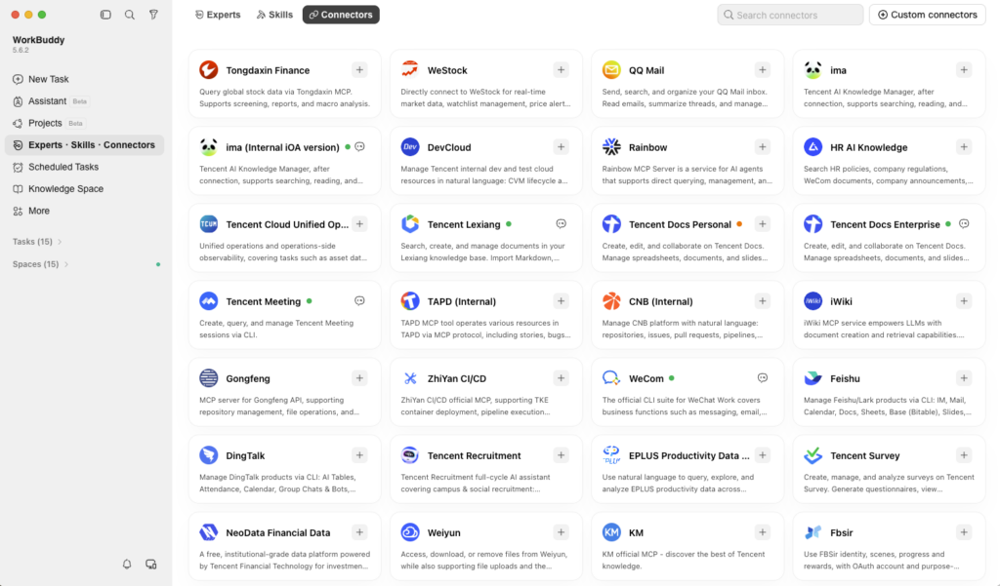

来源：https://www.tencent.com/you-work-across-six-apps-your-ai-should-too/
取文：2026-11-06，直接下载

*AI promised to transform your work. Instead, it gave you another tab to manage. This three-part series follows Tencent*[*WorkBuddy*](https://www.workbuddy.ai/pricing/?fromSource=intl.18037835.18037835.18037835&utm_medium=cpc&utm_id=intl.18037835.18037835.18037835&gad_source=1&gad_campaignid=24129057026&gbraid=0AAAABEP0OHM2vwbf-0ICkg1ej2n9lAHiV&gclid=CjwKCAjwoOjVBhArEiwAUwDak1EjG6tg7y4neZfLZvJsifc0YApn67Myzx30tNlvqEYZ_jgiXZgg4hoCoOYQAvD_BwE)*, an AI agent for everyday tasks, as it moves AI out of the chat box and into the tools where work actually lives. First up, solving a challenge most of us can relate to.*

Try asking a regular AI assistant to edit your report. First, find the file, copy the text, and paste it into a chat box. The AI sends back a rewrite as plain text. You paste it into the document again, fix the formatting, and hope nothing got lost on the way.

The AI did its part. You did the copying, and that’s just one document.

A quarterly review can mean working in six places at once. The numbers are in Excel, the report is in Word and the slides are in PowerPoint. Notes sit in Notion, updates arrive in chat, and the email to your boss still needs writing.

AI can help you turn those numbers into a summary, but it can’t see any of that unless you feed the information in, piece by piece. You still have to copy it into the report, fix the formatting, and check it against the latest figures before updating the slides.

Tencent WorkBuddy takes a different approach. Instead of asking you to bring your work to AI, it brings AI into the files and apps you already use.

**Work with AI in the file**

With [Human–AI Co-Writing](https://www.tencentcloud.com/techpedia/148052?lang=en), you and WorkBuddy work on the same document. Open a Word, Excel or PowerPoint file, or an online file in Tencent Docs, Tencent’s cloud document platform. Select what needs attention, describe the change in plain language, and WorkBuddy makes it right there while you keep editing alongside it.

[视频：WorkBuddy 编辑 Excel 演示](https://www.tencent.com/wp-content/uploads/2026/10/ssstwitter.com_1790590400248.mp4)

*Users can edit Excel spreadsheets directly in WorkBuddy using simple prompts.*

Back to that quarterly review. In the Word report, you highlight the opening section and ask for a tighter summary of the quarter. In Excel, you ask WorkBuddy to flag the regions that missed target and turn the results into a chart. In PowerPoint, you ask it to rebuild slide four around that chart and add speaker notes.

Each change lands in the file itself, where you can see it in context, tweak it or add a comment. Nothing gets pasted in from somewhere else.

**Keep the task moving across your tools**

Editing in the same document makes things easier. But a quarterly review also depends on what’s sitting in shared drives, team notes and message threads.

WorkBuddy reaches those through its internal connectors or [MCP (Model Context Protocol)](https://www.tencentcloud.com/techpedia/144231), an open standard that lets AI work with the apps and information you’ve given it access to. Supported services include Canva, GitHub, Morningstar, Notion, and more.

*WorkBuddy’s connectors let users retrieve information and edit content across external tools.*

Say the latest sales figures arrive in a Tencent Docs spreadsheet the day before your review. Open it in WorkBuddy and ask it to check the numbers against your team’s notes in Notion, then update your report and slides with the findings. Once everything lines up, it can draft that email to your boss, ready for you to read before you hit send.

**Less carrying, more doing**

Your work already lives across documents, spreadsheets, messages and email. The AI helping with it shouldn’t be stuck in a tab of its own. WorkBuddy does the drafting, while you make the judgment calls and have the final say.

That’s the shift WorkBuddy is making: from asking AI in one tab to working with AI across all your apps.

**Next in the WorkBuddy Series:** *Your New AI**Assistant**Brought a Few Friends*. What if one task could draw on a team of AI specialists, from finance and legal to strategy and copy, with you still directing the process?
