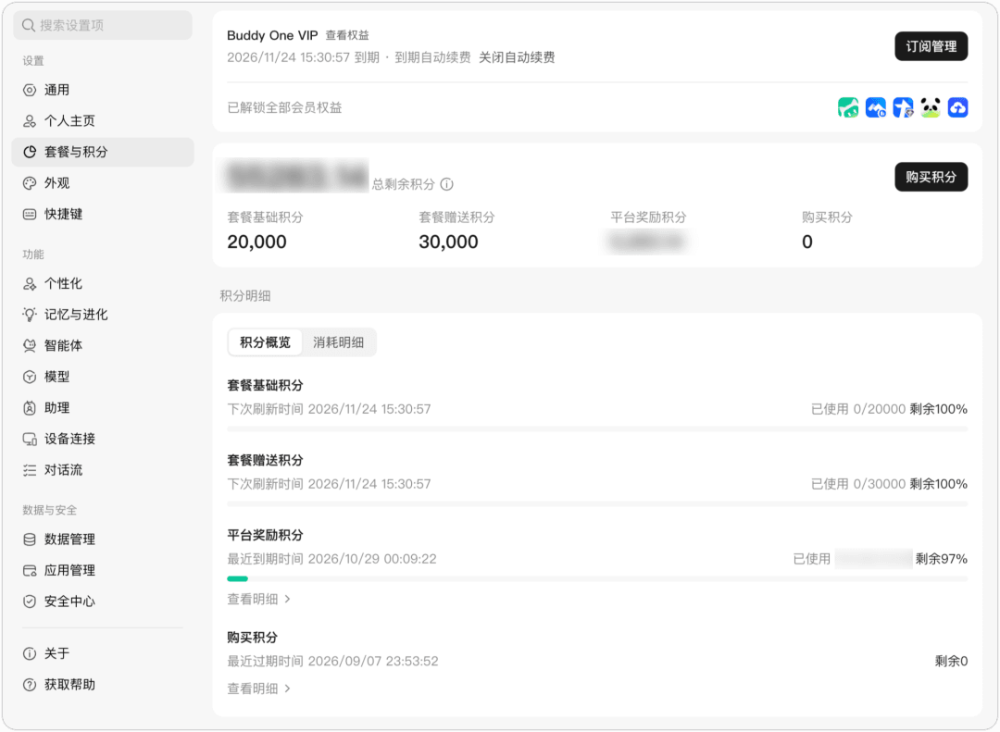
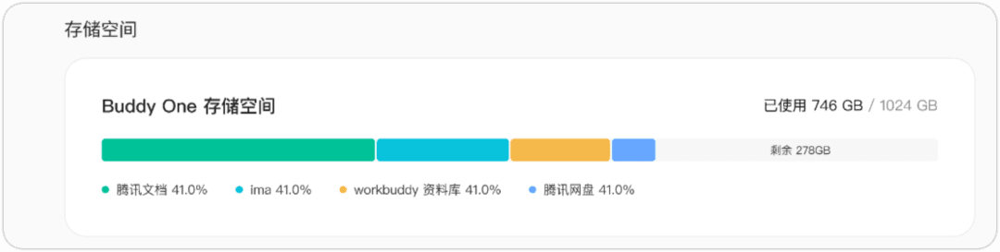
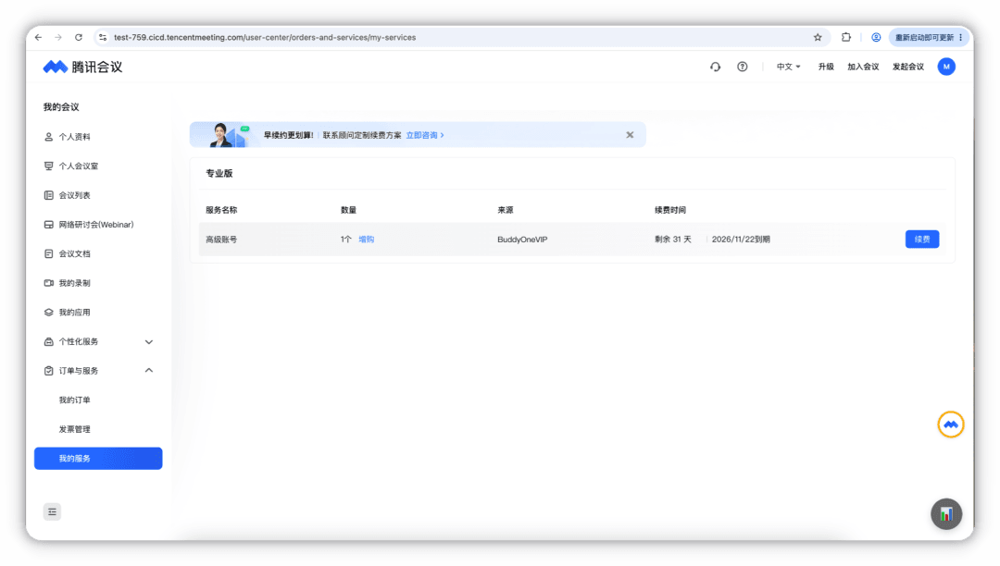
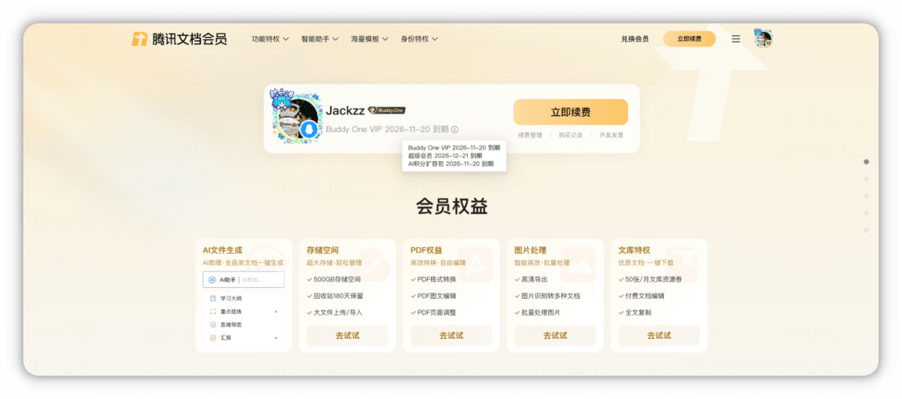
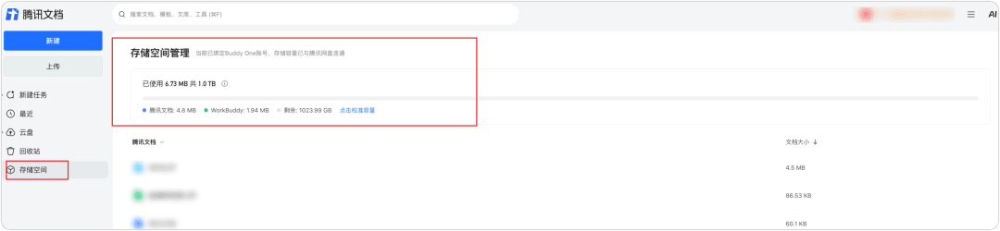
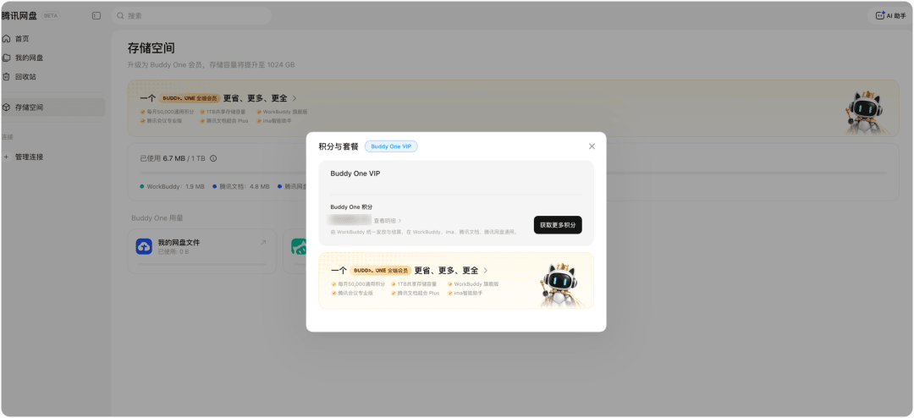
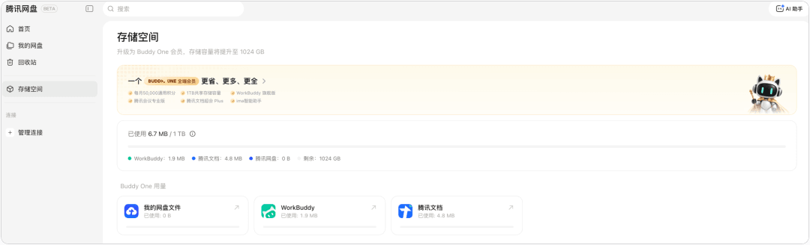
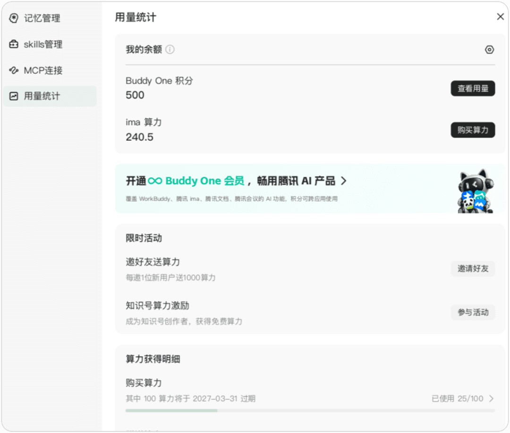
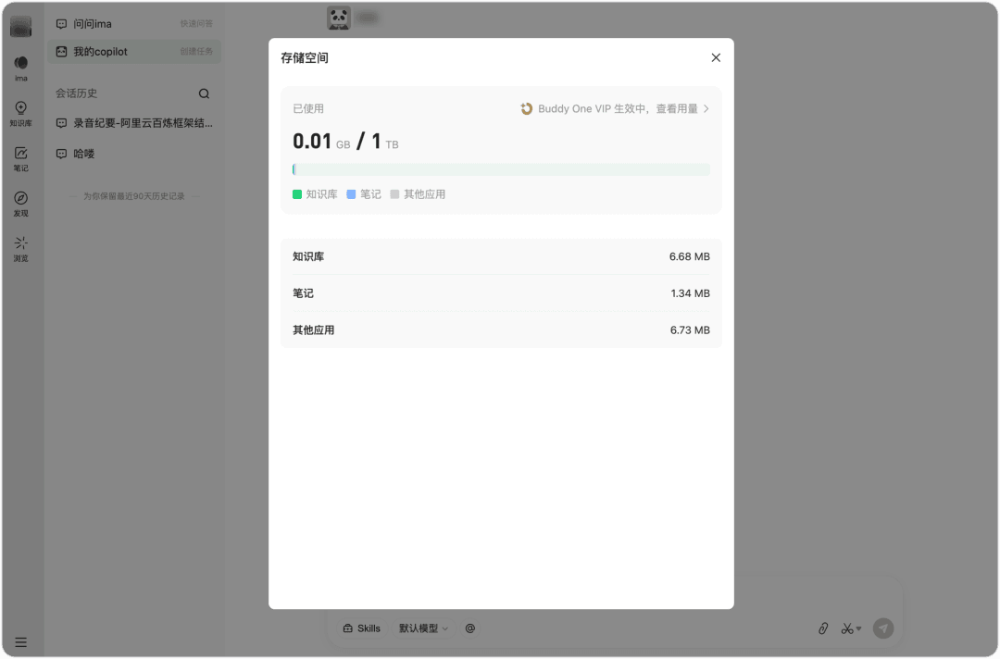



**收录说明**：官方文档站（VitePress）页面，依据原站存档；标题旁的锚点符号、页尾的「最后更新」与上一页/下一页导航未收入，页内相对链接改为绝对地址。

**内容摘要**：开通 Buddy One VIP 后，可以获得 WorkBuddy、腾讯文档、腾讯会议、ima 和腾讯网盘的对应权益：WorkBuddy 每个套餐周期 20,000 基础积分、30,000 赠送积分、1TB 存储空间及旗舰版的其他权益，立即生效；腾讯会议专业版、腾讯文档超级会员 Plus 需要关联对应账号。WorkBuddy 积分统一升级为 Buddy One 积分，与腾讯文档、ima、腾讯网盘共享积分和存储，不重复发放。页面还说明了权益下发与有效期。

**保留理由**：说明腾讯把 WorkBuddy 和自家办公产品捆绑成一个会员、共享积分，是商业模式的一手资料。

---

Buddy One VIP 会员权益说明

开通 Buddy One VIP 后，可获得 WorkBuddy、腾讯文档、腾讯会议、ima 和腾讯网盘产品的对应权益。

其中，WorkBuddy 权益购买后立即生效；其他产品的权益需关联对应产品账号后下发。账号关联入口为[个人中心](https://www.workbuddy.cn/profile/plans-usage)。

## 权益明细

Buddy One VIP 涵盖以下产品权益，各产品的具体权益内容及账号关联要求如下。

| 产品 | 权益内容 | 账号关联要求 |
| --- | --- | --- |
| WorkBuddy | 每个套餐周期 20,000 基础积分、30,000 赠送积分、1TB 存储空间及旗舰版的其他权益 | 无需关联 |
| 腾讯会议 | 腾讯会议专业版 | 关联腾讯会议账号 |
| 腾讯文档 | 腾讯文档超级会员 Plus；其中的积分和存储权益与 WorkBuddy 共享，不重复发放 | 关联腾讯文档账号 |
| 腾讯网盘 | 共享 WorkBuddy 的积分和 1TB 存储空间 | 关联腾讯网盘账号 |
| ima | 共享 WorkBuddy 的积分和 1TB 存储空间 | 关联 ima 账号 |

TIP

- WorkBuddy 积分将统一升级为 Buddy One 积分。
- WorkBuddy、腾讯文档、ima 和腾讯网盘共享积分及存储权益，不会因关联多个产品重复发放。

## 权益下发与有效期

WorkBuddy 权益购买后立即生效，其他产品的权益需关联对应账号后下发。请注意，权益有效期统一从购买完成时开始计算，不因账号关联时间而顺延。

### 权益下发时间

除 WorkBuddy 外，其他产品的权益需关联对应产品账号后下发，具体如下：

- **购买时已关联账号**：购买成功后，立即下发对应产品的权益。
- **购买时未关联账号**：完成对应产品账号关联后，立即下发权益。

### 权益有效期与其他规则

权益下发时间不影响有效期计算。此外，权益续期、积分使用和账号关联还需遵循以下规则：

- **有效期**：权益时长从购买完成时开始计算，不因后续关联账号而顺延。建议购买后尽快完成账号关联，以免缩短实际可用时长。
- **续期**：续期成功后，权益有效期自动顺延；首购权益不会重复发放。
- **积分**：基础积分和赠送积分仅在当前套餐周期内有效，不结转至下一周期。
- **账号**：各项权益仅下发至已关联的对应产品账号，不支持转移至其他账号。

## 第三方权益查看入口

Buddy One VIP 权益生效后，可前往对应产品查看会员权益、积分或存储用量。各产品的查看入口及页面展示内容如下。

### WorkBuddy

- **会员权益与积分**：进入 WorkBuddy 客户端，选择**设置** > **套餐与积分**，查看 Buddy One VIP 权益、到期时间及积分明细。

- **存储空间**：前往[存储用量明细](https://www.workbuddy.cn/profile/plans-usage#usage-detail)查看 Buddy One 存储空间总量、已使用额度，以及腾讯文档、ima、workbuddy 资料库、腾讯网盘等各产品的占用明细。

### 腾讯会议

进入[腾讯会议](https://meeting.tencent.com/user-center/orders-and-services/my-services)服务中心，在**订单与服务** > **我的服务**中查看会员权益与到期时间。

### 腾讯文档

- **会员权益**：前往[腾讯文档 VIP](https://docs.qq.com/vip) 页面，查看超级会员 Plus 权益及到期时间。

- **存储空间**：前往腾讯文档的存储空间页面，查看 Buddy One 存储总量及各产品的存储占用明细

### 腾讯网盘

- **会员权益**：前往[腾讯网盘](https://drive.tencent.com/disk/storage)页面，查看会员权益与存储容量。

- **存储空间**：前往腾讯网盘的存储空间页面，查看存储用量明细。

### ima

- **积分查询**：进入 ima 客户端，点击**我的copilot** > **copilot 设置** > **用量统计**，查询积分的用量。

- **存储空间**：进入 ima 客户端，点击头像，选中**存储空间**，查看共享的存储空间。

## 权益变更规则

Buddy One VIP 开通或失效时，原有权益和 VIP 提供的权益将按不同规则处理。开通前已有的会员、积分或算力可按对应规则衔接；VIP 失效后，部分会员权益、积分和存储空间将失效或被收回，原有会员及单独购买的权益则按相应规则处理。

### 开通前已有权益如何衔接

开通 Buddy One VIP 前已有的会员、积分或算力，按以下规则处理：

| 开通前已有权益 | 开通 Buddy One VIP 后的处理方式 |
| --- | --- |
| WorkBuddy 标准版 / 高级版 | 支付成功后，Buddy One VIP 立即生效；原套餐剩余部分按相关规则退款。 |
| WorkBuddy 旗舰版 | 可免费转换为 Buddy One VIP。转换后的有效期按现有旗舰版有效期按月向上取整；每个账号仅可免费转换一次。 |
| 腾讯文档超级会员 / 超级会员 Plus | 原有会员有效期自动顺延。 |
| 腾讯会议专业版 | 原有专业版有效期延长。 |
| 原有 ima 算力 | 正常使用，不受影响。 |
| 各产品单独购买的积分（如腾讯文档 AI 积分、ima 算力） | 均予以保留，可继续在对应产品内正常使用，不受 Buddy One VIP 开通的影响。 |

### VIP 失效后权益如何处理

Buddy One VIP 因退费等原因失效后，通过 VIP 获得的相关权益将失效或被收回，具体如下。

**将失效或被收回的权益**

- **各产品 VIP 权益**：通过 Buddy One VIP 获得的会员权益将失效，包括腾讯文档超级会员 Plus、腾讯会议专业版等。
- **Buddy One 积分**：通过Buddy One VIP订阅套餐发放、赠送的积分于失效时清零。
- **存储空间**：收回 VIP 提供的 1TB 扩容额度。

**不受影响的权益**

- **原有会员**：腾讯文档、腾讯会议的原有会员权益恢复使用，开通 VIP 期间被暂停的部分自动恢复。
- **已存文件**：已存储的文件会保留，可正常访问和下载，不会因 VIP 失效而被删除。
- **单独购买的权益**：腾讯文档 AI 积分、ima 算力等单独购买的权益不受影响。

### 重新开通后如何恢复

账号关联关系会保留。重新开通 Buddy One VIP 后，对应权益将自动恢复。

## 声明

本节说明，构成[腾讯云Buddy One VIP 权益订阅服务协议](https://rule.tencent.com/rule/202610200001)的组成部分，具有同等法律效力。如有不一致之处，以前述协议原文为准。
